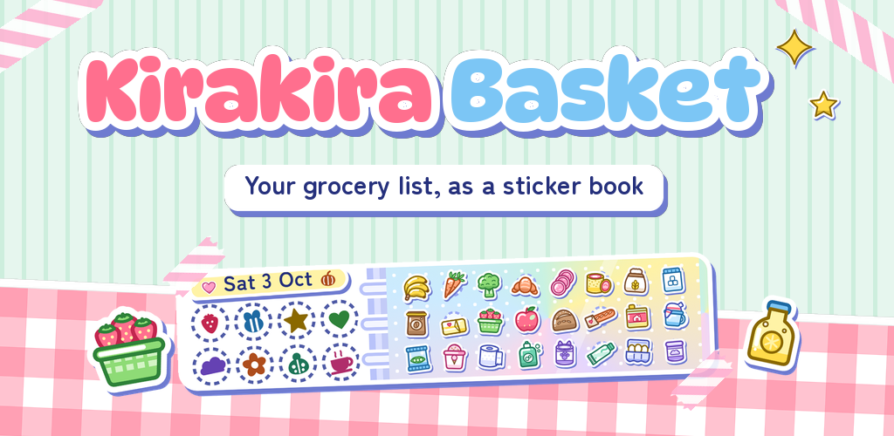
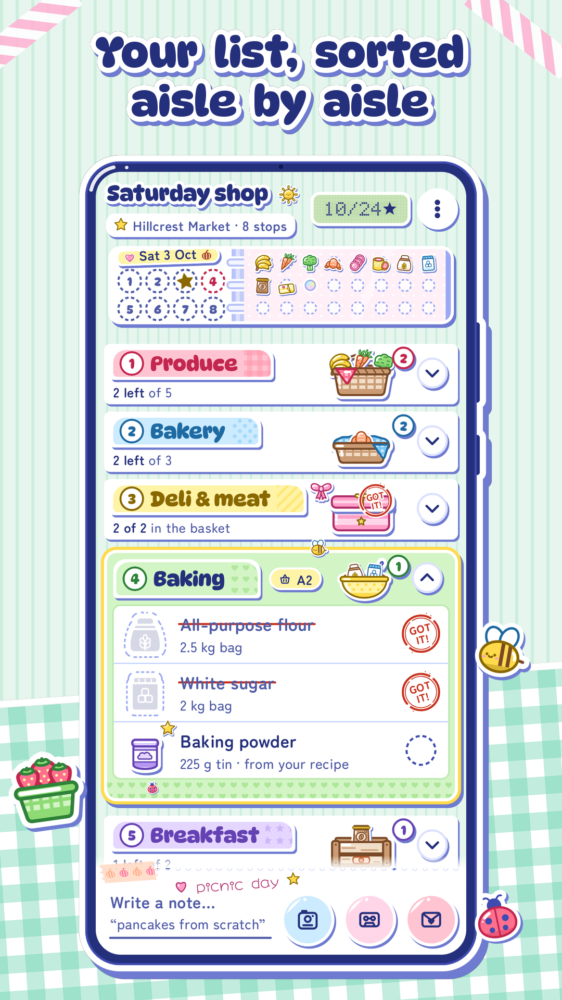
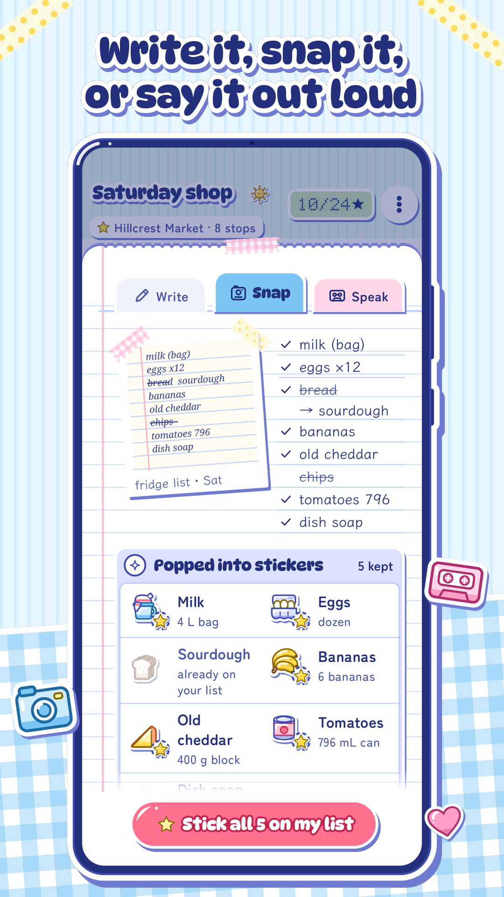
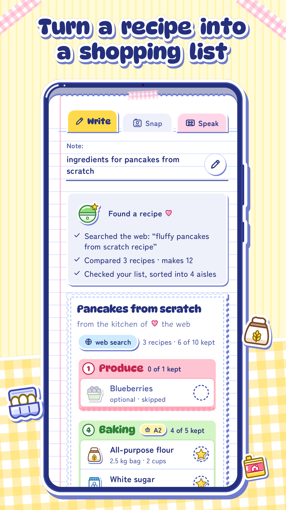
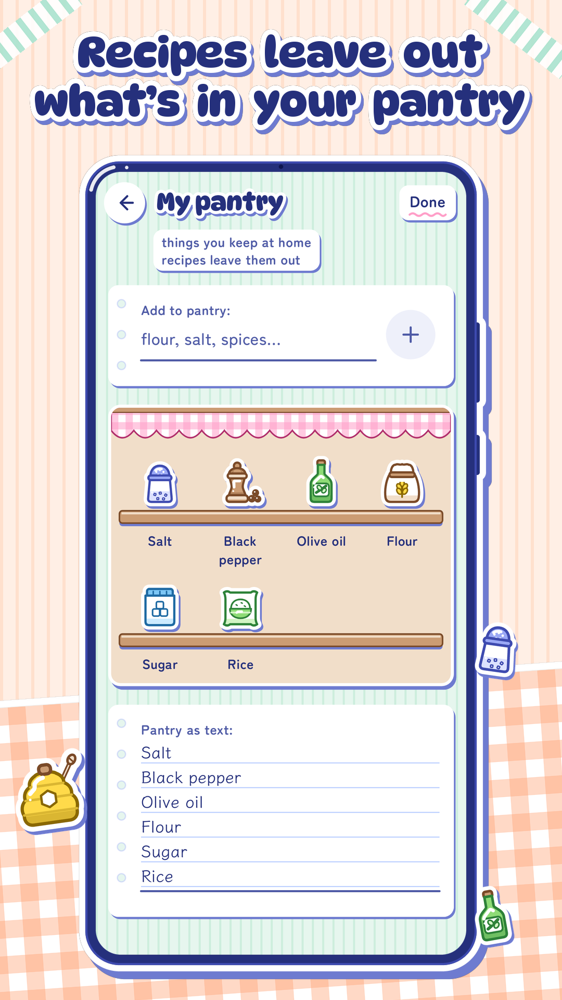
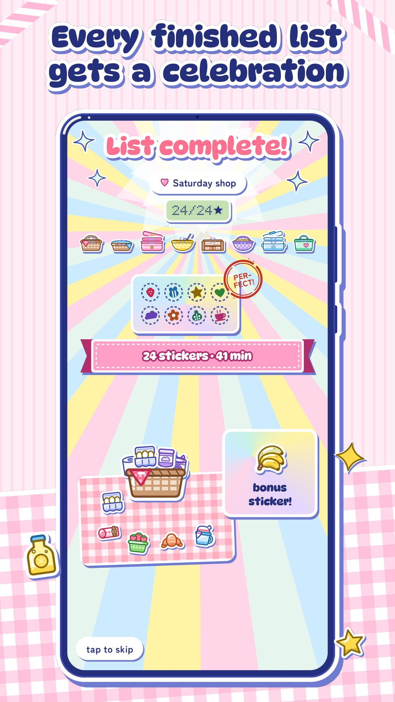
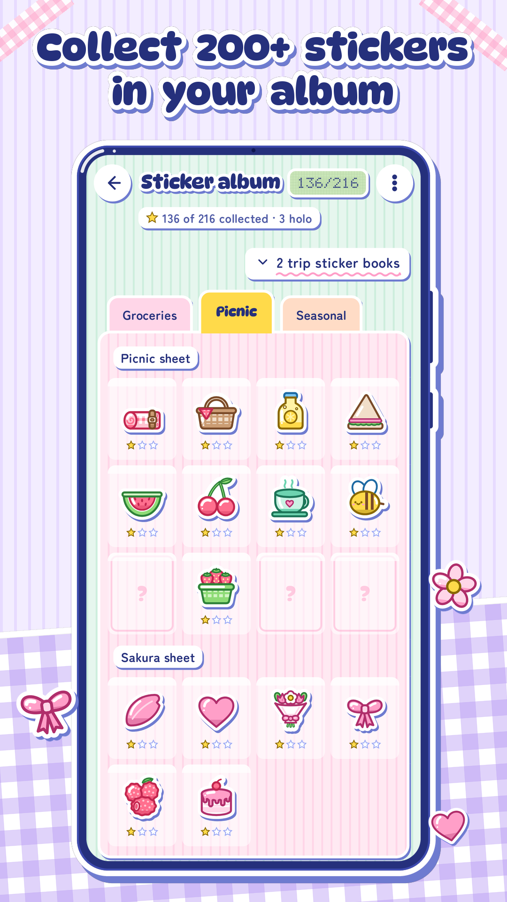
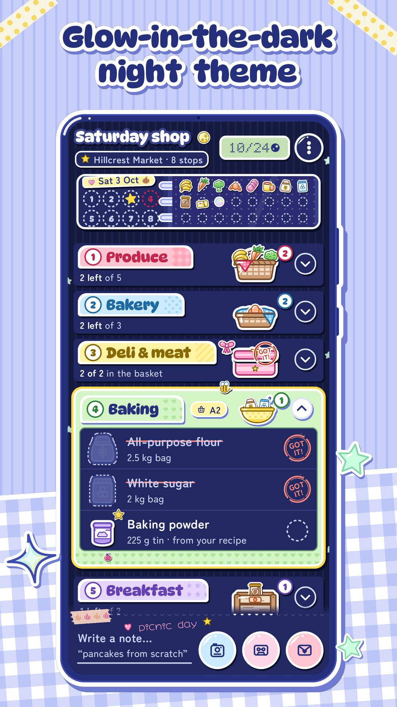
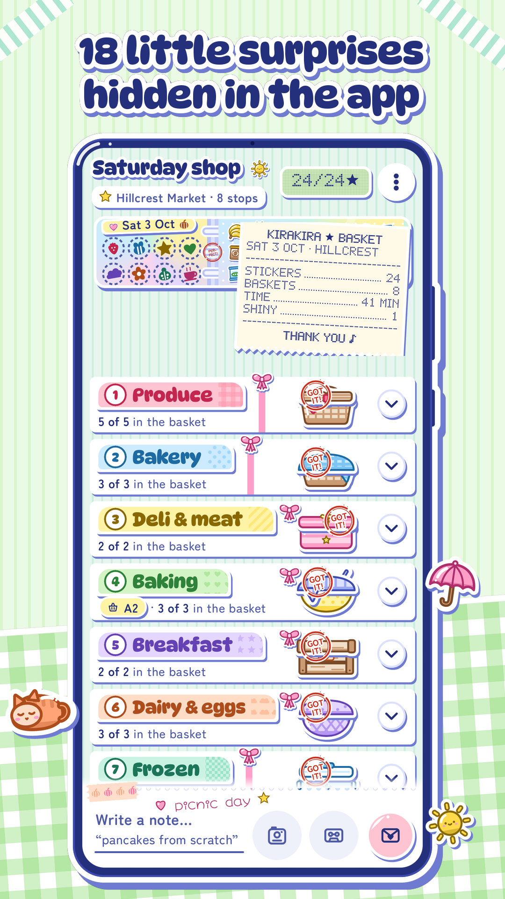

# Kirakira Basket

A picniccore grocery list for Android, styled after early-90s magical-girl anime and sticker books. 

## Screenshots

  

  
  
  
  

  
  
  
  

The store images are drawn from the app's own screenshot tests, fonts and sticker art by [`design/store/make_store_images.py`](design/store/README.md), in the layout Google Play's publishing tools expect ([`fastlane/metadata/android/en-US`](fastlane/metadata/android/en-US)).

## What it does

- **Walks the store with you.** You keep your store's aisles as a plain text list, in the order you walk them. New items are sorted into those aisles by an LLM, and the list is shown aisle by aisle. Collapsed aisles show up as little baskets holding their items.
- **Takes requests.** Type "ingredients for pancakes from scratch" and a reasoning model with web search turns it into the ingredients you need.
- **Reads your handwriting.** Photograph a handwritten list and it gets transcribed into items.
- **Listens.** Say what you need out loud; the recording is transcribed and sorted the same way.
- **Draws every item.** Each item gets its own little icon. Items without one in the bundled library can get a new icon drawn live in the same style.

## Status

Work in progress. The visual direction is chosen: direction C, the "Furoku Sticker Album". [docs/DESIGN_STICKER.md](docs/DESIGN_STICKER.md) is its build spec (design, acceptance checklist, work packages); [docs/ARCHITECTURE.md](docs/ARCHITECTURE.md) is the app's contract, amended for it. The earlier candidates are in [`design/concepts`](design/concepts/README.md).

## API keys

The app never ships with an API key, and none is ever baked into the APK. Whoever uses it pastes their own OpenAI API key into **Settings → Your OpenAI key**, and the phone then talks to OpenAI directly. The key is stored encrypted with the Android Keystore, it is never shown again (only a hint like `sk-…a1b2`), and it is left out of backups.

Making a key for a friend? Use a project of its own with a hard monthly budget, and a restricted key with only the three permissions the app needs. The steps are in [docs/OPENAI_KEY.md](docs/OPENAI_KEY.md).

## Releasing

- **Testers:** every push builds an installable APK signed with the app's private key; tags `v*` attach it to a GitHub Release. See [docs/BUILDING.md](docs/BUILDING.md).
- **Android developer verification:** `earth.cora.picnic` is registered to that key through a free limited distribution account in Android Developer Console (up to 20 authorized phones, not on Google Play). The key, its GitHub secrets and the console are in [docs/RELEASING.md](docs/RELEASING.md).
- **Privacy:** [docs/PRIVACY.md](docs/PRIVACY.md) is the privacy policy draft, written to match what the app actually stores and sends.

## Licence

[0BSD](LICENSE): use, copy, change and share it for any purpose, no attribution needed. Two parts keep their own licences: the bundled fonts in `app/src/main/res/font/`, and DotGothic16, which the LCD digits are drawn from, are under the SIL Open Font License 1.1 (texts in [`app/src/main/assets/licenses/`](app/src/main/assets/licenses/)), and the Gradle wrapper (`gradlew`, `gradlew.bat`, `gradle/wrapper/`) is under the Apache License 2.0.
