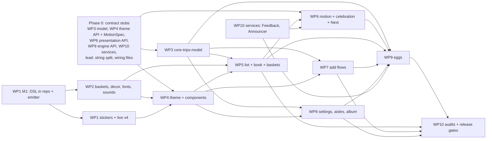

# Direction C, "Furoku Sticker Album": the build spec

Status: **authoritative design spec for the art pass**, 2026-10-02. It turns direction C into the real app. Where this file and the mockup disagree, this file wins. Where this file and `docs/ARCHITECTURE.md` disagree, this file states the change; the amendments it needs (A4, A5, §19.3) land in ARCHITECTURE.md in phase 0 (§21.3), before any package builds on them.

Working app name: **Kirakira Basket**. The launcher label is an open question (Q1, §22); every place the name appears reads one string resource, so the answer is a one-line change.

**Sources** (none of them ship; they are reference):

| Source | What it is |
|---|---|
| `research/directions.md` §C | The written direction the friend chose |
| Mockup `mockups/sticker.section.html` (round r9), generator `sk/` (`python3 build.py`; it moves into the repo as `design/mockup/` frozen as a reference, §18.4) | The approved look and every interaction, live. Screens: phone 1 (List, live), 2 (Add sheet), 3 (Snap and speak), 4 (My store and settings), 5 (Album), 6 (Glow-in-the-dark list), plus the flourish kit, basket family, motion tiles, 18 egg tiles and the celebration. |
| `c_spec/inv_spec.json` (396 items), `c_spec/inv_mockup.json` (312 items) | Inventories of the written spec and the mockup. They were taken **before** r9, so their "broken" and "illustration-only" statuses are out of date: r9 made all 18 eggs, the receipt, single-open aisles, the peel and squash, the reduced-motion Next card and the post-finale PERFECT book work. Appendix B maps their ids to the sections and checklist items that cover them. |
| `c_spec/app_gap.md` | Gap analysis of the app at `7be9b87` against both inventories, decisions D1 to D25, the art-route options |
| `docs/ARCHITECTURE.md` | The app's contract (amendments A1 to A3) |

**How to use this file.** §1 to §18 are the design. §19 is the data and contract changes. §20 is the acceptance checklist: every requirement here has a numbered, testable item, and a package is done only when all its items pass. §21 splits the work into ten packages with file ownership, and §22 lists the open questions, each with a default so nothing waits. Appendix A is the test fixture, Appendix B maps the inventories to sections and items, and Appendix C is the golden manifest.

---

## 0. Decisions this spec makes

### 0.1 Cora's standing rules, and where each is enforced

| Rule | What it means in the app | Enforced in | Checklist |
|---|---|---|---|
| **R1** An expanded aisle visibly owns its items | The open aisle is one tray: pastel tab band on top, rows on the lighter ruled panel, patterned end cap below. Never floating per-row cards. The pinned header is the same tray's band. | §4.10, §6.1 | 92–94 |
| **R2** Checkboxes may be fancy but must read as checkboxes, with no artefacts | Unchecked = a 30 dp dashed "place sticker here" circle whose dash count divides the circumference exactly (no half dash at the seam), crisp at every density; checked = the GOT IT hanko. Both stay unmistakable in every theme variant and at 200 % font. | §4.4, §2.12 | 53–58 |
| **R3** No stray gloss strokes on buttons | Every pill, round button, add-bar button and the FAB has exactly one gloss crescent plus one dot, both inside the face, clear of the label and the border. The only other white on a face is its own label or glyph (the primary's white label, the FAB's white plus). Badge stickers (the FAB's lemon star) sit outside the face outline; add-bar buttons carry line glyphs, never sticker art with a gloss of its own. | §4.6 | 62–64 |
| **R4** A basket holds only GOTTEN items | Empty until the first check (dotted landing spot), fills in check-off order, full and closed (lid + GOT IT on the lid) when the aisle is done. The badge counts what is **still to get**. The four decorated kinds (flower bucket, ice bucket, bottle carrier, candy jar) keep their decoration when empty. | §5 | 99–101, 104–112 |
| **R5** Nothing ever travels to a keepsake | The check-off flies the row's sticker to its aisle's basket (an un-check hops it back). The sticker book, stamp page, LCD, album and receipt update a beat later **in place** (kira bloom, stepped scale-in), never by a flight. The only other travel is inside a scene of its own (the celebration's ribbon ride, Q4) or an egg's bump on a basket (egg 3); neither ends at a keepsake. | §8.3, §7.6 | 122–130, 148, 179, 231 |
| **R6** Pinned headers have a solid backing | The top stack (app bar + sticker book) and the pinned aisle plate repaint the binder ground behind themselves, corners and gaps included. No row pixel may show above, beside or between them. | §6.1, §4.10 | 95–97 |

### 0.2 New requests from Cora and the friend, and where they are answered

| Request | Answer | Section | Checklist |
|---|---|---|---|
| A per-trip **sticker book** at the top (like Firefly's charm bracelet): the sticker hops into the basket, then the same sticker appears by magic in the book. One book per trip. | The trip sticker book: a ring-bound mini album pinned under the app bar. Left page = the trip's stamp card, right page = one spot per item. Twin appears 320 ms after the landing. Filed into the album on "New trip". | §7 | 131–139, 141–165 |
| **Every part of the spec works** (Cora could not print the LCD receipt) | Every interaction in §4 to §13 has a checklist item with an interaction test. The LCD hold is deterministic (trip complete = receipt, otherwise pet), and completion is an invariant of the state that every change recomputes, so a trip finished by a delete, a move or an undo still prints its receipt. A hidden **Surprise lab** lets anyone fire every egg on demand on a real phone, on a sandbox copy that never touches her lists. The mockup's generator and a real assertion suite move into the repo and gate sign-off, and the mockup stops offering anything that won't ship. | §7.1, §12, §13, §18.4 | 133, 154, 176, 228–229, 237–248, 250, 252–255, 257–258, 260, 265–270, 274, 310–312 |
| Full-screen animations are **too fast for their text** | One reading rule, `readHold(words) = max(floor, 1200 + 300 × words)` ms of stillness, measured from the moment the text is still (§9 defines "still"), on every text-bearing moment, with the words counted from the real text at run time. The Next card says only "NEXT" + the aisle tab and holds at least 2.6 s still (longer for long aisle names). The celebration shows one text beat at a time, each starting only after the previous one's hold; its length is computed (about 17 s for the fixture). Holds never shrink under reduced motion or Android's animation scales, and they respect Android's "Time to take action" setting. | §9, §10, §11 | 166–174, 180–188, 196 |
| An **incredibly polished** app | No placeholder art or Material default survives; every state has a golden; motion is checked frame by frame. | all | 235, 303–310 |

### 0.3 Contract decisions (resolving gap-analysis D1 to D25)

| # | Decision |
|---|---|
| D1 | **Checked rows stay in place** in their aisle (hanko, strike, peeled ghost). The CHECKED ("In the basket") section and the 600 ms tick dwell are removed. "Clear checked" becomes **New trip** (§6.5, §7.1). |
| D2 | **One open aisle.** `GroceryList.openAisle`: null = automatic (the first stop in walking order with something left; "Everything else" only when it is all that is left), "" = all folded, otherwise a section id. Opening a strip folds the others. After an aisle completes, the next stop opens automatically behind the Next card. |
| D3 | **Amendment A4 (settings).** Settings gains a "Surprises" card (Easter eggs, Sounds, Haptics, "Next stop" card, Celebration, Weather surprises) and an "About and licences" page. Model names and the web-search toggle shown in the mockup **do not ship** (A1 stands). |
| D4 | Golden hour (egg 12) is computed astronomically for a fixed point (Toronto, America/Toronto): no permission, no network. Rain and first snow (eggs 16 and 11) use the Environment Canada city forecast feed (§12.4) **only** when the "Weather surprises" switch is on (default off; Q3). |
| D5 | Unknown and pending icons show the **gashapon capsule** sentinel `IconRef("_capsule")`, tinted by its aisle. Display-only; nothing persisted changes. |
| D6 | Library stickers are generated **vector drawables** with named groups (§3.2). Live-drawn stickers are bitmaps plus a stored cut path. One render path draws both. |
| D7 | The live-icon pipeline becomes **v4** (2×2 neighbour sheet + mask, palette snap, procedural gloss, die-cut in code) (§18.3). |
| D8 | `BasketKind.MIXING_BOWL` is added as the 17th kind (enum, catalog, LLM enum, ContractTest). |
| D9 | The number circle on a tab is the aisle's **walking position** in the store's aisle list. A store's own aisle number (parsed from the name by `storeAisleNumber`, "Aisle 2 - Baking & spices" → 2, or set in the aisle editor) shows on a separate "A2" chip, and that prefix is stripped from the name the tab shows (`displayName` "Baking & spices"), so a tab never reads "5 Aisle 1 - Breakfast". |
| D10 | Swipe **right checks**, swipe **left tears off** (delete with Undo). TalkBack actions stay. |
| D11 | An 84 dp **envelope add bar** is docked under the list; it folds into a 64 dp FAB while scrolling down. Results that need review open the letter-set sheet; small sure answers commit at once with an Undo toast (§6.2). |
| D12 | `PicnicTheme(variant = Day / Glow / Dusk / Golden, reducedMotion)`. MainActivity resolves the variant (§2.5) and sets the system bar icon styles from it. The celebration is always Day, and the bars switch to dark icons for the scene's duration. |
| D13 | **Amendment A5 (trips).** A trip opens at the first check-off on a list with no open trip and closes on "New trip" or when its list is deleted (the book is filed first). Completion is an invariant that every operation touching items recomputes. Book, stamps, pet, receipt, stats and perfect weeks belong to it (§7). |
| D14 | The celebration's ribbon ride (every sticker rides a ribbon into the hamper) stays: it happens inside its own full-screen scene, not across the list. Q4 asks Cora to confirm. |
| D15 | **Replaced by §0.4 Q5.** There is a pantry (§6.13). Recipe rows say "already on your list", "in your pantry" or "optional · skipped". |
| D16 | No streaming in v1. The thinking steps and the photo's lines are revealed **after** the answer, from real fields in it, 250 ms apart (§6.2). Nothing claims progress that did not happen. |
| D17 | Favourites: `AppState.favourites` (normalized names), toggled by a heart in the Edit sheet; drives the sakura heart flag and the "Favourites" chip. |
| D18 | Pull to refresh re-syncs **icons and aisles**: `icons.resumePending()` and `aisleSync.sortItems` for items still in "Everything else". There are no prices; the copy never mentions them. |
| D19 | Snap and Speak run one after the other: after a Snap preview, Speak appends a second batch to the same preview (merged, de-duplicated). |
| D20 | The app's label and wordmark come from `R.string.app_name` / `wordmark`; applicationId stays `earth.cora.picnic`. |
| D21 | Holding the LCD: **trip complete → receipt (egg 18); otherwise → pet (egg 15).** The pet branch can never swallow the receipt, and because completion is a property of the state (§7.1), not of the gesture that finished the list, a trip completed by a delete, a move or an undo prints too. |
| D22 | Egg 8's cat curls up in an aisle basket that is still empty when every other stop of the trip is done, or when a trip is closed with that basket empty. |
| D23 | The stamp page holds one circle per **stop** (aisle with items this trip; "Everything else" is a stop while it has items, its capsule stamp first, §4.10); it adapts to 1–24 stops (§7.4). |
| D24 | The written 1.2 s cap on the Next card is lifted (reading rule, §9). |
| D25 | The celebration ends on a still summary that holds max(4000, readHold(all its words)) (4.8 s for the fixture) and closes on a tap or at the end of that hold. Its beat times are computed from the real words (the fixture closes at 16.95 s, §11.2). The summary stays reachable from the book. With TalkBack on it waits for a tap. |

Smaller conflicts between the written spec, the mockup and the app, and how this spec settles them:

| Topic | Spec or mockup said | This spec |
|---|---|---|
| Where checked stickers go | one "basket envelope" at the end of the list | one basket per aisle (R4) |
| Aisle-done hanko | on the tab | on the basket **lid** |
| Primary gloss | 7 × 30 dp bar at 90 % | one crescent in the left cap + one dot, 100 % white (R3) |
| Primary pressed offset | (+1.6, +2.2) dp | the button's own shadow offset, (+2.4, +3.4), so it lands exactly on its shadow |
| Postage edge | 4 dp holes every 8 dp | 6 dp semicircle bites every 10 dp, all four sides, dashed inner frame |
| Tab pattern | 35 % on the right third | aisle mid at 50 % on the right 26 dp only |
| Cassette | 120 dp, reels "on threes" | 130 × 86 dp, reels in 8 steps at 8 fps |
| Equaliser dots | 8 dp | 10 dp |
| Screen title | 24 sp | 24 sp, auto-shrinks to 20 sp to stay on one line, then ellipsis |
| "tap to skip", "+n" tag, badge numerals, "shiny!" chip | 11, 8.6, 12, 11 sp | 13 sp minimum (only stamp numerals and aisle-chip number circles are exempt, §2.7) |
| Skipped recipe rows | struck at 1.5 dp | **not** struck (strike means done, ARCHITECTURE §11.4): faded, reason in the detail line |
| LCD text | DotGothic16 font | a vector 5 × 7 dot matrix modelled on DotGothic16 (§2.7). It keeps the list screen at 3 families and prints any store name. |
| Stamp card | collapsible strip under the app bar | the left page of the sticker book (r9) |
| Duplicate add | mockup bumps "×2" | a duplicate of an unchecked item pops the existing row's sticker and the toast says it is already on the list; a duplicate of a checked item un-checks it ("back on your list"); quantities are never rewritten (§6.2) |
| Ambient glint every 7 s on a random sticker | holo | a plain white gloss sweep (holo stays for rewards) |
| Next card glint | a holo glint sweeps the card while it holds | no glint: it would cross the text during its hold (§9); the foil is static and the corner sparkles twinkle outside the text |
| Thinking box headline | "Looking up a recipe…" from the start | "Reading your note…" while waiting; the recipe wording only when the answer has a recipe (D16) |
| Add-bar buttons | square stickers in the mockup | **round** 52 dp stickers in their family pastels (§4.6, §6.2) |

---

### 0.4 Cora's answers (2 October 2026). These override every other section, the §22 defaults included

| Topic | Answer | What changes |
|---|---|---|
| Q1 name | **Kirakira Basket** | Display name, wordmark, receipt header. applicationId stays `earth.cora.picnic`. |
| Q2 New trip | Both, as specified | "Clear what I got" stays primary; "Keep everything, uncheck it all" secondary. |
| Q3 weather | Opt-in, as specified | **Weather surprises** switch, off by default. |
| Q6 city | **Approximate location instead of a fixed city** | A **Use my area** switch in Surprises (off by default). Turning it on requests `ACCESS_COARSE_LOCATION` only; never fine location, and no background location. With it on, sunset (egg 12) and the forecast (eggs 11 and 16) use the device's approximate position, rounded to 0.1° (about 10 km) before any use and refreshed at most every 6 h. The forecast uses the nearest Environment Canada city feed from a bundled list. Only the rounded point and the chosen city code are stored. When the switch is off or permission is denied, everything uses Toronto (43.65 N, 79.38 W), exactly as before. The rationale before the permission prompt reads: "Kirakira Basket can use your approximate area to find tonight's sunset and the local forecast for its weather surprises. Your area stays on this phone; only the forecast request names the nearest city." PRIVACY.md says the same. `SunClock` takes the point from a `PlaceSource` (approximate or Toronto). |
| Q5 pantry (changed later the same day) | **A pantry, and the AI leaves out what's in it** | A **My pantry** screen (§6.13) holds what she keeps at home: written as free text, shown as stickers on pantry shelves, one pantry for the whole app. Every AI request carries the pantry. When the AI works out what to buy for a dish, meal or request, it leaves out what the pantry covers and lists each one as a skipped row, "in your pantry", that she can switch back on for this time. Things she names herself (typed, photographed or spoken) are always added, pantry or not: writing "flour" means she ran out. The Edit sheet gets an "In my pantry" toggle. Replaces D15 and §22 Q5. Items 319–332. |
| Q7 celebration close | **Closes by itself, with a clear progress bar** | The summary shows a visible progress bar while it waits to close: a washi-tape strip along the bottom edge of the summary card that fills from left to right over the summary hold, labelled "Closing… tap to keep it", and stepped under reduced motion. Tapping the summary keeps it open: the bar disappears and a "Done" button closes it. Tapping anywhere else, or Back, closes it at once. With TalkBack on (Android's screen reader), there is no countdown: it waits for a tap, as specified. |
| Q8 re-add | Un-check the existing row | As specified ("Milk is back on your list", with Undo). |
| Q9 idle trip | **Never ask** | No question at the first check-off. Instead, the **first check-off more than 12 h after the trip's last activity starts a new book on its own**: the old book is filed in the album, what was got last time is cleared (as with "Clear what I got"), and the tapped item lands in the fresh book. A sticky-note toast then says "New sticker book for today ✦ your last shop is in the album", with **Undo**. Undo restores the old book and its checked items, and checks the tapped item into the old book instead. This fits her week (build the list over the week, shop once): she is never interrupted and last week's book never swallows this week's shop. The New trip sheet stays available from the overflow menu. |
| Q4 ribbon ride | Keep | As specified. |
| The mockup | **Reference only from now on** | Cora reviews the real app, not the mockup. The mockup in `design/mockup/` is frozen at r9 as a visual reference: no sync pass, no control manifest, no assertion suite, no further fixes. Where it disagrees with this spec (the pinned ring, the clipped title stroke, the produce spin, the Speak line, the pantry, everything in this table) **the spec wins**. Items 311, 312 and 318 are retired; 332, 334 and 335 cover the app only. |
| Copy: the Speak prompt | **"Anything the paper forgot? Say it." is cut** | It reads as filler: paper doesn't remember or forget. The prompt after a photo is now **"Anything else? Say it out loud."** Rule for all copy (§16): say plain true things; objects don't remember, forget, want or feel. Item 333. |
| Pinned current aisle (bug in mockup r9) | **The lemon ring never breaks** | When the current aisle's tray is pinned while its rows scroll, the pinned plate carries the tray's 3 dp lemon ring (top and sides) and its offset shadow, so the yellow border runs unbroken from the plate down the tray. The plate's solid backing (R6) still hides the rows. This holds in Day, Glow and the other variants, and in the mockup too. |

## 1. Concept

The app is the free gift (*furoku*) from the June 1994 issue of a girls' manga magazine: a picnic letter set and a sheet of puffy stickers, clipped into a mint pinstripe vinyl binder.

- The list is a letter-pad page. Each aisle is a binder page with an index tab. Every grocery is a puffy die-cut sticker.
- Checking an item presses a vermilion **GOT IT!** hanko on it; the sticker peels off and hops into its aisle's basket, and its twin appears in the trip's **sticker book**.
- The trip's progress is a summer **stamp card** (the book's left page): one pictogram stamp per aisle done. Counts show on a pastel **LCD toy**.
- The AI is a **gashapon capsule**; photos land as **polaroids** under washi tape; voice notes are a pink **cassette** recorder.
- The magical-girl side is the merchandise: holo prism foil (rare), puffy domed gloss, sparkle and heart stickers, bubbly lettering. The picnic side is the sticker themes: gingham, baskets, strawberries, sandwiches, bees, ladybugs, lemonade.
- **No dark ink.** Every shape is outlined in its own deep colour (colour-trace), wrapped in a fat white die-cut border with a hard periwinkle shadow.
- Mood: playful, tactile, collectible, Heisei-retro. "Maximalism is cute" (Cora), always inside the readability rules.

---

## 2. Design tokens

All tokens live in `ui/theme/Tokens.kt` (`PicnicColors`, `PicnicTypography`, `PicnicShapes`, `PicnicDimens`) and `ui/theme/MotionSpec.kt` (`PicnicMotion`). Screens never use raw colours (ARCHITECTURE §11). Contrast ratios are WCAG 2.x and are asserted by `TokensContrastTest`.

### 2.1 Light theme "Mint Binder" (variant `Day`)

| Token | Hex | Role | Contrast |
|---|---|---|---|
| `binder` | `#E6F6EE` | App background (mint vinyl) | — |
| `binderStripe` | `#CDEEDD` | Vertical pinstripes, 2 dp wide every 10 dp | decorative |
| `pad` | `#FFFFFF` | Letter-pad pages, tray panels, strips, sheets, cards, add bar | — |
| `rule` | `#BCD0FF` | 1 dp ruled lines (decorative; rows are also separated by height) | decorative |
| `margin` | `#FF9CC2` | 2 dp pad margin line at x 26 dp (sheets: 22 dp) | decorative |
| `stickerWhite` | `#FFFFFF` | Die-cut and kiss-cut borders | 1.1:1 on binder: the shadow carries the edge |
| `stickerShadow` | `#6E7BD0` | Hard shadow behind every sticker, card, chip and button | 3.47:1 on binder |
| `ballpoint` | `#25307C` | Primary text ("blue gel pen") | 11.72 pad, 10.48 binder, ≥7.85 on every pastel, 10.39 highlighter, 8.58 LCD |
| `ballpointSoft` | `#4F5BA6` | Secondary text on pad and binder only | 6.21 pad, 5.56 binder |
| `hanko` | `#C8321F` | GOT IT stamp, strike-through, errors | 5.34 pad, 4.78 binder, 5.08 receipt paper |
| `lcd` | `#C9E5B8` | LCD toy-screen face | — |
| `lcdGrid` | `#B6D4A4` | 1 dp pixel grid (50 %) and unlit dots (50 %) | decorative |
| `highlighter` | `#FFF3A6` | Pressed / selected row band, keyword highlight | — |
| `backing` | `#EEF0FA` | Sticker-sheet backing paper (editor, empty state, value pills, disabled fill, tear slot) | ballpoint 10.31 |
| `periwinkleTrace` (spot) | `#3E4BB0` | Unchecked checkbox dashes | 7.40 on pad |

### 2.2 Sticker families (shared by both themes; stickers never change colour in the dark)

Pastel = body fill; mid = accent fill and puffy band; **deep** = mid mixed 32 % toward trace, the puffy band on mid-bodied stickers; trace = outline, and text only at ≥20 sp bold on its own pastel. The icon validator rejects any fill outside these 40 values plus white.

| Family | Pastel | Mid | Deep | Trace | trace/white | trace/own pastel | ballpoint/pastel |
|---|---|---|---|---|---|---|---|
| strawberry | `#FFC4D1` | `#FF6F8E` | `#EC587A` | `#C3264F` | 5.66 | 3.79 | 7.85 |
| peach | `#FFDCC6` | `#FFA477` | `#E5885A` | `#AE4D1C` | 5.42 | 4.20 | 9.10 |
| lemon | `#FFF3A6` | `#FFDA4A` | `#DAB632` | `#8A6800` | 5.17 | 4.59 | 10.39 |
| melon | `#D3F4C5` | `#8EDB76` | `#6FBF62` | `#2E8239` | 4.81 | 4.01 | 9.77 |
| mint | `#C9F2E3` | `#6DD3B0` | `#53B594` | `#1C7558` | 5.62 | 4.63 | 9.65 |
| ramune | `#CCEBFF` | `#7CC6F5` | `#5EA9DB` | `#1E6AA3` | 5.76 | 4.63 | 9.43 |
| periwinkle | `#DCE1FF` | `#9AA8F5` | `#7D8ADF` | `#3E4BB0` | 7.40 | 5.73 | 9.07 |
| grape | `#E4D6FF` | `#B597F2` | `#9B7CDE` | `#6542B3` | 7.04 | 5.15 | 8.57 |
| sakura | `#FFD6E8` | `#FF9FC8` | `#E67BAA` | `#B02E6B` | 6.09 | 4.65 | 8.95 |
| cocoa | `#F1DEC9` | `#CB9C73` | `#B1825B` | `#7A4A28` | 7.40 | 5.65 | 8.94 |
| *neutral* ("Everything else") | `#EEF0FA` | `#C9CFF5` | `#AEB6E8` | `#4F5BA6` | 6.21 | 5.57 | 10.31 |

Text-colour rules (asserted by `TokensContrastTest`, lint-checked by `TextColourUsageTest`):
- Trace-coloured text: only at ≥20 sp bold on its own pastel, any size on white (every trace is ≥4.81 on white).
- Any text below 20 sp bold on a pastel is `ballpoint`. `ballpointSoft` never sits on a pastel (it falls to 4.16 on strawberry pastel).
- Pastel and mid colours are fills only, never text.

### 2.3 Aisle rotation

An aisle's look is decided by its **walking position** n (1-based, in the store's aisle list), unless the aisle editor stores an override (`StoreProfile.aisleStyles`). Index i = (n − 1) mod 10.

| i | Family | Tab pattern | Stamp pictogram |
|---|---|---|---|
| 0 | strawberry | gingham | strawberry |
| 1 | ramune | polka | bee |
| 2 | lemon | stripes | star |
| 3 | melon | hearts | heart |
| 4 | grape | stars | cloud |
| 5 | peach | clouds | flower |
| 6 | mint | small check | ladybug |
| 7 | sakura | waves | teacup |
| 8 | cocoa | flowers | sandwich |
| 9 | periwinkle | plain | sun |
| "Everything else" | neutral | plain | capsule |

An aisle is always identified by **colour + pattern + number + name**, never colour alone. The pictogram follows the aisle (a colour override keeps the pictogram of its position). "Everything else" is a stop while it has items this trip: its stamp is the first on the stamp page, with the capsule pictogram and no numeral (§4.10).

### 2.4 Dark theme "Glow-in-the-dark" (variant `Glow`)

It plays on 90s glow-in-the-dark ceiling stars. Stickers, baskets, tray pastels and the LCD keep their colours.

| Token | Hex | Role | Contrast |
|---|---|---|---|
| `binder` | `#161A3E` | Background | — |
| `binderStripe` | `#1E2350` | Pinstripes | decorative |
| `pad` (page) | `#222861` | Pages, tray inner panels, strips, sheets, add bar | — |
| `rule` | `#3A438A` | Ruled lines | decorative |
| `margin` | `#FF7FB0` | Margin line | decorative |
| `ink` | `#FFFFFF` | Primary text | 13.60 on page, 16.78 on binder |
| `inkSoft` | `#C9CFF5` | Secondary text | 8.89 on page |
| `glowStar` | `#C9FFDE` | Glow stars, current-aisle ring | 15.06 on binder |
| `hanko` | `#FF8A7A` | Stamp, strike, errors | 5.94 on page |
| `stickerShadow` | `#0B0D24` | Hard shadow | — |
| `puffyStroke` | `#3A438A` | Stroke under puffy titles (instead of white) | — |
| `doodle` | `#FF9FC8` | Hachi Maru doodles | 7.15 on page |
| `pressedBand` | `#3A438A` | Pressed row band | — |
| spot / ghost | hollow, `#C9CFF5` dashes / fill `#3A438A`, `#C9CFF5` dashes | Unchecked spot, peeled ghost | — |

Text on tray **pastels** stays `ballpoint` in the dark (pastels do not change). Text on navy pages is `ink` / `inkSoft`.

### 2.5 Theme variants and how they are chosen

`ThemeVariantSource` (owned by the eggs package) resolves the variant at composition and on every minute tick:

1. Surprises → Easter eggs on **and** local time in [23:00, 04:00) → `Glow` + midnight extras (egg 5).
2. System dark mode → `Glow`.
3. Easter eggs on **and** Dusk binder saved (egg 1) → `Dusk`.
4. Easter eggs on **and** within 30 min before Toronto sunset → `Golden` (egg 12).
5. Otherwise `Day`.

The status and navigation bar icon styles follow the resolved variant (dark icons on Day, Dusk and Golden). The celebration scene always composes in `Day` tokens (`PicnicTheme(variant = Day)` around it), even over a Glow list, and while it shows the bars switch to dark icons; they return to the variant's style when it closes. The splash (before any variant is resolved) uses the Day binder and the hamper, and the night splash (`values-night`) the Glow binder `#161A3E`; the midnight-forced Glow on a light system therefore starts from the Day splash, which is accepted (the splash cannot know the clock rule).

**With Easter eggs off**, no egg effect renders, persisted or not: no Dusk (the saved flag is kept for when eggs return), no Golden or midnight extras, no pet in the LCD (`Trip.pet` stays stored), no LCD "ready" wiggle, no seasonal tapes or date pictograms, no umbrella, no HAPPY / B-DAY! hanko (rows read GOT IT), and the bonus stage ends; the LCD hold does nothing and its custom action is hidden. What she has already **collected** stays as it is: shiny and jackpot stickers stay holo (rarity belongs to the item), album sheets, holo pockets, filed books and printed receipts are kept and shown.

| Variant | Differences from Day |
|---|---|
| `Dusk` (egg 1) | Binder `#E9DDF7`, pinstripes white at 40 %; three posterised bands at the top of the binder: `#FFDCC6` 0–40 dp, `#E4D6FF` 40–80 dp, `#DCE1FF` 80–120 dp; five 9 dp four-point sparkles twinkle in the gutters (texture, exempt from the page-sticker budget, §4.1); the sun becomes a full moon; the LCD star becomes a moon. ballpoint on `#E9DDF7` = 9.01. |
| `Golden` (egg 12) | Binder gradient `#FFE7C2` → `#FFD6E8` (top to bottom), stripes `#FFDCC6` on `#FFF1E6`; every hard shadow becomes (+3, +4) dp in `#E59A7A`; the sun sticker sinks 0.5 dp per minute left. ballpoint on `#FFE7C2` = 9.74. |
| `Glow` + midnight (egg 5) | Glow, plus the moon by the title, LCD "SNACK?" once on entry, a snack star and a "snack?" doodle by the frozen aisle's tab. |

### 2.6 Special surfaces

| Surface | Values |
|---|---|
| Sticker book, Day | page `#FFFFFF`; release paper `#FFF0F7` with white 95 % dots (r 1.1 dp every 10 dp) and one 8 dp white sheen band at 115°; spots: 13 dp, 1.5 dp dashed `#9AA8F5`, white 75 % fill; spine: periwinkle cloth stripes `#B9C3FA` / `#DCE1FF` / `#C3CBF7`, three rings 22 × 8 dp (`#F4F6FF` over `#B9C3FA`, 2 dp white border); fore-edge strip 5 dp in plain periwinkle mid `#9AA8F5`, turning holo only once the book is full or PERFECT (§2.11). ballpoint on paper 10.63. |
| Sticker book, Glow | page `#222861`; release paper `#2C2A72`, dots `#C9FFDE` at 28 %; spots `#C9CFF5` on `#222861` at 60 %; spine `#2A3170` / `#3A438A`, rings `#E4E8FF` over `#9AA8F5`; fore-edge `#3A438A` until full or PERFECT, then holo. White on paper 12.49. |
| LCD | face `lcd`, digits `ballpoint` (8.58), unlit dots and grid `lcdGrid` at 50 %. The LCD **stays light** in Glow. |
| Album vinyl | page `#FFE9F2` with `#FFD6E8` 2 dp pinstripes every 10 dp; pockets white 55 % with a 9 dp white 70 % sleeve lip. ballpoint on vinyl 10.15. |
| Receipt paper | `#FFF9E8`, 3 dp white border, torn bottom edge; ballpoint 11.14, hanko 5.08. |
| Toast note | lemon pastel `#FFF3A6` (ballpoint 10.39). |
| Gold capsule (egg 13) | `#FFDA4A` body, `#8A6800` trace, `#FFF3A6` highlight. |
| Celebration rays | 7.5° conic stripes `#FFD6E8`, `#FFF3A6`, `#CCEBFF`, `#E6F6EE`. |

### 2.7 Typography

**Bundled fonts** (all SIL OFL 1.1, from Google Fonts; no downloadable fonts). Subset with `pyftsubset` (fonttools) by the fonts script in `design/fonts/`:

| File in `res/font/` | Source | Weight | Subset |
|---|---|---|---|
| `dynapuff_semibold.ttf` | `DynaPuff[wdth,wght].ttf`, instanced `wght=600, wdth=100` (`fonttools varLib.instancer`) | 600 | Latin |
| `dynapuff_bold.ttf` | same, `wght=700, wdth=100` | 700 | Latin |
| `zen_maru_gothic_medium.ttf` | `ZenMaruGothic-Medium.ttf` | 500 | Latin + kana |
| `zen_maru_gothic_bold.ttf` | `ZenMaruGothic-Bold.ttf` | 700 | Latin + kana |
| `zen_maru_gothic_black.ttf` | `ZenMaruGothic-Black.ttf` | 900 | Latin (hanko text) |
| `klee_one_semibold.ttf` | `KleeOne-SemiBold.ttf` | 600 | Latin |
| `hachi_maru_pop_regular.ttf` | `HachiMaruPop-Regular.ttf` | 400 | Latin |

- **Latin subset** = U+0020–007E, U+00A0–00FF (French: é è ê à â ç ô û ù ï î ë), U+0152–0153 (œ), U+2013–2014, U+2018–201F, U+2022, U+2026, U+00B7, U+00D7, U+2190–2193. **Kana** = キ ラ き ら (U+30AD, U+30E9, U+304D, U+3089), so "キラキラ" echoes in the field. Layout features kept: `kern`, `liga`, `calt`, `tnum`. Hinting dropped.
- Hearts, stars and notes in copy (♡ ☆ ★ ♪) are **never glyphs**: they are inline vector drawables (`InlineTextContent`), so no font needs them.
- Item names in other scripts (e.g. "고추장") fall back to the system font per character; that is accepted.
- **DotGothic16 is not bundled as a font.** All LCD text (chip, timer, page number, receipt) is drawn by `LcdText`, a vector 5 × 7 dot matrix whose glyph table (`LcdGlyphs`) is **derived from** DotGothic16's shapes (§13.1), so it does not count as a font family and can print any store name. The derived table is never called DotGothic16. Nanum Pen Script is a mockup photo prop and never ships.
- The licences page lists **five** OFL texts from `assets/licenses/`: the four bundled families (DynaPuff, Zen Maru Gothic, Klee One, Hachi Maru Pop) and DotGothic16 (the source of the LCD glyphs).

**Roles and sizes** (sp scale with the system font scale unless the row says otherwise):

| Role | Family / weight | Size | Colour | Treatment |
|---|---|---|---|---|
| Wordmark ("Kirakira Basket") | DynaPuff 700 | 40 sp (splash, empty state, About), 30 sp compact | "Kirakira" strawberry mid, "Basket" ramune mid (logotype, exempt from contrast) | puffy: 7 dp white stroke first, then fill, hard shadow hs2 under the whole word; a 28 dp 4-point star and a 20 dp 5-point star twinkle beside it, never on a glyph; no crescent anywhere in the letterforms |
| Screen title | DynaPuff 700 | 24 sp expanded, 20 sp collapsed; shrinks to 20 sp to fit one line, then ellipsis | ballpoint (Glow: ink) | puffy stroke 6 dp white (Glow `#3A438A`), shadow hs |
| App-bar subtitle | Zen Maru 700 | 13 sp | ballpointSoft | 13 dp lemon star vector leads ("★ Hillcrest Market · 8 stops"); sits on a pad patch, never straight on the pinstripes (§4.1) |
| Aisle tab label | DynaPuff 700 | 20 sp; shrinks to 16 sp to fit, then ellipsizes (§4.10) | aisle trace on folded strips; **ballpoint** on the open tray's tab, the pinned plate and the Next card | no stroke. Trace on its own pastel is 3.79–5.73 (large-text rule), so the label she reads walking under store lights, the current aisle's, is ballpoint (≥7.85), the strongest text on the list |
| Tab number | DynaPuff 700 | 14 sp in a 24 dp circle | trace | white circle, 2 dp trace ring |
| Item name | Zen Maru 700 | 17 sp (16 sp compact rows) | ballpoint; checked: ballpointSoft + 2 dp hanko strike | wraps to more lines, never ellipsized; ≥16 sp always |
| Item detail | Zen Maru 500 | 13.5 sp (13 sp compact) | ballpointSoft (on pastel: ballpoint) | metric size + context, "1 L basket · produce" |
| Strip meta | Zen Maru 500 / 700 for the count | 13 sp | ballpointSoft / ballpoint | "**2 left** of 5", "**5 of 5** in the basket" |
| Body | Zen Maru 500 | 16 sp | ballpoint | — |
| Labels, chips | Zen Maru 700 | 13.5 sp | ballpoint | — |
| Hanko text | Zen Maru 900 | auto-fit: min(10.4, 25.5 / (longest line × 0.7)) units on a 40-unit stamp, letter-spacing .02 em | hanko | two lines: GOT / IT!, PER- / FECT!, HAPPY / B-DAY!, JACK / POT! |
| Primary button label | DynaPuff 700 | 18 sp | white | 4 dp trace stroke (white on strawberry trace 5.66) |
| Secondary button label | DynaPuff 700 | 16 sp | ballpoint | — |
| Text button | Zen Maru 700 | 15 sp | ballpoint | wavy sakura-mid underline |
| Raw transcription, notes, aisles text | Klee One 600 | 15 sp / 22 sp lines (photo), 16 sp (voice, aisles text 16/24) | ballpointSoft (done lines ballpoint) | on ruled lines |
| Doodles | Hachi Maru Pop 400 | 13–15 sp | sakura trace `#B02E6B` (Glow `#FF9FC8`) | decorative only, hidden from TalkBack, never carries information |
| Next card "NEXT" | DynaPuff 700 | 26 sp | ballpoint | 6 dp white stroke, hs |
| Next card aisle name | DynaPuff 700 | 23 sp; shrinks to 18 sp, then wraps to two lines (§10) | ballpoint | — |
| Celebration title | DynaPuff 700 | 34 sp | strawberry mid | 9 dp white stroke, hs2 |
| Toast | Zen Maru 700 | 14 sp | ballpoint | — |
| Stamp numerals | DynaPuff 700 | 12 sp (11 sp in 20 dp circles) | ballpointSoft; current stop: strawberry trace | exempt from the 13 sp floor because it repeats the tab number |

**13 sp floor.** No text is smaller than 13 sp except two numerals that repeat a number shown at ≥13 sp elsewhere: the stamp numerals and the aisle chip's number circle (11 sp). `MinTextSizeTest` walks every screen fixture.

**Three families per surface.** DynaPuff + Zen Maru + **one** of Klee One / Hachi Maru Pop. LCD text is vector, so it never counts. A bottom sheet is its own surface. The list uses Hachi Maru (doodles); the Add sheet uses Klee One (transcripts) and no doodles. `FontFamilyBudgetTest` walks every screen's text nodes and fails on a fourth family.

**Puffy text never clips** (Cora, 2 October: in mockup r9 the white stroke of "Saturday shop" was cut off at its right edge). Every stroked or shadowed title (screen titles, the wordmark, NEXT, the celebration title, tab labels with a stroke) measures and lays out its box from the **stroke pass**, not the fill: it reserves half the stroke width on every side plus the hard-shadow offset on the right and bottom, and nothing that draws it clips to the fill's bounds (no `clipToBounds`, no `graphicsLayer { clip = true }`, no parent `clipRect` tighter than that box). The last glyph's overhang (DynaPuff's rounded terminals and italic-like tails) is included through the text layout's `getBoundingBox`, not the advance width. An ellipsized title clips to that padded box, never to the fill's box (the r9 cause: `overflow: hidden` for the ellipsis on a box only 4 px wider than the fill, so a 6 px stroke lost its right side). `PuffyText` owns this, so every caller gets it.

**Never**: Unicode circled digits (numbers sit in drawn circles), glyph stars or hearts, DynaPuff / Klee One / Hachi Maru for item names, monospace anywhere.

### 2.8 Shapes and radii

| Shape | Radius |
|---|---|
| Letter-pad page, folded strip | 6 dp |
| Aisle tray (outer) / inner row panel | 12 dp / 8 dp |
| Index tab | 12 dp top, 4 dp bottom |
| Pinned aisle plate | 12 dp top, 0 bottom |
| Sticker book outer / pages | 12 dp / 9 dp |
| Cards (kiss-cut), next card | 10 dp / 14 dp |
| Bottom sheet | 20 dp top corners |
| Chips, pills, buttons | full (stadium) |
| LCD chip | 9 dp |
| Toast note | 2 dp (paper square) |
| Icon art | every corner r ≥2u, star and leaf tips r 0.8u |

### 2.9 Spacing and sizes (`PicnicDimens`)

| Token | dp | Use |
|---|---|---|
| `listGutter` | 8 | list side padding |
| `stackMargin` | 12 | book and stamp margins |
| `rowMin` | 56 (64 at font scale ≥1.3) | list rows; grows when the name wraps |
| `rowCompact` | 48 | sheet and recipe rows |
| `sticker` | 52 | row sticker box (48-unit art + border + shadow) |
| `stickerCompact` | 40 | sheet rows, tray-free lists |
| `mini` | 30 | stickers in a basket |
| `bookSticker` / `bookStickerCollapsed` | 26 / 22 | sticker book |
| `pocket` | 56 | album |
| `touch` | 48 | every interactive target, minimum |
| `spot` / `hanko` | 30 / 40 | checkbox face in the 48 dp target |
| `basketStrip` / `basketTray` / `basketCard` | 80 × 64 / 64 × 51 / 120 × 96 | baskets |
| `badge` | 22 | to-get count sticker |
| `tabTray` / `tabStrip` | 38 / 32 | index tab heights |
| `strip` | 56 | folded aisle strip (7 dp gap between strips) |
| `trayHeader` / `endCap` | 50 / 15 | open tray band and patterned cap |
| `pinnedPlate` | 53 | pinned band |
| `appBar` | 72 expanded, 56 collapsed | binder top |
| `book` | 76 (102 with 3 stamp rows), 40 collapsed | §7.4 |
| `addBar` / `fab` | 84 / 64 | docked add bar, collapsed FAB |
| `roundButton` | 40 face in 48 target | More, Back |
| `addBarButton` | 52 | camera, cassette, send |
| `primary` / `secondary` | 52 / 48 tall | buttons |
| `chip` | 32 face in 48 target | chips |
| `field` | 56 | ruled text field |
| `toast` | 220 wide | sticky note, 14 dp from the left, 20 dp above the add bar |
| `nextCard` | 236 wide | 20 dp above the add bar |

### 2.10 Shadows

All shadows are **hard**: the element's own shape, filled with `stickerShadow`, drawn at an offset behind it. No elevation, no blur, ever.

| Token | Offset (x, y) | Use |
|---|---|---|
| `hs` | (+1.6, +2.2) dp | stickers, chips, badges, tabs, small cards, round buttons |
| `hs2` | (+2.4, +3.4) dp | sticker book, primary pill, next card, toast, large cards, wordmark |
| `hsLift` | (+3.2, +4.4) dp | a dragged aisle label |
| Golden variant | (+3, +4) dp in `#E59A7A` | replaces hs and hs2 |
| Glow variant | same offsets in `#0B0D24` | — |

Stickers inside a tray row lie flat on the page except their own die-cut shadow (part of the sticker). Nothing else in a row casts a shadow. This **changes** ARCHITECTURE §11.4, which lays row stickers flat with no offset shadow at all; the amendment is listed in §19.3.

### 2.11 Holo foil (reward moments only)

- **Foil brush** (`Holo.kt`): a sweep gradient from 210° with stops `#FFD6E8`, `#CCEBFF`, `#C9F2E3`, `#FFF3A6`, `#E4D6FF`, `#FFD6E8` (closed loop) at 0, .2, .4, .6, .8, 1.
- **Sticker holo** (shiny and jackpot stickers, holo album pockets): a linear gradient (0,0) → (1,1) `#FFD6E8` 0, `#CCEBFF` .25, `#C9F2E3` .5, `#FFF3A6` .72, `#E4D6FF` 1, clipped to the sticker's `dominant` shape at 62 % opacity, under the trace lines.
- **Glint**: a 30 dp band of white at 35 %, at 60° from the horizontal, sweeping left to right in 12 steps over 1.2 s. On shiny stickers: an 80 % white band clipped to the die-cut, 6 steps, every 4 s.
- **Where holo is allowed**: the next sticker spot in the book, the Next card's foil (static), the celebration (title glint, stamp card back, bonus card), the full book (release paper and fore-edge) and PERFECT stamp page, shiny and jackpot stickers, holo album pockets, the perfect-week card, the "shiny!" chip. **Nowhere else**; no rainbow gradients in everyday UI.
- Tilt shimmer: not built (optional in the spec; off under reduced motion anyway).

### 2.12 Patterns and textures

| Texture | Construction (Android) |
|---|---|
| Pinstripe binder | 10 × 1 dp `ImageBitmap` tile (2 dp stripe) in an `ImageShader(Repeat, Repeat)`, **aligned to the window origin** so pinned backings line up with the real ground |
| Tab patterns (10) | white-on-transparent mask tiles printed in the aisle mid: gingham 10 dp (two 55 % bars), polka 10 dp (r 1.9), stripes 10 dp (2.6 diagonal), hearts 11, stars 12, clouds 13, small check 6 (3 dp squares), waves 12 × 8 (1.8 stroke), flowers 12 (4 r2 petals), plain (none). Printed at 50 % on the right 26 dp of a tab, 45 % on the next card's tab, 50–55 % on tray end caps. Never under text. Cached once as `ImageBitmap`s (generated by the decor package). |
| Ruled pad | 1 dp `rule` lines at row height (56 / 64 dp), aligned to rows; 2 dp `margin` line at x 26 dp |
| Perforated top edge | 4 dp semicircle bites every 10 dp (add bar, sheets), a 55 % periwinkle rim under each bite |
| Punch holes | 8 dp `binder`-coloured circles with a 35 % periwinkle rim, centred at x 13 dp every 30 dp, **only on pad cards** (settings cards, About, empty-state card). Never on trays, never under text. |
| Postage edge (recipe card) | 6 dp semicircle bites every 10 dp on all four sides, white card, 2 dp dashed `rule` frame inset 8 dp, shadow on the cut shape, and a 1 dp 55 % periwinkle rim on the whole cut shape (the perforation rims' colour), so the bites read on the top and left too, where the card is white on the white sheet and the shadow does not reach (Cora, 3 October) |
| Washi tape | 18 dp strip at 75–90 %, rotated ±3–5°, zig-zag torn ends (3 dp teeth). Patterns: sakura 45° stripes (6 dp sakura mid 78 % / 6 dp white), pink gingham, lemon dots (2.4 dp every 10 dp on cream), mint stripes; seasonal (§12, egg 11); raindrop (egg 16). Never over text. |
| Dashes (rule R2) | `DashSpec.forCircle(r, nominalDash, nominalGap)`: n = round(2πr / (dash + gap)); interval = 2πr / n; dash = interval × dash/(dash+gap); phase puts the seam in the middle of a gap; the path starts at −90°. Used by every dashed circle (spot 4/3 dp, stamp rings 3.4/2.6, book spots, landing spot 3.2/2.4). `DashSpec.forPath(length, closed, nominalDash, nominalGap)` does the same for any other closed path, with `length` from `PathMeasure` and the seam mid-gap at the path's start (top-left): the ghost outline (3/2, around the die-cut path), the Add-aisle spot (rounded rect), the recipe card's dashed frame. (Empty album pockets use a solid inset outline, so they need no dashes.) |
| Glow stars | `#C9FFDE` puffy stars with a white border, in the binder **gutters only**, never on a page; 85 % at rest, charge to 100 % at 1.15× for two frames every 5 s. Texture: exempt from the page-sticker budget (§4.1) |

---

## 3. Stickers (item icons)

### 3.1 Style rules (the same recipe for every illustrated thing)

- **Box**: viewBox −2 −2 52 52; art grid 0–48, live area 6–42; base on y 42; centred. Front view, chibi (height:width ≈ 1:1.1), cylinders with a 1:3 top ellipse, boxes front face only with r 3–4u corners.
- **Colour-trace outline**: every shape outlined in its own trace, 2u, round joins and caps. Interior detail 1.5u trace. Texture lines 2u mid on pastel. **No universal dark ink.**
- **Two-tone fill**: dominant shape pastel + mid accents (or mid body for berries and tomatoes). At most two families per icon, plus white and lemon-pastel details; a third family only as a small accent (a stem, a leaf, a cap, an olive's pimento: under 6 % of the coloured area, lemon pastel counted as lemon; `validate.py` fails anything more, with no sticker grandfathered on this rule). Kept exceptions, each with its reason: a composite generic that stands for a whole aisle of mixed things (`fruit_generic`, `vegetables_generic`, `breakfast_generic`, `deli_generic`, `household_generic`) may show three, because it shows several things at once; `sprinkles` may show more, because sprinkles are multicoloured by nature (the library sticker uses sakura and ramune, which read best on its white jar). No gradients.
- **Volume**: no cel shadow. A flat puffy bottom band: the bottom 20–25 % of the dominant shape in its mid (deep on mid bodies), clipped to the silhouette.
- **Bonbon gloss**: one 2.6u white curved stroke (round caps) along the upper-left inner contour, inset 3u, covering 25–35 % of the contour, plus a 1.6u white dot just past its end; sub-shapes ≥10u wide get a 2.2u gloss. 100 % white, never blurred. Generated from each outline and linted (no gloss in critter heads, no stray fragments).
- **Die-cut**: the union silhouette stroked 8u white with round joins and filled white (border 4u outside the art); the hard shadow is drawn at render time (§3.3).
- **Limits**: smallest feature and gaps 2u; corners r ≥2u; no text, no brands, packaging shows a pictogram or colour band only.
- **Ontario set**: 4 L milk bag as a pouch in a pitcher; green 1 L berry basket; 3 L peach basket; generic red-band 540 mL maple tin with no label; McIntosh apple; butter tarts; peameal bacon; cheese curds. A white trillium only ever as a botanical drawing, never the provincial logo.
- **Calibration set** (the same 12 as the other directions): 1 L berry basket, 4 L milk bag, 540 mL maple tin, McIntosh apple, egg carton, 675 g loaf, 454 g butter brick, 796 mL tomato tin, carrots, chicken tray, toilet roll, the unknown capsule.

### 3.2 Generated vector format

Each library sticker is `res/drawable/sk_i_<key>.xml` (one per catalog key: the 235 of today plus `peameal_bacon`, §18.3), generated by the DSL emitter with **named groups**:

| Group | Contents | Used for |
|---|---|---|
| `cut` | union silhouette, white fill + 8u round-join white stroke | the sticker's white border; tinted for the shadow; the ghost outline |
| `fills` | pastel fills, the clipped puffy band, texture | art |
| `lines` | trace outlines and detail lines | art (drawn above holo) |
| `gloss` | procedural gloss | art |
| `dominant` | clip-only path of the dominant shape | holo clip |
| `face` (optional) | kawaii face (two 2u trace dots, a 1.5u smile, two 3 × 2u sakura-mid blush ovals) | album, achievements, empty states only; never on list icons |

`StickerManifest.kt` (generated) maps key → drawable id, families (two), personality (berry / egg / bread / can / frozen / none), `hasFace`, and the source (`dsl` or `ai`, for any long-tail key drafted through the live pipeline).

### 3.3 One render path (`ItemIcon`)

Library vectors and live bitmaps go through the same steps:

1. **Shadow**: the sticker drawn with `ColorFilter.tint(stickerShadow, SrcIn)` at (+1.6u, +2.2u) (Golden: +3/+4 in `#E59A7A`). The cut covers all the art, so its tinted alpha is the silhouette.
2. **Sticker**: cut + fills + lines + gloss (or the bitmap, which already carries its white cut).
3. **Variants**:
   - `ghost` (a checked row's peeled outline): the cut silhouette stroked 11u in dashed `#9AA8F5` (dash 3 / gap 2) with the 8u white cut drawn over it, so a dashed line shows just outside the white border, and the monochrome silhouette at 18 % inside. Glow: the cut in `#3A438A`, dashes `#C9CFF5`.
   - `holo`: the sticker holo (§2.11) clipped to `dominant` (vectors) or to alpha (bitmaps), under `lines`.
   - `pixel` (egg 10): drawn into a 16 × 16 px bitmap and scaled up with `FilterQuality.None`.
   - `mono`: a ballpoint silhouette with white interior lines (themed launcher, widget, ghost).
   - `capsule` (sentinel `_capsule`): top half the aisle mid, bottom half white, lemon star sticker; gold when it is a jackpot.
4. **Flags** at the top-right (−6, −6), 20 dp, each with its own 2u white border: lemon 5-point star = new: added after the list's **new-anchor**, from any source (AI-suggested items are told apart by their detail line, e.g. "from your recipe"); the anchor is the open trip's `startedAt`, else `GroceryList.lastClosedAt`, and a list that has never had a trip shows no new stars; sakura heart = favourite; star + "shiny!" chip in the detail line = shiny.
5. **Legacy live stickers** (drawn before v4: 192 px direction-A rasters with a baked ink outline, white border and lavender shadow, and no `.cut` file) are drawn as they are: no added shadow (step 1) and no variants that need a cut (ghost falls back to the mono silhouette at 18 %). They are redrawn in v4 in the background (§18.3 step 5).

Sizes: 52 dp rows, 40 dp compact rows, 30 dp basket minis, 26 / 22 dp book, 56 dp album, 120 dp cards and the Edit sheet hero. Live bitmaps are 4× (208 px) so 52 dp stays crisp at xxxhdpi.

### 3.4 Toolbar glyphs

24 dp, ballpoint 2u line only, round caps, no border, no gloss: add, close, check, back, more, camera, gallery, mic, stop, send, settings, aisles, lists, edit (pencil), delete, undo, refresh (resort), sparkle, expand, collapse, link, drag (2 × 3 dots), key, eye, web, search, sort, scissors, album, trip (book), cassette, envelope (with a heart seal), polaroid camera. `PicnicGlyph` grows to this set. The add bar's three buttons use the polaroid camera, cassette and envelope **line glyphs** (§4.6), never sticker art.

---

## 4. Components (every one, with its states)

Every component is a theme composable (ARCHITECTURE §11); screens never hand-roll one. Each listed state has a golden (§20). "Target" means the touch target, always ≥48 dp even when the face is smaller.

### 4.1 Binder ground (`PicnicBackground`, `groundBacking`)

- Binder colour + pinstripe shader, window-aligned (§2.12). Dusk and Golden draw their bands and gradient here; Glow draws glow stars in the gutters only.
- `Modifier.groundBacking()` repaints this exact ground behind any pinned piece (top stack, pinned plate), so the stripes line up and nothing underneath shows (R6).
- **Decor taxonomy** (`DecorBudgetTest` checks it):
  - **Page stickers**, decorative stickers placed on a screen: stars, hearts, clouds, the bee over the current tray, the ladybug on its end cap, an ant carrying a strawberry, the gingham blanket, and from eggs the nap cat and the umbrella. **At most 3 per screen**, at the edges only, never under text, no faces in the list, no TalkBack node. The list's standing pair is the bee and the ladybug, so an egg can add one more, never two: if a second egg sticker would show at the same time (the nap cat and the rainy-day umbrella), the ladybug steps off for as long as both are there.
  - **Texture**: glow stars (Glow) and Dusk's gutter sparkles. Gutters only, never on a page; exempt from the budget.
  - **Transient bursts**: check-off bursts and sparks, kira blooms, petals (egg 4), ants (egg 17), confetti (eggs 9 and the celebration). Exempt for their duration (≤5 s each) and never drawn over text.
- **Information text never sits straight on a pattern.** Text that carries information on the binder (the app-bar subtitle, the album and My store subtitles, the end note) sits on a **pad patch**: a white kiss-cut label (Glow: page `#222861`), radius 9, 3 × 8 dp padding, 2 dp white border, hs. Puffy titles carry their own 6 dp stroke; doodles are decorative and carry no information. `TextOnPatternTest` checks it.

### 4.2 App bar ("binder top")

- **No bar shape.** Puffy screen title on the binder, then the sun sticker (Day, Dusk shows the moon, Golden the sinking sun; Glow a static moon), the subtitle, and on the right the LCD chip and a 40 dp "More options" round sticker button (48 dp target).
- Heights: 72 dp expanded (title 24 sp + subtitle 13 sp on its pad patch), 56 dp collapsed on scroll (title 20 sp, subtitle hidden, LCD stays). Collapse follows the list's scroll (nested scroll connection), 200 ms standard easing; snaps open at the top. The sticker book collapses with it (§7.4).
- The sun sticker is 22 dp in a 48 dp target (egg 1). Each tap bounces it (1.25, −20° → 1.1, +10° → 1; 2 steps, 240 ms).
- Secondary screens: a 40 dp Back round button on the left, the title, and an optional text button ("Done") on the right.
- Font scale: the title shrinks 24 → 20 sp to stay on one line, then ellipsizes; at 2.0 the bar grows to fit (min 72 dp) and the subtitle wraps under the title.
- TalkBack: the title is a heading; the sun is "Sun sticker" with no hint (it is an egg, not a feature); the LCD reads its count label (§13.1).

### 4.3 LCD chip

See §13.1 for the glyphs and modes. Face `lcd`, 3 dp white border, radius 9, hs, padding 7 × 8 dp, faint 1 dp grid at 50 %. Digits tick on change (−2 → +1 → 0 dp, 2 steps, 160 ms). The star blinks to 12 % for 3 % of every 4 s (0.25 Hz). Press and hold for the **hold threshold**: §13.

**Hold threshold** (every press-and-hold in the app: the LCD, peeking a basket): `max(440 ms, ViewConfiguration.longPressTimeout)`, so Android's "Touch & hold delay" (up to 1.5 s) lengthens it. The ladybug (egg 2) fires at the hold threshold + 560 ms (1 s by default).

### 4.4 Checkbox (the "place sticker here" spot and the hanko)

| State | Look |
|---|---|
| Unchecked | 30 dp circle, white fill (Glow: hollow), 2 dp dashed ring in periwinkle trace `#3E4BB0` (Glow `#C9CFF5`), nominal dash 4 / gap 3 made exact by `DashSpec` (13 dashes at r 14 dp), centred in the 48 dp target |
| Pressed | the whole row shows the highlighter band (§4.11); the spot does not move |
| Checked | the 40 dp hanko (§4.5) at (4, 4) in the target, the dashed spot hidden underneath, rotated per item |
| Focused (keyboard / switch access) | a 2 dp ballpoint focus ring 3 dp outside the 48 dp target |

Semantics: the row is the toggle (`Role.Checkbox`, `toggleableState` on/off); Space/Enter toggles. Rule R2: no half dash at the seam, no clipped ring, the stamp never misaligned, crisp at 1.0×, 2.0×, 2.625×, 3.0× and 3.5× density, both themes, font scale 1.0 to 2.0 (the spot does not scale with font size; the row grows around it).

### 4.5 Hanko stamp

- A circle with a 2u hanko ring broken by two 3.2u gaps (ink texture), an inner 0.8u ring broken twice, two lines of Zen Maru 900 text auto-fitted, three 1 dp speckles outside the ring. Colour `hanko` (Glow `#FF8A7A`).
- **Rotation**: −12° ± 4°, seeded from the item id (`hankoAngle(id) = −12 + ((id.hashCode() mod 9) − 4)`), stable across recompositions and restarts.
- Sizes and texts: 40 dp GOT / IT! (rows); 34 dp GOT / IT! on a basket lid; 58 dp PER- / FECT! (celebration stamp card); 40 dp PER- / FECT! across the book's spine; 44 dp PER- / FECT! (album perfect-weeks card); HAPPY / B-DAY! (egg 9, that item's row stamp); JACK / POT! (egg 13).

### 4.6 Buttons (rule R3)

| Button | Face | Label | States |
|---|---|---|---|
| **Primary** ("candy pill") | 52 dp tall, strawberry mid `#FF6F8E`, 3 dp white border, hs2; padding 0 24 0 30 dp; optional leading 18 dp star, a **flat** lemon-pastel vector that is part of the label (no die-cut border, no gloss) | DynaPuff 700 18 sp white, 4 dp `#C3264F` stroke | **Pressed**: shadow gone, face translates (+2.4, +3.4) dp in 2 steps of 80 ms. **Disabled**: `backing` fill, ballpointSoft label, no stroke, no shadow, no gloss; an optional 4-point star spinner (8 steps per 2 s) leads ("Reading… 6 of 9"). **Focused**: 2 dp ballpoint ring 3 dp outside. |
| **Secondary** | 48 dp white pill, 3 dp white border, inset 2 dp periwinkle-trace outline, hs | DynaPuff 700 16 sp ballpoint, optional 18 dp glyph | pressed (+1.6, +2.2) flat; disabled as above |
| **Text** | none; 48 dp min height | Zen Maru 700 15 sp ballpoint | hand-drawn wavy underline, 2 dp sakura mid, 12 × 5 dp wave tile, 13 dp under the baseline; pressed = highlighter band behind the label |
| **Round sticker** (More, Back, add-bar buttons) | 40 dp pad-white circle (add bar: 52 dp in its family pastel: camera ramune, cassette sakura, send strawberry), 3 dp white border, hs | 24 dp ballpoint **line glyph** (add bar: polaroid camera, cassette, envelope with a heart seal, §3.4); never sticker art, which would bring a second gloss | pressed flat; disabled 50 % |
| **FAB** | 64 dp strawberry-mid circle sticker, white border, hs2; a 22 dp lemon star **badge** sticker centred on the 45° point of the white border's outer edge, so it sits outside the face outline (its own die-cut and gloss belong to the badge, not the face); bobs −4 dp, 2.4 s ease-in-out, while visible | white plus over a 4 dp `#C3264F` stroke | pressed flat |

**Gloss (R3).** Exactly one gloss per face: a crescent hugging the inside of the **left cap** (a 36 dp ring arc with a 3.5 dp white top edge rotated −45° at (5, 5)) and one 3.6 dp white dot at (27, 5). Round buttons and the FAB: one crescent at the upper-left inside the circle + one dot. 100 % white, never blurred, never on the border, never within 4 dp of the label's bounds. If a label starts at the left edge, the gloss moves to the right cap. **Allowed white on a face**, exactly: one crescent, one dot, and the face's own label or glyph (the primary's white label, the FAB's white plus). The 3 dp white border is the die-cut around the face, not on it, and badge stickers sit outside the face outline. `ButtonGlossTest` checks the geometry for every kind (pills, round, the three add-bar buttons, the FAB); the goldens check the look.

### 4.7 Chips

| Chip | Look |
|---|---|
| Kiss-cut label | 32 dp face in a 48 dp target, pastel fill, 3 dp white border, hs, Zen Maru 700 13.5 sp ballpoint |
| Selected | mid fill, ballpoint text, a leading 13 dp puffy star |
| Aisle chip | leads with a 20 dp number circle in the aisle trace (DynaPuff 11 sp, one of the two exemptions from the 13 sp floor, §2.7; the number repeats the label) |
| Store-aisle chip "A2" | 22 dp lemon-pastel pill, 2 dp white border, hs, a small basket glyph + "A2"; TalkBack "store aisle 2" |
| "shiny!" / "jackpot!" | after the detail text, DynaPuff 13 sp ballpoint on a holo pill with a 1.5 dp white border; decorative (the row's TalkBack label says "shiny") |
| Source chip (web results) | kiss-cut label with a link glyph; opens the URL |
| Filter chips (Album: Groceries · Picnic · Seasonal; List switcher) | as label; selected as above |

There is no "On sale" chip (no prices) and no "Pantry" filter chip (the pantry has its own screen, §6.13).

### 4.8 Text fields

- **Ruled field**: no box. 2 dp ballpointSoft underline, label above in Zen Maru 700 13 sp ballpointSoft ("Note:"), value Zen Maru 700 16 sp ballpoint, 56 dp tall.
- **Focus**: underline becomes 3 dp strawberry trace `#C3264F` with a 13 dp puffy heart sticker at its left end.
- **Error**: `hanko` underline, helper text in hanko 13 sp with a 16 dp torn-paper glyph. Copy is key/network wording, never proxy wording ("That key didn't work. Check it?", "Couldn't reach OpenAI. Check your connection?").
- **Disabled**: underline dotted, value ballpointSoft.
- **Multi-line**: the rule lines continue under every line (24 dp pitch); the aisles text field uses Klee One 16 / 24 sp.
- **Key field**: masked ("sk-•••••••••• 3f9a" after save, never pre-filled), an eye round button (reveal while typing) and a paste round button.
- **Add-bar field**: ruled, placeholder "Write a note…" with the example line "“pancakes from scratch”" (13.5 sp, ballpointSoft) under it.

### 4.9 Toggle switch

40 × 24 dp pill in a 48 dp target: on = melon mid with a 16 dp white knob at the right; off = `backing` with the knob at the left and a 1.5 dp periwinkle ring; 2 dp white border, hs; the knob moves in 2 steps (120 ms). Disabled: 50 %. `Role.Switch` with its label.

### 4.10 Aisle pieces (rules R1, R6)

| Piece | Look |
|---|---|
| **Index tab** | aisle pastel, 3 dp white border, radius 12 / 4, hs; 38 dp tall in a tray header, 32 dp on a folded strip; padding 3 32 3 6 dp: number circle (24 dp white, 2 dp trace ring, DynaPuff 14 sp trace) + the **display name** (DynaPuff 700 20 sp; trace on strips, ballpoint on the open tray and the pinned plate, §2.7) + the pattern on the right 26 dp only. **Display name** = the aisle name without its parsed store prefix ("Aisle 3 - Pasta, rice & international" → "Pasta, rice & international"; `storeAisleNumber` gives the 3). **Fit**: the tab's maximum width ends 8 dp before the basket (strip) or before the store chip (tray header); a name that does not fit at 20 sp shrinks in 1 sp steps to 16 sp, then ellipsizes. TalkBack always reads the full name. |
| **Folded strip** | white 56 dp strip, radius 6, hs, 7 dp gap: tab on the top-left, meta line under it, led by the store-aisle chip when the aisle has one ("A3 · **2 left** of 5" / "**5 of 5** in the basket"), the aisle basket 80 × 64 dp on the right (overhanging −14 / −6 dp), its badge, and a 48 dp chevron target (30 dp pad circle, 2 dp periwinkle-pastel ring). **The whole strip is one button** ("Aisle 1, Produce: 2 left of 5. Expand"). A finished strip is tied with a vertical sakura ribbon (10 dp: white 1.5 / sakura 7 / white 1.5) with a 30 dp bow at the top, placed from the text, not from a fixed offset: x = max(tab end, meta line end) + 12 dp, and at most the basket's left edge − 22 dp; when a long name leaves no such gap, the ribbon ties at the basket's left shoulder instead (bow only, no vertical band), so it is never over text. |
| **Open tray** (R1) | one kiss-cut object in the aisle pastel: 3 dp white border, radius 12, hs, padding 0 5 18 dp. Header band 50 dp: tab, store chip, optional doodle, basket 64 × 51 dp + badge, chevron-up ("Collapse Baking"). Rows sit on a white inner panel (radius 8, inset 1.5 dp ring in the aisle mid at 60 %) with 1 dp `rule` lines between rows. A 15 dp patterned end cap (aisle mid at 55 %) closes the tray. Drawn slice by slice, one slice per lazy item (ARCHITECTURE §11.4). |
| **Current-aisle emphasis** | the open tray also gets a 3 dp lemon-mid ring outside it and a (2.6, 3.6) offset shadow, and its tab label is ballpoint (the highest-contrast text on the list); a 22 dp bee flies a small figure-8 above its header (3.2 s, 38 steps, stopped under reduced motion) |
| **Pinned plate** (R6) | while the open tray's rows scroll, its header band pins flush to the top of the list viewport as an **opaque** full-tray-width plate: 53 dp, the tray pastel, 3 dp white border on top and sides, radius 12 12 0 0, `groundBacking` behind it from the viewport top to its bottom edge across the full width. A one-pixel sticky marker after the tray pushes it off as the tray ends. |
| **Doodle** | optional Hachi Maru line beside a tab, outside it, rotated −4° ("brrr…" by Frozen, "snack?" at midnight); decorative |
| **"Everything else"** | the Unsorted section: neutral colours, plain pattern, a capsule glyph in the number circle, the wire shopping basket. It is listed **first** whenever it has any item this trip: while it has items to get, as a strip (or tray) like any aisle; once they are all gotten it **stays** at the top, folded, lid shut with GOT IT on the lid, ribbon tied, its checked rows in place when reopened (D1, R4). It disappears only when it has no items at all. It **is a stop**: its stamp is the first on the stamp page (capsule pictogram, no numeral), it counts in the app bar's "n stops", the stamp total, the receipt's BASKETS and the celebration shelf, and egg 10 skips it (§12.2). |

### 4.11 Item row

- **Layout**: min 56 dp (64 dp at font scale ≥1.3; grows when the name wraps): 52 dp sticker, 8 dp gap, name (Zen Maru 700 17 sp) over detail (13.5 sp), the 48 dp checkbox target on the right. No card per row; rows sit on the ruled panel. **The whole row is one tap target**; long-press opens Edit.
- **Item text never moves during the check and un-check chains**: those animate the sticker, hanko, basket and decor only, and the name and detail keep their bounds throughout. Layout changes move whole rows (fold and unfold, a new row arriving, a delete closing its slot, a swipe), never the text alone. A new row and a duplicate add pop only the **sticker**, with a 400 ms highlighter flash on the text band (§6.2).

| State | Look |
|---|---|
| Unchecked | full-colour sticker, dashed spot, flags (new star, favourite heart, shiny star + chip) |
| Pressed | a highlighter `#FFF3A6` band behind the **text area only** (left −4, right −2, top/bottom 3 dp), rounded like a marker stroke (radius 3 10 4 12), rotated −0.6° (Glow `#3A438A`) |
| Checked | hanko in the target; the name in ballpointSoft with a **2 dp hanko strike-through** (custom-drawn under the text layout, not `LineThrough`); the sticker replaced by its peeled ghost (§3.3); the sticker itself is in the basket |
| Landing (during un-check) | the ghost stays until the sticker has hopped back (360 ms) |
| Drawing | the aisle-tinted capsule with the busy sparkle (twinkle, 8 fps) until the live icon arrives, then the capsule pops in place (§12, egg 13) |
| Swipe right (check) | the row slides with the finger; a lemon-pastel band with a GOT IT hanko grows on the left; release past 56 dp checks (same chain as a tap) |
| Swipe left (tear) | a backing-coloured band with scissors and a perforation grows on the right; release past 56 dp tears (§8.6) |
| Shiny / jackpot | holo sticker with a glint every 4 s, lemon star, "shiny!" / "jackpot!" chip; stays holo in the basket and the book |
| Birthday (egg 9) | its checked hanko reads HAPPY / B-DAY! |

TalkBack: "Strawberries, 1 litre basket" + state ("not checked" / "got it"); custom actions "Check" / "Uncheck", "Delete", "Edit"; units in words (§15).

### 4.12 Badge and "+n" tag

- Badge: 22 dp count sticker in the basket's top-right flag slot (right −12, top 8 dp; top 2 dp in a tray header): white, 2 dp aisle-trace border, DynaPuff 13 sp trace numeral (trace on white ≥4.81), hs. **Shows how many are still to get; hidden at 0.** Never drawn on the basket art. Pops on change (0 → 1.4 → 1, 3 steps, 300 ms).
- "+n" tag: more than 5 gotten → a white 30 × 20 dp pill, periwinkle inner ring, DynaPuff 13 sp "+n" at the basket's right shoulder.

### 4.13 Stamp circles and pictograms

- Circle: 24 dp (20 dp above 8 stops) with a 2 dp dashed ballpointSoft ring (`DashSpec` 3.4 / 2.6), the walking number in DynaPuff 12 sp (11 sp at 20 dp); "Everything else" has the first circle, with no numeral. The **current stop** (the "now" ring) is the open aisle if it has items left, otherwise the automatic current aisle (D2); its ring is strawberry trace and turns slowly (6 s per turn, off under reduced motion). In the fixture that is stop 4, Baking.
- Stamped: the aisle's pictogram (24-grid monochrome vector, white details) at 0.75 of the circle, inked in the aisle trace, rotated −10°. On the Glow page (`#222861`) the traces fall to 1.7–2.8 : 1, so there the stamp is inked in the aisle **mid** (5.1–10 : 1; `AisleLook.stampInk`, golden `stamp_pictograms_glow`).
- Pictograms: strawberry, bee, star, heart, cloud, flower, ladybug, teacup, sandwich, sun (+ capsule for "Everything else"; seasonal: maple leaf, pumpkin, ghost, snowflake, heart, envelope).

### 4.14 Washi tape and dividers

- Washi tape: §2.12. The add bar wears the season's tape (egg 11) or the default sakura stripes; it flutters (skewX 10° → −6°) for 10 % of every 6 s.
- Major divider (page break): a perforation of 2 dp dots (2 on / 4 off) in ballpointSoft with an 18 dp scissors sticker at the left.
- Minor divider: the 1 dp rule line.

### 4.15 Sticky-note toast

- A 220 dp lemon-pastel square note rotated −2°, a pink-gingham washi strip (90 dp, +3°) on top, 3 dp white border, hs2; text Zen Maru 700 14 sp ballpoint; the action is a tiny white chip sticker with an undo glyph ("Undo"), 48 dp target.
- Position: bottom-left, 14 dp from the left, 20 dp above the add bar (above the FAB when collapsed; above the IME when it is open).
- Motion: drops in 220 ms `cubic-bezier(.3, 1.3, .5, 1)` from −30 dp at −9°, overshoots +4 dp at −1°, settles at −2°; stays still for its **hold**; lifts off upward (260 ms). A swipe dismisses it.
- **Hold**: max(4000 ms, readHold(words)), then passed through Android's "Time to take action" setting: `AccessibilityManager.getRecommendedTimeoutMillis(hold, FLAG_CONTENT_TEXT | FLAG_CONTENT_CONTROLS)` for a toast with an action, `FLAG_CONTENT_TEXT` alone otherwise (§9).
- **Queue and merge**: an Undo toast is never cut short. Another Undo of the same kind during its hold **merges** into it ("2 items torn out" + Undo, which restores both; the hold restarts). Any other toast waits in a queue (at most 2; a newer info toast of the same kind replaces a queued one) and shows when the current one has had its hold and left.
- **Stacking**: a toast and the Next card never overlap. Whichever arrives second sits 8 dp above the first (on a 360 dp phone the toast spans x 14–234 dp and the card x 62–298 dp, at the same height).
- `role=status` (polite live region). Copy in §16.

### 4.16 Letter-set sheet (Add, Edit, list switcher, Trip book, New trip)

- A pad sheet with rules and a margin line at 22 dp, top corners 20 dp, a perforated top edge, shadow (0, −3) dp; the list, app bar and LCD stay visible behind a 38 % ballpoint scrim.
- Handle: a pink-gingham washi strip 60 × 16 dp rotated −3° straddling the top edge; it "slaps on" a beat after the sheet arrives (scale 1.6 → 1.2 → 1, 2 poses).
- Entrance: slides up 280 ms `cubic-bezier(.2, .9, .3, 1.1)` with a small overshoot (−3 %). Exit 260 ms. Sticky footer with a white fade above it.
- Add sheet index tabs **Write · Snap · Speak** in lemon, ramune and sakura pastels, 38 dp tall, Zen Maru 700 14 sp with a 20 dp glyph; the selected tab is 6 dp taller (44 dp), mid fill, DynaPuff 16 sp. A 2 dp rule under the tabs. Tabs switch modes (`Role.Tab`). A REC dot (8 dp, hanko, white ring) sits on Speak while recording.

### 4.17 Recipe card and keep switch

- Postage-edged card (§2.12): DynaPuff 20 sp title ("Pancakes from scratch"), Klee One 15 sp "from the kitchen of ♡ the web" (vector heart), a meta row (ramune "web search" chip when the answer used web search + "3 recipes · 5 of 10 kept"), then one compact aisle tray per aisle ("Baking · 3 of 6 kept") with ingredient rows (40 dp stickers, 16 sp names; detail "2.5 kg bag · 2 cups": pack size, then the recipe amount). Pack sizes are always metric. The recipe amount after the "·" may keep the cooking measures recipes print (cup, tbsp, tsp, pinch), as Canadian recipes do; every other unit is converted (`normalizeMetric`). This is the one place the metric-only checks whitelist.
- **Keep switch**: 48 dp target on a dashed spot; kept = a 30 dp lemon star sticker pressed onto the spot (the book's magic-appear poses, 320 ms). `Role.Switch`.
- **Skipped rows** stay readable: name ballpointSoft (no strike), icon at 45 % with 60 % desaturation, the reason in the detail line: "already on your list", "in your pantry", "optional · skipped". A pantry row keeps the recipe amount after the reason ("in your pantry · ½ tsp"). Its keep switch starts off; switching it on adds the item this time only and never changes the pantry. When any pantry row shows, a text button **"Edit my pantry"** (jar glyph) sits under the last tray; it opens My pantry (§6.13) and Back returns to the same card with every keep switch as she left it.
- Footer: primary "★ Stick all 5 on my list" (the count of kept rows, live).

### 4.18 Thinking box (gashapon)

Backing box, 3 dp white border, radius 12: a 52 dp capsule in the target aisle's mid wobbling ±8° in 3 poses (on threes) and a headline (Zen Maru 700 15 sp), then the step lines. While waiting for the answer the headline is the neutral **"Reading your note…"** (it claims nothing). When the answer arrives it becomes "Looking up a recipe…" only if the answer carries a `recipe` block; otherwise it stays. Steps are revealed from the real answer (D16): "Searched the web: “pancakes from scratch”" only if the answer used web search; "Compared 3 recipes · makes 12" only if the answer carries `recipe.recipes_compared` / `servings`; "Checked your pantry · left out 3" only if the answer has rows skipped as `in_pantry` (the count is theirs); "Checked your list, sorted into 8 aisles" always. Each step's tick lands at 1.3 scale in 2 frames, 250 ms apart, and the line darkens to ballpoint. Then the capsule pops ("pon!") and the item stickers fan out one by one, 80 ms apart, into the card's rows.

### 4.19 Polaroid (Snap)

150 dp wide, 9 dp white frame with a 26 dp bottom lip, 3 dp white border, hs2, rotated −4°, washi on two corners (gingham −38°, lemon dots +38°); caption in Klee One 13 sp ("fridge list · Sat", from the capture day). While reading: a 40 dp holo glint band (25°) sweeps every 2.6 s and a 3 dp sakura scan line runs top to bottom, with the bee-loop loader and "Reading your list…". After the answer, the transcribed `lines[]` appear beside it in Klee One one by one (250 ms apart), crossed-out lines shown struck in ballpointSoft and then dropped, corrections shown as "bread → sourdough"; each kept line then pops into a sticker row ("Popped into stickers 4 of 7"). The footer pill reads "Reading… n of m" (disabled) until the last line has popped, then "Stick all m on my list".

### 4.20 Cassette, equaliser, REC (Speak)

- A generic pink cassette 130 × 86 dp: sakura pastel body, white 4u border, sakura trace, a white label window with a lemon tape window, two pink reels with white spokes turning in 8 steps per second; no brand. A 48 dp hanko-red stop sticker sits on its bottom-right corner (TalkBack "Stop recording").
- Equaliser: 7 columns × 6 stacked 10 dp puffy dots (1.6 dp white border, small hard shadow): lemon mid (dots 1–2), peach mid (3–4), sakura mid (5–6). Whole dots switch on and off from the bottom up in 3 stepped poses, driven by the mic level (~10 Hz), never squashed.
- An LCD chip timer "0:12" and a 10 dp hanko REC dot blinking 1.2 s per cycle (0.83 Hz).
- Prompt "Anything else? Say it out loud." when Speak follows Snap (§0.4); the transcript in Klee One 16 sp in quotes, keywords on a highlighter band; found items in a "Heard · 2 more stickers" tray.

### 4.21 Empty state ("A brand-new sticker sheet!")

A backing card with punch holes: a fresh sticker sheet art with five unpeeled stickers (gingham blanket, picnic basket, strawberries, bee, lemonade; faces allowed here) and an envelope with a heart seal; title DynaPuff 22 sp ballpoint "A brand-new sticker sheet!"; body Zen Maru 500 16 sp "Nothing on Saturday shop yet. Type it, snap your paper list, or just say it out loud."; doodle "♡ let's go shopping ♡"; the sheet art carries a small printed caption "sticker sheet 1 of 2" in its corner (decorative, Hachi Maru 13 sp; egg 14's back pocket holds sheet 2 of 2); primary "Start my list", which focuses the add-bar field and opens the keyboard. The sticker book is hidden while the list is empty.

### 4.22 Loaders

| Loader | Use | Look | Reduced motion |
|---|---|---|---|
| Gashapon | AI text / recipe | §4.18 | static capsule + "working…" |
| Bee loop | photo and voice | a bee flies a dotted figure-8 (2.4 s linear loop) | static bee + "working…" |
| Ladybug ring | re-sort, sync, icon drawing in the Edit sheet | a ladybug walks a 110 dp dashed periwinkle ring head-first (3 s loop) while an LCD counts | static ladybug + "working…" |
| Busy sparkle | an icon being decided or drawn | a 14 dp sparkle twinkling at 8 fps over the capsule | static sparkle |

The loader's label is announced once (polite).

### 4.23 Peek note

A 168 dp lemon-pastel sticky note rotated −2°, 3 dp white border, hs2, 54 dp from the right, just below the strip (flips above it when the strip is in the lower 55 % of the list). DynaPuff 14 sp aisle name, then one line per item (Zen Maru 700 13 sp) with a 7 dp dot: strawberry dot = still to get, melon dot + strike = already in the basket. The peeked strip rises above later strips. `role=status`.

### 4.24 Overflow menu

A kiss-cut pad card (radius 10, hs2) dropping from the More button (pop 220 ms `cubic-bezier(.3, 1.5, .5, 1)` from 90 % 0). Items, each 48 dp with a glyph: **New trip** (disabled at 50 %, state "No trip yet", while the list has no trip), **Switch list…**, **Refresh** (the same re-sync as pull to refresh, for TalkBack, keyboard and switch access), **My store & aisles**, **Sticker album**, **Settings**. Album and Settings screens show **Back to <list>**, **My store & aisles**, **Settings** / **Sticker album**.

### 4.25 Album pieces

- **Pocket**: 4-column grid of vinyl pockets: the 56 dp sticker, a white sleeve lip, three 9 dp rarity stars (filled lemon / hollow periwinkle). Holo pockets: holo foil + a glint every 3.2 s. Face pockets blink on long-press. Empty pockets: a puffy "?" (22 sp, sakura at 50 %) and a 2 dp inset outline; a random "?" wobbles every 6 s and a kira star visits a holo pocket.
- **Trip-book row**: up to 6 mini stickers (20 dp), the date (DynaPuff 15 sp), "19 of 19 stickers · perfect · receipt"; tap opens the Trip book sheet (read-only).
- **Perfect-weeks card**: pad card, "Perfect weeks" (DynaPuff 15 sp), "week 4 of 4 · sakura sheet unlocked" (13 sp), four stamped circles, a 44 dp PER-FECT! hanko on its top-right corner once earned.
- **Seasonal card**: backing card with the season's washi, the sheet name + a lemon "next! · Thanksgiving Oct 12" chip, three 40 dp stickers (55 % until unlocked) with labels.
- **Back pocket** (egg 14, after ten finished trips): a pocket at the back of the album that opens with a page curl: "sticker sheet 2 of 2".
- **Pocket interaction**: tap a collected pocket and its sticker lifts (−1, −2 dp, −4°, 2 steps, 120 ms) while its top-right corner curls off the sleeve (0 → 13 dp, 2 steps, 160 ms); tap again or elsewhere to drop it. Long-press a face pocket: it blinks (2 frames).

### 4.26 Aisle editor label

A kiss-cut label 40 dp tall on the backing sheet, single column: drag handle (2 × 3 grid of 3 dp dots, 48 dp target), number circle, name (Zen Maru 700 16 sp) + "store aisle 2" (13 sp), a 26 dp round colour+pattern swatch, a pencil round button. **Editing** expands the label: the name field in focus, a store-aisle number field ("store aisle", prefilled from the name's prefix; blank = none; stored as `AisleStyle.storeAisle`), 10 colour swatches (24 dp, selected = 2.5 dp ballpoint ring), 10 pattern swatches, and a row of 17 basket-kind stickers (40 dp each in a horizontal scroller, selected = lemon ring). **Dragging** lifts the label (tilt −2.4° → +2°, hsLift); neighbours shift 6 dp; only its hard shadow ever meets a neighbour's border, never a name. "Add aisle" is a dashed 2 dp periwinkle-trace empty sticker spot (40 dp, radius 10, white 50 %) with a plus.

### 4.27 Decorative critters and sparkles

Bee, ladybug (waddle ±5° every 250 ms), ant (always carrying food, never on it), stars and hearts that twinkle by the one rule: three hand-drawn scale poses (.82, −8° → 1.12, +6° → .95, 0°) at 8 fps (375 ms per cycle, `steps(3)`), offset by delay only. A shape change, never a flash (<3 Hz).

---

## 5. Baskets (rule R4)

### 5.1 Construction

- Drawn on a 64 × 48 grid (base y 46, viewBox −8 −9 80 64) in **two layers**: the back wall (with the whole die-cut and its shadow) and the front wall, so minis tuck in between, their bottoms hidden. Optional open lid (drawn behind) and closed lid.
- Per-kind metadata from the DSL (`BasketManifest`): rim height (for mini placement), hanko point (where the GOT IT lands on the lid), badge slot, decoration layer, lid layers.
- Sizes: 80 × 64 dp on folded strips, 64 × 51 dp in tray headers, 120 × 96 dp in cards and the editor.
- TalkBack: decorative (the strip's label carries the counts).

### 5.2 The 17 kinds

| Kind (`BasketKind`) | Default aisle | Look (open) | Aisle done (closed) | Decoration kept when empty |
|---|---|---|---|---|
| `WICKER_PICNIC` | Produce | wicker weave (3 horizontal, 6 vertical lines), gingham flap | two lids flip shut | — |
| `BREAD_BASKET` | Bakery | shallow weave, a gingham napkin draped over the back rim, a corner over the front | napkin folds over | — |
| `BENTO_BOX` | Deli & meat | lacquer box, lid hinged open behind it | lid shuts with a lemon ribbon bow | (open lid stands behind) |
| `MIXING_BOWL` (new) | Baking | polka-dot bowl with a whisk | a striped tea towel covers it | — |
| `FRUIT_CRATE` | Breakfast | two planks, corner posts | a plank lid | — |
| `EGG_BASKET` | Dairy & eggs | wire lattice with a straw nest | a dotted cloth cover | — |
| `COOLER` | Frozen | white lid hinged open behind it, snowflake, side handles | lid shuts | (open lid stands behind) |
| `CANVAS_TOTE` | Household | canvas with a heart patch | the flap snaps shut | — |
| `WIRE_BASKET` | Everything else | shopping basket, two flaps | flaps close | — |
| `BERRY_PUNNET` | Farmers' market | green ribbed punnet | clear clamshell lid | — |
| `MILK_CRATE` | Dairy | plastic crate with carry slots | a gingham cloth | — |
| `ICE_BUCKET` | Drinks | domed bucket, side handles | domed lid | **yes: three ice cubes** |
| `FLOWER_BUCKET` | Florist | zinc bucket | kraft-paper wrap and a ribbon | **yes: tulips and a daisy** |
| `BOTTLE_CARRIER` | Drinks | carry board | a gingham cover | **yes: two bottle necks and the board** |
| `CANDY_JAR` | Snacks | glass jar | a domed lid | **yes: a layer of sweets at the bottom** |
| `JAR_SHELF` | Pantry | little pantry shelf with posts | a gingham curtain | — |
| `VANITY_CASE` | Pharmacy | mirror lid open behind it, lemon clasp | the mirror lid closes | (open lid stands behind) |

Decorated kinds carry their decoration in the **back layer**, so it is there empty or full; gotten minis are added in front of it ("maximalism is cute"). The badge, not the art, says how much is left. Kind assignment stays with the model and the keyword heuristic; keywords are tuned so the friend's default store matches the table (`BasketCatalogTest`). **Her existing store**: kinds already stored in `aisleBaskets` survive `setAislesText`, so the v1 → v2 migration re-guesses, once, every stored kind that equals what the v1 heuristic would have guessed for that aisle (her Baking aisle becomes a mixing bowl); kinds that differ from the v1 guess (the model's or hers) are kept (§7.2).

### 5.3 States

| State | Look |
|---|---|
| **Nothing gotten yet** | the empty basket of its kind (decorated kinds with their decoration) with a dotted 7 dp-radius landing spot half-sunk in its mouth (1.8 dp dashed ring, 3.2 / 2.4); the badge shows the full count |
| **Filling** | gotten minis (30 dp, full colour, shiny ones holo) in **check-off order**, newest on top: 1 upright; 2 tilted ±7°; 3 fanned −9° / 0 / +9° (outer two raised 1.5 dp); 4 = two front + two raised back row (−6 dp); 5 = three front + two back (−7 dp); more than 5 = the newest 5 + the "+n" tag. Earlier stickers keep their places; each new one lands on top. The badge counts what is left. |
| **Aisle done** | the lid / cover shuts over everything gotten (2 frames, 160 ms), the 34 dp GOT IT hanko presses onto the **lid** at the hanko point (never onto the tab), the badge hides, the minis hide once the lid has landed (240 ms). The lid stamp is Day vermilion `#C8321F` in every variant (baskets keep their colours, §2.4; the Glow hanko `#FF8A7A` falls to 1.1–2.0 : 1 on the lids) on a 1.5u white backing ring (`drawBasketHanko`) |
| **Peek** (press and hold a folded basket for the hold threshold, §4.3) | the lid opens in 2 frames, the minis rise 8 dp, the basket wobbles, the peek note appears; release closes it; the click is swallowed so the strip does not open |
| **Un-check in a done aisle** | the lid re-opens (minis visible again), the hanko lifts, the badge returns, the stamp goes back to the number |
| **Nap** (egg 8) | a ginger tabby curled up inside, breathing |

Items still to get **never** sit in, on or beside a basket.

---

## 6. Screens and states

### 6.1 List ("Saturday shop")

**Structure, top to bottom:**

1. **Top stack** (pinned, solid ground behind it, R6): status bar inset; the app bar (§4.2); the **trip sticker book** (§7) with 12 dp side margins and 8 dp below. Expanded it is about 180–206 dp tall; on scroll-down the app bar and the book collapse together (56 + 40 dp), and every height change (collapse, a third stamp row, the IME) animates with `standard` (200 ms) so the list never jumps. The book is hidden while the list is empty.
2. **List viewport** (a `LazyColumn` clipped to its bounds, starting under the top stack): 11 dp top padding, 8 dp sides, bottom padding = add bar + 26 dp (and the IME when open). Content: the "Everything else" strip whenever it has any item this trip (§4.10), then one entry per stop in walking order (folded strip, or the open tray), then the end note (Hachi Maru 14 sp sakura trace on a pad patch, "♡ end of the list · 24 stickers", the total).
3. **Add bar** (§6.2) docked at the bottom with a 12 dp pad fade above it, or the FAB when collapsed.
4. **Overlay layer** (`FlightLayer`, above the list and the add bar, below sheets): the hopping sticker, bursts, the Next card, peek notes, toasts, egg overlays, the receipt.
5. **Celebration host** (above everything except system bars).

Z order: list < add bar < overlay (hops, toasts, Next card, peek, eggs) < sheets and scrim < celebration.

**Aisle behaviour (D2):** exactly one aisle is open at a time. The automatic current aisle is the first stop with something left. Tapping a folded strip opens it and folds the others; the chevron folds it. Opening scrolls it into view (smooth, programmatic). A finished aisle folds itself (§8.4) and the next stop opens behind the Next card. Reopening a finished aisle shows all its rows stamped.

**States (each a golden):** empty list (no book); loading (skeleton strips with spots); fresh trip (nothing checked, book empty); mid-trip (the fixture: 10 of 24, aisle 4 open); an aisle done (lid, stamp, ribbon); everything done after the finale (book PERFECT, receipt slip if saved); scrolled with the pinned plate under the book; IME open (book collapsed to 40 dp, add bar above the IME); FAB mode; peek open; a row mid-swipe right and left; tear-off in progress with the Undo toast; a drawing item (capsule + sparkle); a shiny item; Dusk, Golden, Glow and midnight variants; bonus stage (pixel stickers); font scale 1.3 and 2.0; reduced motion.

**Pull to refresh** (list at the top, pull down): a string of sticker bunting (hearts and stars on a dashed 1.6 dp cord) sags as you pull (−34 → +10 dp; the list follows at 0.6×, max 70 dp); release past 40 dp: the sun sticker spins 360° once (400 ms), the LCD reads "SYNC" for 1500 ms (the LCD-word floor, §9), and icons and "Everything else" re-sync (D18); a toast reports what changed ("Sorted 2 items · 1 new sticker drawn") or nothing if nothing did. The same re-sync is the overflow menu's **Refresh** item and the list's TalkBack custom action "Refresh stickers and aisles", so it never needs the gesture.

**Collapsed add bar (FAB)**: scrolling down ≥70 dp accumulated past 140 dp from the top folds the add bar into the 64 dp FAB at the bottom-right; scrolling up 40 dp, reaching the top, or tapping the FAB brings the bar back (tap also focuses the field). Programmatic scrolls (auto-open of the next aisle) are ignored for 1.2 s. Never collapses while the field is focused or a sheet is open. Transition: the bar slides down 220 ms `cubic-bezier(.3, 1.2, .5, 1)`, the FAB pops in (0 → 1.4 → 1, 3 steps).

**Nudge:** if the list opens with an open trip idle for more than 12 h, a toast says "New shop? Start a fresh sticker book" with the action "New trip"; it holds max(6000 ms, readHold, the recommended timeout) (§4.15). Nothing is ever cleared automatically: if she ignores it, the first check-off on that idle trip asks first (§7.1).

### 6.2 Add bar and the Add flows

**Add bar** (84 dp envelope strip): pad white, perforated top edge, the season's washi tape at the left end (56 × 18 dp, −4°), the doodle "♡ picnic day ☆", the ruled field, and three 52 dp round sticker buttons carrying **line glyphs** (§3.4, §4.6): polaroid camera (ramune, "Snap a photo of a list"), cassette (sakura, "Speak a voice note"), envelope with a heart seal (strawberry, "Send"). Enter or Send submits.

**Send rules** (D11, D16):

1. The magic word (egg 7) is intercepted **before** any network call; nothing is added.
2. No key: the text is parsed as typed (`OfflineParser`) and committed at once; toast "Added as typed · add your OpenAI key for smart sorting" with Undo.
3. Otherwise `assistant.ingest(Text)`. While waiting, the Send button becomes a wobbling capsule (gashapon, ±8° on threes) and the field is read-only.
4. **Quick add**: the answer has ≤ 3 items, no `recipe` block, no skipped rows and no message worth showing (a `message` is worth showing when it is non-blank and is not an echo of the input, i.e. not equal to the sent text after `normalizeName`) → commit at once; toast "Added Milk to Dairy & eggs ♡" (one item) or "Added 3 items to Saturday shop ♡" with Undo. New rows arrive with the lemon "new" star.
5. **Review**: anything else opens the letter-set sheet on the Write tab with the thinking box (steps revealed, §4.18), then the recipe card (§4.17); "Stick all n on my list" commits.
6. Failure: the friendly message in the sheet's error state with "Try again" and "Add as plain lines".
7. **Duplicates are never added twice.** A duplicate of an **unchecked** item: the existing row's sticker pops (scale .9 → 1.1 → 1, 400 ms) with a highlighter flash on its text band, and the toast says "Milk is already on your list". A duplicate of a **checked** item means she needs it again: the existing row is **un-checked** (the un-check chain plays, §8.4, and its twin peels out of the book) and the toast says "Milk is back on your list" with Undo (Undo checks it again). No second row is ever created (Q8). `addItems` matches incoming names against every item on the list (§19.1); `ingestContext` keeps sending only unchecked names, so the model may return a checked one, which then revives it.
8. **The pantry** (§0.4, §6.13). `ingestContext` carries the pantry entries as she wrote them. Every item in the answer says whether she **named** it (typed, photographed or spoken) or the model **worked it out** from a dish, meal or request. A worked-out item the pantry covers comes back skipped with `skip_reason: in_pantry` and the covering entry ("spices" covers ground cinnamon; "flour" covers all-purpose flour, not almond flour). Two client rules back the model up (`PantryMatch`, core): a named item is never skipped for the pantry (it is switched back on), and a worked-out item whose name equals a pantry entry after `normalizeName` and singular/plural folding is skipped even if the model kept it. Pantry rows make the answer a review (rule 4: they are skipped rows), so she always sees what was left out.

**Snap** (camera button → camera): the sheet opens on Snap with the polaroid (§4.19), reading, then the lines and stickers; "Stick all m on my list". Speak can follow (D19). To use a saved photo: a visible **"Choose a photo"** chip in the Snap tab, the camera button's TalkBack custom action "Choose a photo", or a long-press on the camera button (a shortcut only, never the only way).

**Speak** (cassette button): permission request if needed; the sheet opens on Speak with the cassette (§4.20); "clunk" + KEYBOARD_TAP on start and stop; transcribe (bee loop), show the transcript, then ingest (gashapon) and the "Heard" tray.

**Write tab** (in the sheet): the ruled note field ("Note:"), the "As typed" text button (no AI), and Send.

**Commit** (shared): items join the list (each new row is laid out at once and its sticker pops in, 80 ms apart, in its aisle); shiny rolls (egg 6), rolling produce (egg 3), birthday (egg 9) and ants (egg 17) fire from the commit event; the sheet closes; the toast confirms with Undo (Undo removes exactly the added items).

**States (goldens):** add bar idle, focused (keyboard), typing, waiting (capsule); sheet: Write with thinking, recipe card with kept and skipped rows, error with plain lines; Snap: reading (glint), lines revealed, popped; Speak: recording (EQ, REC, timer), transcribing, heard; Snap + Speak merged; toast after commit.

### 6.3 Edit item sheet

Letter-set sheet: the 120 dp hero sticker (lifted, hs2), a favourite heart toggle (sakura heart sticker, `Role.Switch`, "Favourite"), an **"In my pantry"** toggle beside it (a jar sticker, `Role.Switch`; on adds the item's name to the pantry, off removes the matching entry; toast "Flour is in your pantry · recipes will leave it out" / "Flour is off your pantry shelf"), ruled fields Name / Amount / Note, "Move to aisle" (aisle chips with number circles, current one selected), "Change sticker" (a grid of 40 dp stickers starting with the item's category, kiss-cut cells, selected = lemon ring), "Draw a new sticker" (secondary, with the ladybug ring while drawing; shown when a key is set), Save (primary), Delete (text button, hanko colour). States: default, renamed (dirty), drawing, no key.

### 6.4 List switcher sheet

Kiss-cut labels per list with an LCD chip of what is left ("3"), the current list selected; "New list" dashed spot; rename (pencil) and delete (with a confirm sheet). When the list has an open trip with stickers, the confirm sheet adds "Its sticker book goes into your album." and the book is filed (with a printed receipt as saved) before the list is deleted. Switching lists switches the book (each list has its own trip); a printed receipt that was not tapped is tucked in first (§13.2).

### 6.5 "New trip" sheet

A small letter-set sheet: title "Start a new trip?", the closing book drawn small (stickers + PERFECT if earned), body "Today's sticker book goes into your album.", primary **"Clear what I got"** (removes checked items, keeps the rest; default), secondary **"Keep everything, uncheck it all"** (a reusable staples list), text button "Not yet". Afterwards: the book turns its page to a fresh one (3 frames, 240 ms), the date label shows today, and a toast says "New trip · a fresh sticker book ♡". A printed receipt that was not tapped is filed as saved. (Q2 asks Cora which button is primary.)

- **Only with a trip**: New trip is disabled while the list has no trip (there is no book to file).
- **Idle-trip prompt**: the same sheet opens when she checks an item on a trip idle for more than 12 h (§7.1), with that item waiting: "Clear what I got" or "Keep everything…" files the old book and then checks the item on a fresh trip; "Not yet" checks it on the old trip.

### 6.6 Trip book sheet (new in this spec)

Opened by tapping the book's right page (or a trip-book row in the album). The book at 2×: the stamp page with 32 dp stamps in 48 dp targets and the aisle names under them (13 sp); the sticker pages with 40 dp stickers, swipeable page by page (page dots + LCD "2/3"); a header with the date and "10 of 24 stickers · 1 of 8 aisles stamped"; for a finished trip, "41 min" and the PER-FECT! hanko; the receipt slip if saved (tap → the receipt sticker full size). Read-only.

### 6.7 My store (aisle editor)

- App bar: Back, title "My store", subtitle "walking order · colours · baskets", text button "Done".
- "Store:" inline ruled field (e.g. "Hillcrest Market") with a pencil glyph.
- The sticker-sheet editor (§4.26) on `backing`: one label per aisle in walking order; drag to reorder (`moveAisle` rewrites the aisle text's line order and remaps every reference through an old → new id map, so items, baskets, styles, corrections and the open aisle follow their aisle even when duplicate names renumber their "-2" ids); pencil → inline edit (name, store number, colour, pattern, basket kind); a new name goes through `renameAisle(oldId, newName)`, which remaps `item.aisleId`, `aisleBaskets`, `aisleStyles`, corrections and `openAisle` (aisle ids are slugs of the name, so a plain re-parse would orphan them); "Add aisle" spot (adds a label in edit state at the end).
- "Aisles as text:" the raw multi-line ruled field (Klee One 16 / 24 sp); editing it **previews** the labels live (debounced 400 ms) and **commits** on Done or when the field loses focus (`commitAislesText`): a line-level diff (LCS) keeps the ids of unchanged lines, treats a changed line in place of a removed one as a rename (its items follow), and sends the items of a removed line to Everything else.
- "Re-sort my list" (secondary + resort glyph): re-files **every** item not placed by hand with the fast model (`AisleSync.resortAll`), the ladybug ring circling the button while it works; toast "Sorted 6 items · 2 left in Everything else".
- No AI-connection card here (that is Settings), no model names anywhere (A1).
- States: default; one label editing; dragging; text field focused; re-sorting; error toast.

### 6.8 Settings

Binder background, puffy title "Settings", pad cards with punch holes:

1. **Your OpenAI key**: intro line; the key field (§4.8) with eye and paste; Save (primary), Remove key (text, hanko colour); "Test connection" (secondary) with the result on an LCD chip: "OK" → "OK." → "OK.." ticking every 0.6 s while it is the latest result, or the friendly error in hanko under the field; the note "Stored encrypted on this phone (Android Keystore) and sent only to OpenAI."
2. **Stickers**: "Draw new stickers with AI" switch + cost note "Drawing a new sticker takes about 10 s and costs about 1.5¢ (US)."
3. **Surprises** (A4): switches with a one-line hint each:
   - Easter eggs (on) "all 18 secrets"
   - Sounds (**off**) "thunk, tk, pff, pon!"
   - Haptics (on) "hanko thunk, peel tick"
   - "Next stop" card (on) "between aisles"
   - Celebration (on) "when the list is done"
   - Weather surprises (**off**) "rain and first-snow stickers; asks Environment Canada for Toronto's forecast"
   - footer: "Reduced motion follows your phone's setting."
4. **About your key** (as today, restyled).
5. **About & licences** row → §6.9.
- States: no key; key typed (shown / hidden); saved with a passing test; failed test (missing permission); Surprises all off; notice "Couldn't save. Try again."

### 6.9 About & licences, Surprise lab

- About: the wordmark (40 sp), version, "Made for one friend in Ontario", the five OFL texts (the four bundled families and DotGothic16, the source of the LCD glyphs), each expandable, the sticker art credit (original, made for this app).
- **Surprise lab**: tapping the version line 7 times unlocks it (persisted; a toast says "Surprise lab unlocked ★"). It lists the 18 eggs as sticker tiles, each with its "Try it" line and a **Try it** button. Debug builds show it without the 7 taps. It works even with Easter eggs off.
  - **Sandbox, never her data.** Every firing runs on a practice copy: the Appendix A fixture ("Saturday shop" at Hillcrest Market, mid-trip) in an `InMemoryStateStore`, with an in-memory album, in-memory DataStore values and a fake clock, rendered by the real List screen under a "Surprise lab · practice list" ribbon. Nothing it does reaches `state.json`, `album.json` or DataStore, and the sandbox is discarded when she leaves the lab.
  - **Simulated conditions** (clock past 23:00, 20 min before sunset, rain today, a season's window, four finished trips, a guaranteed shiny or jackpot on the next add) exist only inside the sandbox and end when the lab is left.
  - Each egg's lab action, and what it shows under reduced motion, is in §12.3. Egg 13 plays its reveal on an existing sandbox row with no network call and no cost.

### 6.10 Sticker album

- App bar: Back, title "Sticker album", subtitle on a pad patch "★ 64 of 216 collected · 3 holo" (collectible = the 236 catalog keys minus the 20 generics; live-drawn stickers add to both numbers once collected), LCD "64/216", More.
- Tabs **Groceries · Picnic · Seasonal** (sakura, lemon, peach chips; `Role.Tab`).
  - Groceries: every catalog key, grouped by category in catalog order, "?" until first checked off; live-drawn stickers in a "Drawn for you" group at the end; holo pockets for shiny and jackpot pulls; face variants for the album-face keys (apple, milk bag, sourdough first; the rest as authored).
  - Picnic: the picnic sheet (blanket, basket, lemonade, sandwich, watermelon, cherries, teacup, bee, …) filled by celebration bonus stickers; the sakura sheet once unlocked (egg 14).
  - Seasonal: the six seasonal sheets (egg 11), the upcoming one flagged "next!" with its computed date.
- Below the tabs: **Trip sticker books** (newest first), the **Perfect weeks** card, the **back pocket** once open.
- Newly collected pockets play the magic appear once on first view (R5).
- States: early (few collected), full-ish, each tab, holo glint frame, face blink, back pocket open, Glow.

### 6.11 Celebration overlay

§11. Always in Day tokens, over any variant.

### 6.12 Errors and empty states elsewhere

- Network / key errors appear inline in the sheet in hanko with the torn-paper glyph and a retry; never a system dialog.
- "Couldn't save. Try again." toast for a failed store write.
- Album empty: the fresh sticker sheet art with "Your album is waiting · check something off to collect your first sticker".

---

### 6.13 My pantry (new, §0.4)

What she keeps at home. One pantry for the whole app (it is her kitchen, not a list's). It never adds or removes list items; it only tells the AI what to leave out of the things it works out.

- **Ways in**: the overflow menu ("My pantry", jar glyph, between "My store & aisles" and "Sticker album"); "Edit my pantry" on the recipe card (§4.17); the Edit sheet's toggle adds from a list row (§6.3).
- **App bar**: Back, title "My pantry", subtitle "things you keep at home · recipes leave them out" (on a pad patch, §2), text button "Done".
- **Add field**: an inline ruled field "Add to pantry:" with the hint "flour, salt, spices…" and a 48 dp strawberry Add sticker button; Enter adds. Commas, new lines and " and " split entries (`OfflineParser` splitting, no AI); quantities are dropped ("2 kg flour" → "Flour"); each entry is capitalised like an item name. A name already there (after `normalizeName`) is not added twice: its sticker pops on the shelf (the §6.2 pop) and the toast says "Salt is already in your pantry".
- **The shelves**: the `JAR_SHELF` basket's language at full width: a gingham curtain valance across the top, then wooden shelves (peach-brown mid with a light top edge and a 3 dp hard shadow under each board), stickers standing on them at 52 dp with the name under each (Zen Maru 700 13 sp, two lines, centred). Four per shelf at 360 dp wide, five at 412 dp and up; shelves are added as needed and scroll with the page. Order = the order of the text (below). A new entry lands with the book's magic-appear (§8), never a flight.
- **Tapping a sticker** opens a small kiss-cut pop card (as the overflow menu): "Take off the shelf" (removes it; toast "Salt is off your pantry shelf" with Undo) and "Change sticker" (the Edit sheet's sticker grid). TalkBack: each sticker is a button "Salt, in your pantry", with custom actions "Take off the shelf" and "Change sticker".
- **"Pantry as text:"** the raw multi-line ruled field under the shelves (Klee One 16 / 24 sp), one entry per line. It is the source of the order. Editing it previews the shelves live (debounced 400 ms) and commits on Done or when the field loses focus (`setPantryText`); a line with commas becomes several entries on commit.
- **Pantry stickers**: the learned icon override for that name if there is one (`iconOverrideMap()`), else the local alias match (`localIcon`), else, with a key set, the IconDecider's answer (one batched call when the screen commits, the capsule while it waits), else the category generic or the capsule (D5). Pantry entries **never** start a live drawing and never call the network without a key.
- **Empty state**: an empty shelf with a dust-bunny doodle and the line "Nothing on the shelves yet. Write what you always keep at home, and recipes will leave it out." plus four suggestion chips ("Salt", "Pepper", "Oil", "Flour") that each add their entry.
- **No key**: the pantry still edits; nothing about it changes (without a key there is no AI to tell).
- **States (goldens)**: empty, a few entries (6), full (24, scrolled), text field focused, the pop card open, after "Take off the shelf" (Undo toast), Glow variant, font scale 2.0.
- **Limits**: up to 200 entries are sent with a request (the first 200 in shelf order); the screen shows a quiet note "Recipes check the first 200" past that.

## 7. The trip and its sticker book

The new keepsake. Like the Firefly direction's charm bracelet, but a 90s sticker album page: every grocery you get on this trip hops into its basket, then its twin is laid down in the book by magic. It fills up as you shop and is the trip's keepsake.

### 7.1 What a trip is (amendment A5)

| Event | Rule |
|---|---|
| **Opens** | at the first check-off on a list that has no open trip: `Trip(id = "t-<listId>-<now>", startedAt = now, storeName = store.name)` (the id is deterministic, so the pure `toggleChecked` can mint it). Before that, the book shows today's date and empty spots. |
| **Belongs to** | one list. Each list has at most one open trip; switching lists switches the book. |
| **Complete** (an invariant) | `completedAt` is non-null exactly when the list has at least one item and every item is checked. It is not set by the check-off gesture: `TripRules.reconcile(list, now)` runs at the end of **every** StateOp that touches items (`toggleChecked`, `addItems`, `removeItem`, `restoreItem`, `moveItemToAisle`, `applyAisleAssignments`, `setAislesText` / `commitAislesText`, `renameAisle`, `newTrip`). So a trip also completes when she tears off or deletes the last unchecked item, moves it, a re-sort or an aisle-text edit changes what is left, or she undoes a quick add. Un-checking or adding clears it; re-completing sets it again. Aisle completion is derived the same way (`AisleSection.complete`). |
| **Finale** | plays when the trip first becomes complete (`finaleShownAt == null`), once per trip, whatever the cause: a check-off tap plays the full chain; any other cause plays the in-place form (§8.4). If the app dies between completion and the finale, the next time the list opens with `completedAt != null && finaleShownAt == null`: within 30 min of `completedAt` the finale plays then; later, it is marked shown and the book's PERFECT is pressed in place. After an un-check and a re-completion the book's PERFECT is pressed again at L + 1800 (the same moment it would follow a skipped celebration) without replaying the scene. |
| **Idle trip** | the first check-off on a trip whose `lastActivityAt` is more than 12 h old opens the New trip sheet first (§6.5), with the tapped item waiting: "Clear what I got" or "Keep everything…" files the old book, then checks the item on a fresh trip; "Not yet" checks it on the old trip. So items added a week later never merge silently into last week's book, and a stray check at home on Tuesday doesn't own Saturday's shop (Q9). |
| **Empty again** | when a trip's last checked item is un-checked or deleted (0 stickers), the trip closes **without filing** (`trip = null`; a hatched pet leaves with it). |
| **Closes** | on **New trip** (overflow menu, or the New trip sheet §6.5; disabled while there is no trip) or when its list is deleted (§6.4): the book is archived to the album, the checked items are cleared (or un-checked, by choice; a deleted list just goes), `trip = null`, `lastClosedAt = now`, the open aisle resets to automatic. Never automatic; an idle trip only gets the nudge toast (§6.1) and the idle prompt above. |
| **Date** | the book's date label and the receipt's date are the day of the **first check-off of the last session** (sessions break at any gap over 45 min between check-offs); before the trip opens, today. |
| **New-anchor** | the "new" star (§3.3) marks items added after the open trip's `startedAt`, else after `GroceryList.lastClosedAt`; a list that has never had a trip shows none. |
| **Stats** | stickers = checked items; baskets = stops ("Everything else" included); minutes = **shop time**: from the first check-off of the last session to `completedAt`, where a session breaks at any gap over 45 min between check-offs (so a check at home on Tuesday does not count Saturday's shop as four days); at least 1 min; computed at the **first** completion and frozen in `Trip.shopMinutes` (un-checking and re-checking an item an hour later never turns 41 min into 1 min); shown as "41 min" or "1 h 5 min"; shiny = shiny + jackpot stickers in the book. |

### 7.2 Data model and persistence

State (in `state.json`, schema v2, all additive with defaults):

```kotlin
// GroceryItem (+)
val checkedAt: Long? = null      // set on check, cleared on un-check; check-off order (baskets) and shop time
val bookSlot: Int? = null        // the book spot this item's twin sits in; null when unchecked
val rarity: Rarity = Rarity.NONE // NONE | SHINY (egg 6) | JACKPOT (egg 13); persisted by name
// GroceryList (+)
val openAisle: String? = null    // D2: null = automatic, "" = all folded, else a section id
val trip: Trip? = null
val lastClosedAt: Long? = null   // set when a trip is filed; the "new" star's anchor while there is no trip (§7.1)
@Serializable data class Trip(
    val id: String,                        // "t-<listId>-<startedAt>", deterministic
    val startedAt: Long, val storeName: String,
    val lastActivityAt: Long,              // last check-off or un-check
    val completedAt: Long? = null,         // invariant: set iff ≥1 item and all checked (TripRules.reconcile)
    val finaleShownAt: Long? = null,
    val shopMinutes: Int? = null,          // frozen at the first completion; null for a migrated trip (shown as "--")
    val pet: Boolean = false,              // egg 15: the pixel bee lives in the LCD for this trip
    val receipt: Receipt? = null,          // egg 18: printed
    val receiptSaved: Boolean = false,     // tucked into the book (also set on leave, list switch, New trip, §13.2)
    val napDismissed: Boolean = false,     // egg 8: the cat trotted off
)
@Serializable data class Receipt(val printedAt: Long, val dateLabel: String, val store: String,
    val stickers: Int, val baskets: Int, val minutes: Int?, val shiny: Int)
```

**Book slots.** `BookSlots` (pure, core) keeps the book stable, like a real album: a check takes the **lowest free spot**; an un-check frees its spot (a hole the next check fills, so later stickers never shift); spots = the number of items on the list. Adding items adds spots at the end; deleting an unchecked item removes a free spot from the end; deleting a checked item frees its spot; if the spot count drops below the highest used spot, the highest stickers move into the lowest holes (stable order). `BookSlotsTest` covers each case.

The book itself is **derived**, never stored twice: `stickers = items.filter { checked }.sortedBy { bookSlot }` with their current icon (a sticker drawn live later updates its twin too).

Album (`filesDir/album.json`, stored by `JsonFileAlbumStore` on the generic `JsonFileStore<T>` that `JsonFileStateStore` is refactored onto (atomic write, migrations, repair; §19.3), on the backup allow-list next to `state.json`):

```kotlin
@Serializable data class Album(
    val version: Int = 1,
    val collected: Map<String, Collected> = emptyMap(), // key: catalog key, or "c:<customIconId>"
    val books: List<TripBook> = emptyList(),            // filed trip books, newest first (cap 200; the oldest drop off)
    val sheets: Set<String> = emptySet(),               // unlocked: "sakura", "sheet2", "thanksgiving-2026", "first-snow-2026", …
    val picnic: List<String> = emptyList(),             // picnic-sheet stickers won as celebration bonuses
    val finishedTrips: Int = 0, val perfectStreak: Int = 0, val perfectUntil: Long? = null,
    val backPocketOpen: Boolean = false,
)
@Serializable data class Collected(val name: String, val firstAt: Long, val count: Int, val holo: Boolean = false, val seen: Boolean = false)
@Serializable data class TripBook(val id: String /* = Trip.id; filing is idempotent by it */, val listTitle: String, val storeName: String,
    val startedAt: Long, val completedAt: Long?, val closedAt: Long, val total: Int, val minutes: Int?,
    val stickers: List<BookSticker>, val stamps: List<BookStamp>, val perfect: Boolean, val receipt: Receipt?,
    val bonus: BookSticker? = null,       // the celebration's bonus sticker
    val napAisleId: String? = null)       // egg 8: the basket the cat slept in, shown on this book's page
@Serializable data class BookSticker(val slot: Int, val name: String, val icon: IconRef, val rarity: Rarity, val at: Long)
@Serializable data class BookStamp(val position: Int /* walking position, 0 = Everything else */, val aisleName: String,
    val family: String, val pattern: String, val pictogram: String, val done: Boolean)   // colour + pattern + number + name
interface AlbumStore { val album: Flow<Album>; suspend fun current(): Album; suspend fun update(transform: (Album) -> Album): Album
    suspend fun referencedCustomIconIds(): Set<String> }   // books + collected; consumed by the bespoke-icon sweep and redraw
```

- **Collected = really bought.** An item is collected when it is checked **and** its sticker is real: an EXACT catalog key, or a custom icon (`"c:<customIconId>"`). PENDING items (the capsule; `paper_bag` underneath) and APPROXIMATE items (a nearest-neighbour key) are not collected at check time; a checked PENDING item that later resolves to EXACT, or an APPROXIMATE one that gets its live sticker, is collected then. Once collected, always collected; un-check does not uncollect.
- **Redraws keep references.** A redraw mints a new custom id (collected again if the item is checked). The replaced file is deleted only when neither the list nor `album.json` references it: `BespokeIconCache.sweep` and the redraw path both consult `AlbumStore.referencedCustomIconIds()` (this changes ARCHITECTURE §8.3, §19.3).
- **Write order and crashes.** Album writes are coalesced (one write per 500 ms burst). New trip writes the album **first** (the `TripBook` keyed by `Trip.id`; filing an id that is already filed is a no-op), then `state.json`. On start, `AlbumReconciler` collects every checked item of every open trip (so a coalesced write lost to process death is redone) and skips trip ids already filed, so no crash ordering loses a book or files it twice.
- **Schema v2 (a real migration).** `STATE_SCHEMA_VERSION` = 2 with a v1 → v2 step in `StateMigrations` (a downgrade keeps `state.json.v2.bak`). For each list with checked items: `checkedAt = addedAt` for each checked item; book slots in that order; `trip = Trip(startedAt = min checkedAt, lastActivityAt = now, completedAt = now if every item is checked, finaleShownAt = now` (no surprise finale on her first open)`, shopMinutes = null)`, so a list that was already fully checked is complete and its LCD prints a receipt. Lists with nothing checked get no trip. Stored basket kinds that equal the v1 heuristic's guess for their aisle are re-guessed once (§5.2). Bespoke icons drawn before v4 are marked legacy (§3.3) and queued for a v4 redraw. One fixture test per case (`StateMigrationV2Test`).

### 7.3 Anatomy (light)

```
┌──────────────────────────────────────────────────────────────────────┐ 3 dp white border, radius 12, hs2
│ ♡ Sat 3 Oct      ║║ ○ ○ ○ ○ ○ ○ ○ ○                                  │
│ (1)(2)(*)(4)     ║║ ■ ■ ■ · · · · ·      (release paper, dotted)  ▌│ ← 5 dp fore-edge (holo once full)
│ (5)(6)(7)(8)     ║║ · · · · · · · ·                          [2/2]  ▌│
└──────────────────────────────────────────────────────────────────────┘
  left page = stamp card  spine + 3 rings   right page = one spot per item
```

| Part | Spec |
|---|---|
| Outer | `pad` page, 3 dp white border, radius 12, hs2, height 76 dp (102 dp with three stamp rows); 12 dp side margins; z above the list |
| Date label | a lemon-pastel tag 18 dp tall (radius 5 9 9 5), 2 dp white border, hs, rotated −2°: a 12 dp sakura heart + "Sat 3 Oct" (Zen Maru 700 13 sp ballpoint; the day of the first check-off of the trip's last session, or today before the trip opens, §7.1) + the season pictogram when a seasonal sheet is active (egg 11) |
| Stamp card (left page) | one circle per stop in walking order (§4.13), "Everything else" first when it is a stop, grid per §7.4, the current stop spinning; stamped stops show their pictogram |
| Spine | 12 dp periwinkle cloth tape, three binder rings 22 × 8 dp at 9, 31 and 53 dp |
| Right page | release paper with dots and a sheen band; spots 13 dp dashed in a 23 × 22 dp grid, 7 dp left padding; the next free spot is **holo** (1.5 dp white border + 1.2 dp spot ring) |
| Stickers | 26 dp, centred on their spot, each tilted by `ROTS[slot % 12]` = −6, 4, −2, 7, −5, 3, 6, −4, 2, −7, 5, −3 degrees (hand-stuck); shiny ones stay holo |
| Page number | an LCD chip "2/3" (vector, pitch 1.2 dp) at the bottom-right when there is more than one page |
| Fore-edge | a 5 dp strip on the right edge, plain periwinkle mid until the book is full or PERFECT, then holo (§2.6, §2.11) |
| PERFECT | after the finale: the stamp page turns holo and a 40 dp PER-FECT! hanko is pressed across the spine (right −24, top 6 dp) |
| Receipt slip | once saved (egg 18): a 26 × 32 dp cream slip with three ink lines pokes out of the fore-edge behind the page, rotated −7° |
| Glow | navy page, violet release paper with glow specks (§2.6); stickers and the white edge unchanged |

### 7.4 Layout (`BookLayout`, pure and unit-tested)

Inputs: book width W (screen width − 24 dp, max 456 dp, centred), stops S, spots N, font scale f.

```
stampSize = if (S <= 8) 24 else 20                       // dp
stampRows = if (S <= 16) 2 else 3
stampCols = max(4, ceil(min(S, 24) / stampRows))         // above 24 stops: 23 circles + a "+n" circle
leftW     = 12 + stampCols * stampSize + (stampCols - 1) * 3
rightW    = W - 6 - leftW - 12                           // 6 = borders, 12 = spine
cols      = max(4, floor((rightW - 12) / 23))            // 12 = page padding + fore-edge
rows      = stampRows + 1                                // 3 rows, or 4 with three stamp rows
perPage   = cols * rows
pages     = max(1, ceil(N / perPage))
shownPage = page of the lowest free spot, or the last page when full
```

Examples (asserted in `BookLayoutTest`; each rechecked against the formula): W 336, S 8, N 24 → 24 dp stamps, 4 stamp columns, stamp page 117 dp, rightW 201, 8 × 3 = 24 per page, 1 page (the mockup); W 336, S 8, N 30 → 2 pages; W 387 (411 dp phone), S 8 → rightW 252, 10 columns, 30 per page; W 336, S 14 → 20 dp stamps, 7 stamp columns, stamp page 170 dp, rightW 148, **5 × 3 = 15 per page**; W 336, S 20 → three stamp rows, 7 stamp columns, stamp page 170 dp, book 102 dp, 5 × 4 = 20 per page; W 336, S 1 → 4 stamp columns (the minimum), stamp page 117 dp, 24 per page.

- **N = 0** (an empty list): no book; the empty state takes the screen (§4.21). Every item belongs to a stop ("Everything else" included), so S = 0 only when N = 0 and needs no layout.

- **Font scale > 1.3**: the date label leaves the left page and becomes a caption row above the book (Zen Maru 700 13 sp × f); the pages keep their size (stickers are art and do not scale); the page LCD scales its pitch up to 1.6×.
- **Collapsed (40 dp)** when the IME is open, when the window is under 600 dp tall (or landscape under 480 dp), or on scroll-down together with the app bar (§4.2; it expands again on scroll-up or at the top). Height changes animate (`standard`, 200 ms). Collapsed: one strip with the date tag, the stamps as 12 dp dots (stamped dots filled in the aisle trace), and the newest stickers at 22 dp right-aligned with a "+n" pearl before them. The magic appear lands in the newest position.
- **Paging**: the right page shows `shownPage`. A horizontal swipe on it flips pages (3-frame turn); after 6 s idle it returns to `shownPage`. Before a twin appears on another page, the book turns to it first.

### 7.5 States

| State | What shows |
|---|---|
| New trip | today's date, every spot dotted, the first one holo, all stamps waiting, stop 1 (or the current stop) spinning |
| Mid-trip | twins in their spots, crooked; stamped stops show pictograms; the next free spot holo |
| Page 2+ | the page LCD "2/2"; earlier pages reachable by swipe |
| Full (every item checked) | the release paper turns holo; one holo glint across it (12 steps, 1.2 s) |
| PERFECT (after the finale) | the stamp page holo, the PER-FECT! hanko across the spine |
| Receipt saved | the cream slip on the fore-edge |
| Bonus stage (egg 10) | every sticker drawn as a pixel sprite |
| Collapsed | §7.4 |
| Empty list | no book (the empty state, §4.21) |
| Glow, Dusk, Golden | palette per §2.6 (Golden lengthens its shadow too) |
| Filed (album) | the same book drawn read-only in the Trip book sheet |

### 7.6 Motion (R5)

| Moment | Timing | Detail |
|---|---|---|
| **Magic appear** | starts **320 ms after the sticker lands** in its basket (t = 940 ms after the tap, 1000 ms for a personality hop) | at the spot: a 30 dp kira star blooms (0 → 1.4 → .9 → .5 → 0 while turning −30° → +30°, 4 steps, 400 ms) with 6 sparks (star4, heart, star, star4, flower, star) flying 13 dp out; the twin in 4 stepped poses: .2 at −16° (0 ms) → 1.3 at −8° (+64) → .86 at +5° (+144) → pressed .95 offset (+0.8, +1.2) dp (+224) → its tilt at 1.0 (+320); the right page lifts 2 dp (2 steps, 160 ms); the next free spot turns holo. Sound "kira" (if on); no haptic. |
| Page turn first | 240 ms, 3 frames | when the target spot is on another page: rotateY 0 → −70°, then +70° → 0, about the spine, then the magic starts |
| Book becomes full | +360 ms after the last twin | the fore-edge turns holo; one holo glint across the release paper (12 steps, 1.2 s) |
| **Peel off** (un-check) | at once (t = 0) | corner lifts (−1, −2 dp, −12°, skewX −8°) at +64 → rises to 1.12 (−16°) at +144 → shrinks to .55 with 6 sparks running **inward** at +224 → gone at +320; the spot becomes free (holo if it is now the lowest) |
| Stamp thunk | aisle landing + 500 ms | §8.4 |
| PERFECT | celebration close + 450 ms | stamp page turns holo; PER-FECT! slams across the spine (2.2 → 1.25 → 1, −30° → −12°, 3 steps, 260 ms) + 8-sticker burst + "thunk" + CONFIRM; one holo glint |
| Receipt tucked in | tap on the printed receipt + 420 ms | the receipt poofs (1.08 then 0, turning 10°, 4 steps, 400 ms) with a 40 dp kira; the slip magic-appears on the fore-edge (same 4 poses, 320 ms) with a 26 dp kira |
| New trip | on confirm | the page turns (3 frames) to a fresh page; date and stamps reset |
| Reduced motion | — | no bloom, no sparks, no lift, no turn: at the same beat time (940 ms after the tap, §8.8) the twin fades in (or out) in place over 120 ms |

Nothing ever flies to the book: twins only appear and disappear in place, even when the list is scrolled far below the book. The book updates even if its aisle's basket is off screen.

### 7.7 Interaction and accessibility

- Tap the **right page** → Trip book sheet (§6.6). Swipe it → turn pages.
- Tap the **left page** → the nearest stamp does a 2-frame boing and a small lemon name tag ("4 · Baking · 1 left" / "3 · Deli & meat · stamped"; the display name, §4.10) is clipped onto the book's **right page**, next to the spine, over the release paper: it never leaves the book, so it never covers the pinned plate's tab or any other text. It holds max(2600 ms, readHold(words), the recommended timeout for text) (§9). Stamp taps also feed egg 10. The left page as a whole is the ≥48 dp target; the nearest-centre rule picks the stamp.
- TalkBack: the book is **one** node: "Trip sticker book, Sat 3 Oct: 10 of 24 stickers, 1 of 8 aisles stamped" with the action "Open trip book"; the stickers are decorative twins with no nodes. One polite announcement per magic appear, merged with the check-off: "Strawberries added to today's sticker book". Un-check: "Strawberries peeled out of today's sticker book". In the Trip book sheet every stamp is its own node ("Produce: stamped" / "Bakery: not yet").
- The book is part of the top stack: solid ground behind it, nothing scrolls above or around it (R6).

### 7.8 Filing into the album

On New trip (or deleting a list with a non-empty book): a `TripBook` snapshot (stickers with slots, icons and rarity; stamps with position, pattern and pictogram; total; frozen minutes; perfect; receipt, saved if it was printed; bonus sticker; nap aisle) is prepended to `Album.books` (album first, idempotent by trip id, §7.2); `finishedTrips` and the perfect streak update (egg 14); the album's trip-book row appears with a magic appear the next time the album is opened. The current book resets.

- A **finished trip** is any trip filed with at least one sticker, complete or not; `finishedTrips` counts them across all lists (egg 14's back pocket opens at ten).
- A **complete** trip is one filed with every item checked. The **perfect streak** runs across all lists in filing order: each complete trip adds one, a finished-but-incomplete trip resets it to 0, and an empty trip (closed without filing, §7.1) does not count either way.

---

## 8. Motion system

### 8.1 Principles

- **Stickers move in stepped poses**, 2–3 frames at 12 fps (one pose ≈ 83 ms), like a cel. **Layout moves smoothly** with standard easing. Sparkles twinkle at 8 fps.
- **Item text never moves during the check and un-check chains.** Only stickers, baskets, decor and cards do; layout changes move whole rows (§4.11).
- Every animation has a reduced-motion form (§8.8). Nothing flashes faster than 3 Hz.
- All timings live in `MotionSpec.kt`. Tests drive them with the Compose test clock (`mainClock.autoAdvance = false`). Chains, overlays and holds run under a fixed motion scale and the frame clock, never under Android's animation scales (§8.8).

### 8.2 Tokens

| Token | Value |
|---|---|
| `pose` | 83 ms (12 fps) |
| `sparkle` | 375 ms per 3-pose cycle (8 fps), `steps(3)` |
| `Stepped(n)` easing | `floor(t × n) / n` (CSS `steps(n, end)`) |
| `layout` | 240 ms `cubic-bezier(.2, .9, .3, 1.2)` (fold / unfold) |
| `standard` | 200 ms `cubic-bezier(.4, 0, .2, 1)` (app bar collapse, list placement) |
| `sheetIn` / `sheetOut` | 280 ms `cubic-bezier(.2, .9, .3, 1.1)` / 260 ms |
| `toastIn` / `toastOut` | 220 ms `cubic-bezier(.3, 1.3, .5, 1)` / 260 ms |
| `hop` / `hopPersonality` | 300 ms / 360 ms `cubic-bezier(.3, .9, .5, 1)` |
| `cardIn` / `cardOut` | 400 ms `cubic-bezier(.3, 1.3, .5, 1)` / 300 ms `cubic-bezier(.5, 0, .7, .4)` |
| `glint` | 1.2 s, 12 steps |
| `rmFade` | 120 ms |
| `readHold(words, floor)` | `max(floor, 1200 + 300 × words)` ms (§9) |

### 8.3 Check-off chain (the check-off flight, R5)

Times are ms from the tap. The store is updated at 0 (`toggleChecked`); everything below is presentation (`ListPresentation`), so state is never late and never lost if the screen leaves mid-chain. A check through a TalkBack action, the keyboard or a swipe is a tap (`ToggleEvent`); every other change that finishes or re-opens an aisle or the trip arrives as a `ListChange` (§8.4).

| t | Beat | Detail | Cue |
|---|---|---|---|
| 0 | **Hanko slam** | the 40 dp hanko replaces the spot, 1.4 → 1.15 → 1.0 in 2 steps (160 ms), at its seeded angle; the name strikes through (2 dp hanko) and turns ballpointSoft at once; 8 stickers (heart, star, star4, flower) burst 30–50 dp from the checkbox (5 steps, 500 ms) | "thunk" + CONFIRM |
| 160 | Ink spread | a 2.5 dp hanko ring 1 → 1.08 scale, .4 → 0 alpha (2 steps, 170 ms); the ruled line under the row thunks (2 frames, 170 ms) | — |
| 200 | **Peel** | the sticker's corner lifts in 2 poses: (−2 dp, −6°, skewX −5°), then at 260 (−4 dp, −12°, skewX −8°), pivot 20 % / 90 %; the ghost outline shows underneath | "tk" + CLOCK_TICK |
| 320 | **Hop** | an overlay copy leaves the row on an arc to its aisle's basket mouth (x = basket centre, y = basket top + (rim + 9) / 64 × height − 6 dp): 300 ms `cubic-bezier(.3, .9, .5, 1)`; apex at 45 % (half way, 46 dp above the chord, scale .8, −4°); ends at scale .48 (360 ms with personality, below). The row now shows the ghost. | — |
| 620 | **Land** | the overlay is removed; the mini appears in the basket with a 2-frame squash (1.12 / .86 → .96 / 1.05 → 1, 160 ms); the basket wobbles −6° / +5° / −2° / 0 (4 steps, 360 ms, pivot 50 % / 90 %); a 14 dp sakura heart rises 14 → 24 dp off the rim (.4 → 1 → .9, fading, 4 steps, 600 ms); the badge ticks −1 (pop); the strip meta updates; the LCD ticks; the pixel pet chomps (egg 15) | "pff" + TEXT_HANDLE_MOVE; LCD "beep" (sound only) |
| 940 | **Magic appear** in the book | §7.6 | "kira" |
| 1260 | Settled | — | — |

**Personality hops** (360 ms; from `StickerManifest.personality`): **berry** (strawberries, blueberries, raspberries, cherries) lands at 66 % and bounces +10 dp at 78 %, +4 dp at 94 %; **egg** wobbles ±10° before landing (70 %, 84 %); **bread** (bakery) puffs to 1.08 in the first 10 %; **can** (tins, jars of maple) rolls the last 10 dp turning 120°; **frozen** shivers ±1° in the first 16 %. Land is then at 680 ms and the magic at 1000 ms.

**Off-screen basket.** The open aisle's basket is in its header, which is pinned while its rows scroll, so the hop target is on screen. If the basket is not laid out (for example, an item checked through a TalkBack action while its aisle is folded), the chain lands instantly (no hop) and the rest plays in place.

**Rapid taps.** Each row runs its own chain. Re-tapping a row mid-chain cancels its pending beats and starts the reverse from the current state; book spots are claimed at the tap (store) so two quick checks never fight for a spot.

**Aisle- and trip-level cancel.** If an aisle stops being complete before its chain has played out (an un-check, delete, move or add in that aisle between L and L + 1350), every pending aisle beat (lid, stamp, curl, fold, Next card) and the celebration are cancelled, and beats already shown are reversed in place: the lid re-opens, the GOT IT lifts off the lid, the stamp returns to its number, the ribbon unties, and a Next card already up exits at once. Likewise the celebration is cancelled if the trip stops being complete before L + 1350 (`CheckOffChoreographyTest.revertDuringAisleDone`).

### 8.4 Un-check, and the aisle-done chain

**Un-check** (t from the tap): at 0 the hanko lifts (1 → 1.1 → 0, 2 steps, 160 ms), the strike and ballpointSoft go, the badge +1 and the LCD tick **at once**, the mini leaves the basket at once, an overlay copy hops from the basket mouth back to the row (340 ms reverse arc) and the row keeps its ghost until it lands (360 ms); the basket wobbles; the twin peels off the book (§7.6). Sound "peel". If the aisle was complete: the lid re-opens (2 frames), the hanko lifts off the lid, the stamp returns to its number, the ribbon unties; the trip loses `completedAt`.

**Aisle done** (L = the landing time of the aisle's last sticker):

| t | Beat | Cue |
|---|---|---|
| L + 300 | the lid / cover shuts (scaleY .2 → .7 → 1 from the bottom, 2 frames, 160 ms); the 34 dp GOT IT hanko slams onto the lid (1.6 → 1.2 → 1, 2 steps, 200 ms, 140 ms after the lid); the basket hops (−5 dp squash, 3 steps, 360 ms); the badge hides | "thunk" + CONFIRM |
| L + 500 | the aisle's pictogram thunks into its stamp on the book's stamp page (1.6 → 1.25 → 1, −30° → −16° → −10°, 3 steps, 300 ms) with a 4-pictogram burst in the aisle trace; the "now" ring moves to the next stop | "thunk" + CONFIRM |
| L + 800 | the tray curls away like a page (4 frames, 300 ms) | "peel" |
| L + 1100 | the tray folds into its strip (240 ms `layout`); the sakura ribbon ties down (scaleY 0 → 1, 3 steps, 300 ms, delay 100) and the bow pops (300 ms, delay 300); TalkBack: "Baking done" | — |
| L + 1300 | the **Next card** rises and the next stop opens behind it (smooth programmatic scroll) — §10 | "pon!" |
| L + 1350 | instead, if every item is checked: the **celebration** — §11 | jingle |

If the aisle was folded when it completed (rare): lid at L + 300, stamp at L + 500, Next card or celebration at L + 700; no curl or fold.

**Completion by other causes (`ListChange`).** When an aisle or the trip completes (or re-opens) without a check-off tap (a delete, a tear-off, Move to aisle, a re-sort or `applyAisleAssignments`, an aisle-text edit, Undo of a quick add), the ViewModel compares successive `GroupedList`s and emits `ListChange(aisleCompleted, aisleReopened, tripCompleted, tripReopened, cause)`. The Choreographer plays the **in-place form**: the aisle-done beats at the same times from L = the change time, as 120 ms fades (lid, GOT IT, badge, stamp), the fold at L + 1100, the Next card at L + 1300 if items remain elsewhere, and, for the trip, the celebration at L + 1350 with its iris from the screen centre. Re-opening reverses in place, as for an un-check.

### 8.5 Other motion (catalogue)

| Animation | Spec | Reduced motion |
|---|---|---|
| Fold / unfold an aisle | strip ↔ tray: opacity .2 → 1, scaleY .6 → 1 from the top, 240 ms `layout`; chevron turns 180°; focus moves to the chevron (open) or the strip (folded) | instant swap |
| Basket wobble on landing | −6 / +5 / −2 / 0°, 4 steps, 360 ms | none |
| Ambient: folded baskets | every 5 s while the list is ≥10 % visible, one random folded unfinished basket wobbles and one mini peeks up 3 dp (2 steps, 500 ms) | off |
| Ambient: gloss sweep | every 9 s one visible unchecked sticker gets a white gloss sweep (80 % band clipped to the die-cut, 6 steps, 900 ms); shiny stickers glint holo every 4 s | off |
| Bee over the current tray | figure-8, 3.2 s, 38 steps | off |
| Ladybug on the current end cap | 14 dp, 22 dp hops (8 % each) to 130 dp, pause, vanish, restart every 9 s, waddle ±5° every 250 ms | off |
| Washi flutter | skewX 10° → −6° for 10 % of every 6 s | off |
| LCD tick / star blink | §4.3 | tick instant; no blink |
| Glow-star charge | 85 % → 100 % at 1.15× for 2 frames every 5 s | off |
| Sparkle twinkle | §4.27 | static |
| Sheet entrance / exit | §4.16 | 120 ms fade |
| Toast | §4.15 | 120 ms fade, same hold |
| Gashapon thinking + fan-out | ±8° on threes; pop; stickers fan out 80 ms apart | static capsule + "working…"; rows appear at once |
| Bee loop, ladybug ring | §4.22 | static + "working…" |
| Polaroid glint + scan line | every 2.6 s | static "Reading your list…" |
| Cassette reels / EQ | 8 fps / 3 poses per 750 ms | reels still; EQ shows level as static dots |
| Tear-off delete | §8.6 | row removed, toast at once |
| Pull to refresh | bunting sag, sun spin 400 ms | no sag; "SYNC" on the LCD only |
| FAB ↔ add bar | 220 ms slide + 3-step pop; FAB bob −4 dp, 2.4 s | instant; no bob |
| Drag reorder (editor) | tilt −2.4° → +2°, hsLift, neighbours shift 6 dp (200 ms) | no tilt |
| Album pockets | "?" wobble every 6 s; kira visits a holo pocket; holo glint every 3.2 s; face blink on long-press (2 frames) | off (blink still on long-press) |
| Celebration | §11 | final frame fade |
| Next card | §10 | fade, same hold |

### 8.6 Tear-off delete (swipe left)

Swipe a row left past 56 dp and release: a perforation prints in at 62 % of the row (2 frames, 120 ms), the row tears into two halves that tumble off (left half to (−40, +80) dp turning −18°, right half to (+30, +90) dp turning +24°, 600 ms `cubic-bezier(.5, 0, .7, 1)`), the slot closes (380 ms), then the toast "Oat cereal torn out" with **Undo** holds for **max(4000, readHold)** = 4 s (or the recommended timeout); a second tear-off during that hold merges into it ("2 items torn out", Undo restores both, §4.15). Undo re-opens the slot and the row is back as it was (checked state, slot and icon included). Sound "peel" + CLOCK_TICK. TalkBack action "Delete" does the same without the gesture.

### 8.7 Overlay layer (`FlightLayer`) and anchors

- `AnchorRegistry` records the window bounds of: each row's sticker (`row:<itemId>`), each basket (`basket:<sectionId>`; the open header's basket wins over a folded strip's), each book spot (`spot:<slot>`), each stamp (`stamp:<sectionId>`), the LCD (`lcd`), the sun (`sun`), the add bar (`addbar`).
- The overlay draws hopping stickers, bursts, sparks, the Next card, peek notes, toasts, egg overlays and the receipt. It never intercepts touches except on its own interactive pieces (Next card, receipt, toast action, nap cat). Toasts and the Next card stack per §4.15; the stamp name tag lives inside the book (§7.7), not here.
- `ListPresentation` (a `StateFlow`) tells the list what to show **now**: per row (Idle, Slam, Peeling, Away, Landing), per basket (visible minis in order, wobble tick, lid, peek), per book spot (Empty, Next, Appearing(t0), Shown, Peeling(t0)), per stamp (Waiting, Now, Thunking(t0), Stamped), the LCD (shown count, mode), the Next card and the celebration.

### 8.8 Reduced motion and animation scales

On when `ANIMATOR_DURATION_SCALE == 0` **or** `TRANSITION_ANIMATION_SCALE == 0`, read explicitly from `Settings.Global` at start and on every resume and provided as `LocalReducedMotion`. The system scale is used only to make this decision.

- **One timeline.** Reduced motion keeps every **beat time** of §7.6, §8.3, §8.4, §10 and §11 and swaps each movement for a **120 ms fade in place**: the hanko at 0, the mini in the basket at 620, the twin in the book at 940, the lid and its GOT IT at L + 300, the stamp at L + 500, the fold at L + 1100 (an instant swap), the Next card at L + 1300, the celebration summary at L + 1350. No peel, hop, squash, wobble, burst, glint, curl, shake, page turn, flash, iris or confetti. (Delays do not collapse to 0: the reading and the rhythm stay the same.)
- **Scale-proof timing.** Android feeds its animation scale into Compose's `MotionDurationScale`, so at 0 every `animate*` / `Animatable` call snaps to its end and at 0.5× or 2× every duration scales. The Choreographer, the overlay layer (`FlightLayer`), toasts, the Next card, the receipt, sheets and the celebration therefore run their animations with `Animatable` in a coroutine context carrying a fixed `MotionDurationScale` of 1f (`FixedMotionScale`, in `MotionSpec.kt`), and **every hold and beat time is measured on the frame clock** (`withFrameMillis`), never built from tween delays or keyframes. A 120 ms reduced-motion fade is therefore really 120 ms on a phone with "Remove animations" on, and a Next card hold is 2.6 s at any developer scale. `MotionScaleTest` injects scales 0, 0.5 and 2.
- State changes that are not chain beats (badge, LCD digits) appear at once.
- Every loop pauses (ambient, bee, ladybug, glow stars, LCD star blink, FAB bob, washi flutter, holo glints). Loaders become static art + "working…".
- **Text-bearing moments keep their full reading holds** (§9); they fade in and out over 120 ms instead of moving.
- The celebration shows its final summary frame, faded in over 120 ms (§11.4).
- Eggs: each egg's reduced-motion behaviour is in §12.3. Pure-motion eggs (ladybug stroll, rolling produce, petal shake, ant parade) do not run; eggs that change state still apply in place (dusk, shiny, pet, receipt, bonus stage pixel look, seasonal tapes).

---

## 9. The reading rule (every text-bearing moment)

Cora and the friend found the full-screen moments too fast for their text. Two levers, used together: **fewer words**, and **holds long enough to read at a relaxed pace**.

```
readHold(words, floor) = max(floor, 1200 ms + 300 ms × words)     // fully still time, from the moment the text is still
words(text) = count of whitespace-separated tokens after removing · ♡ ★ ✦ … ! ? , . and dropping
              every token made only of punctuation (- – — & / + :)
floors:  interstitial card 2600 ms · toast 4000 ms · in-scene beat 1500 ms · LCD word 1500 ms
```

- **Still** means: the text's own transform (position, scale, rotation) and alpha are constant, **and** no overlay (a glint, the page curl, a screen shake, a sparkle, another card or toast) crosses its bounds. Rays and confetti drawn **behind** a text's plate do not count.
- The hold counts from the moment the text is still (after its entrance and any shake or glint that follows it) to the start of its exit, of anything that covers it, or of the next text beat.
- A beat's words are **everything newly on screen** with it (chips, LCD words, labels such as "tap to skip"), counted from the **real** values (list name, stats, aisle name) at run time; no hold is hard-coded from the fixture.
- **Glints run before a text settles or after its hold**, never inside it.
- Holds are measured on the frame clock under the fixed motion scale (§8.8), so neither reduced motion nor Android's animation scales shorten them.
- **"Time to take action".** A moment that carries an action (a toast with Undo or New trip, the Next card) holds `AccessibilityManager.getRecommendedTimeoutMillis(hold, FLAG_CONTENT_TEXT | FLAG_CONTENT_CONTROLS)`; a text-only moment (the stamp name tag) passes `FLAG_CONTENT_TEXT`. With the setting at its default this returns the hold unchanged.
- Every moment stays **skippable with one tap**, and the interstitials can be switched off (Surprises).
- `ReadHoldTest` (unit) checks the formula and `words()`; each moment's interaction test measures its still time from settle with `StillnessProbe` (transform, alpha and overlay bounds sampled every frame on the test clock).

| Moment | Copy (after cutting) | Words | Rule | Hold in this spec |
|---|---|---|---|---|
| Next stop card | "NEXT ✦" + tab "5 Breakfast" (+ the store chip "A3" when the aisle has one) | 3 for the fixture; "NEXT 7 Pasta, rice & international A3" = 6 | readHold(words, 2600) | **2600 ms still** for the fixture, 3000 ms for that name; doubled with TalkBack; tap skips |
| Celebration · title beat | "List complete!" + chip "♡ Saturday shop" + LCD "24/24★" + chip "tap to skip" | 8 | readHold(8, 1500) | 3.6 s still before PERFECT arrives |
| Celebration · PERFECT! | "PER-FECT!" | 1 | readHold(1, 1500) | 1.5 s still, counted after the ink ring and shake |
| Celebration · ribbon | "24 stickers · 41 min" ("24 stickers · 1 h 5 min" = 5) | 4 | readHold(4, 1500) | 2.4 s (2.7 s for a trip of an hour or more) before the bonus |
| Celebration · bonus | "bonus sticker!" | 2 | readHold(2, 1500) | 1.8 s before the page curl |
| Celebration · summary | everything on screen | 12 | max(4000, readHold(12)) | **4.8 s still**, then closes (16.95 s for the fixture) or on a tap; reduced motion max(6000, readHold) = 6 s (§11.4) |
| Sticky-note toast | "Added 5 items to Saturday shop ♡" + Undo | 6–7 | max(4000, 3300) | 4 s (or the recommended timeout) |
| Tear-off undo | "Oat cereal torn out" + Undo | 4–5 | 4000 | 4 s; merges with the next tear-off (§4.15) |
| Rainy-day toast | "Rain on the way · bring the tote!" | 7 | max(4000, 3300) | 4 s |
| Nudge toast | "New shop? Start a fresh sticker book" + New trip | 7 | 4000 | 6 s (it carries an action) |
| JACK / POT! | hanko on the row | 2 | 1800 | 1.8 s with the gold capsule, then it stays as the row's chip |
| HAPPY / B-DAY! | the row's hanko | 2 | — | stays (it is the stamp) |
| LCD "FED", "SNACK?", "SYNC", "BONUS" | 1 word | 1 | 1500 | FED 1.5 s, SYNC 1.5 s, SNACK? 2.6 s, BONUS until it ends |
| Stamp name tag | "4 · Baking · 1 left" | 4 | max(2600, 2400) | 2.6 s |
| LCD receipt | 9 short lines | ~16 | — | prints in 1.7 s, then **stays until tapped** |
| Snap lines, AI steps | one line each | — | — | lines accumulate (never removed); ≥250 ms between pops |

---

## 10. "Next stop" interstitial

**When**: an aisle completes (by a check-off or any other change, §8.4), items remain elsewhere, and the "Next stop" card switch is on. Points to the next stop in walking order that still has items (wrapping), which is also the aisle that auto-opens.

**Copy (fewer words)**: "NEXT ✦" and the next aisle's tab sticker (number circle + display name, §4.10, in its colours and pattern), followed by its store-aisle chip ("A3") when the aisle has one, because that is the sign she looks for in the store. Nothing else: the duplicate "Aisle 5 · Breakfast" pill is gone.

**Look**: a holo prize card 236 dp wide, centred, 20 dp above the add bar; padding 18 / 12 dp; radius 14; 4 dp white border; hs2; z above the list and add bar, below sheets. "NEXT" in DynaPuff 700 26 sp ballpoint with a 6 dp white stroke and hs, a 20 dp sparkle sticker after it. The tab: 46 dp tall, 30 dp number circle (DynaPuff 17 sp), the name in DynaPuff 700 23 sp **ballpoint** (§2.7), pattern on its right 32 dp at 45 %. Three sparkle stickers (4-point star, star, heart) at the card's corners, twinkling, outside the text's bounds. The foil is **static**: the card has no glint, because a sweep would cross the text during its hold (§9).

**Name fit**: the tab's name gets the card's 200 dp inner width minus the number circle and chip. A name that does not fit at 23 sp shrinks in 1 sp steps to 18 sp, then wraps to two lines and the card grows taller (it never clips; beyond two lines it ellipsizes, which none of `Aisles.DEFAULT_TEXT`'s names need at font scale ≤2.0). At font scale 2.0 the same steps apply on the scaled sizes, and the card grows. TalkBack always hears the full name.

**Timeline** (from the aisle's last landing L; for the fixture's Baking powder, L = 620 ms):

| t | Beat |
|---|---|
| L + 1300 | card rises from below the add bar: translateY(100 % + 130 dp) at 4° → −8 dp at −1.5° (75 %) → rest at −1°, 400 ms `cubic-bezier(.3, 1.3, .5, 1)`; "pon!" (sound); the next aisle opens behind it and the list scrolls to it (programmatic) |
| L + 1700 | settled: **still** for `hold = readHold(words("NEXT " + number + displayName + storeChip), 2600)`, computed per card (fixture "NEXT 5 Breakfast": 2600 ms; "NEXT 7 Pasta, rice & international A3": 3000 ms), doubled with TalkBack, then passed through the recommended timeout (§9) |
| L + 1700 + hold | exits downward (300 ms `cubic-bezier(.5, 0, .7, .4)`); for the fixture at L + 4300, gone at L + 4600 |

- **Tap anywhere on the card** skips it (exit at once). A tap elsewhere goes to the list as usual.
- **Stacking**: the card and a toast never overlap; whichever arrives second sits 8 dp above the first (§4.15).
- **TalkBack**: polite "Next: aisle 5, Breakfast" (with a store number: "Next: aisle 7, Pasta, rice and international, store aisle 3"); the card is a button "…. Double-tap to dismiss". With TalkBack on, the hold is doubled.
- **Reduced motion**: fades in (120 ms) at L + 1300, holds the same computed hold, fades out (120 ms). It is always visible for the full hold, including with "Remove animations" (animator scale 0), because it runs under the fixed motion scale and the frame clock (§8.8; `NextStopTest.reducedMotionShowsCardForFullHold`, `MotionScaleTest`).
- **Switched off**: no card; the next aisle still opens and TalkBack still announces it.
- The page curl behind it is the tray's own curl at L + 800 (§8.4), not a second curl.

---

## 11. Celebration ("List complete!")

### 11.1 Trigger

When the trip first becomes complete (`finaleShownAt == null`; whatever the cause, §7.1), at L + 1350 (after the last aisle has folded), if the Celebration switch is on. `finaleShownAt` is set when it starts, so it never replays for this trip (re-completion only re-presses the PERFECT book). The heart iris opens from the last tapped checkbox (its centre at tap time); the screen centre if unknown or if the completion had another cause (§8.4). The scene always uses the Day tokens, and the system bars switch to dark icons until it closes (§2.5). If the trip stops being complete before L + 1350, it is cancelled (§8.3).

### 11.2 Storyboard (computed: one text beat at a time)

Text beat times are **computed at run time** by `CelebrationTimeline.of(listName, stats, petHatched)` with the §9 rule: each text beat starts at the previous text's **settle** + readHold(the words newly on screen), and glints sit outside every hold. A longer list name, or a trip of an hour or more, plays longer. The times below are the fixture's (title beat 8 words, banner 4 words); the right-hand column gives the rule.

| t (s), fixture | Rule | Beat | Detail | Cue |
|---|---|---|---|---|
| 0.00 | start | Flash | a white flash over the finished list (8 baskets shut, 8 stamps in, 24/24): opacity 1 → .92 → 0, 2 steps, 170 ms (one flash) | jingle |
| 0.04 | | Heart iris | a heart mask grows from 1 dp at the row to 80 → 260 → 820 → 3000 dp in 4 steps over 420 ms onto pastel rays (fade in 600 ms, then 24 s per turn), the gingham blanket and the open hamper; a 240 dp double 12-point burst star pops at 0.10 s (500 ms, then 18 s per turn) | — |
| 0.10 → **0.70** | settle S1 = 0.70 | **Title beat** | "List complete!" DynaPuff 34 sp strawberry mid, 9 dp white stroke, drops in (−80 dp, .6 → 1.06 → 1, 600 ms `cubic-bezier(.3, 1.4, .5, 1)`); with it a white chip "♡ Saturday shop" (the list name), the LCD "24/24★" and the "tap to skip" chip (Zen Maru 700 **13 sp**, bottom-left, fades in by 0.30) | — |
| 0.15 | | Hamper | pops in (400 ms) | — |
| 0.25–0.40 | | Kira stars | four 48 dp holo kira stars pop **around** the title, outside its bounds (0 → 1.4 → 1, 3 steps, 250 ms each), then twinkle at 8 fps | — |
| 0.35–2.45 | | Ribbon ride | a sakura ribbon spiral (white 13 dp under sakura 8 dp, dotted stitch) draws itself in 12 steps over 1.2 s from the shelf of baskets into the hamper. **Riders**: the newest 24 gotten stickers, with at least one from every basket, ride it 45 ms apart from 0.85 s (550 ms each, 10 steps, landing with a 1.15 / .8 squash), so the last lands by 2.45 s whatever the trip's size; stickers beyond the 24 riders leave with their baskets. Shelf baskets empty at 2.2 s, hamper minis show at 2.1 s, the hamper wobbles at 2.3 s. **Shelf**: one basket per stop, 44 dp in one row for 1–8 stops, 32 dp in two rows for 9–16, 26 dp in three rows for 17–24 | — |
| 1.95–2.60 | | Picnic spread | blanket, strawberries, croissant, milk bag and eggs pop onto the blanket, 50 ms apart (400 ms `cubic-bezier(.3, 1.5, .5, 1)`) | — |
| 2.30 | | Stamp card | the trip's stamp card rises in from below (+320 dp, 400 ms), so its path never crosses the title during the title's hold; its circles use the book's stamp grid (§7.4) scaled to the card, so 1 to 24 stops fit | — |
| 2.70 | | Flip | the card flips (rotateY 0 → 180°, 500 ms `cubic-bezier(.4, 0, .3, 1)`) to its holo back | — |
| 3.20–4.40 | ends before PERFECT settles | Card glint | 1.2 s, across the card back (PERFECT is still slamming when it ends) | — |
| **4.30** → **4.73** | S1 + readHold(title beat) | **PER-FECT!** | the 58 dp hanko slams onto its corner (2.2 → 1.25 → 1, −30° → −12°, 3 steps, 260 ms), then the ink-spread ring and a 2-frame 3 dp screen shake (4.56–4.73); it is still from 4.73 = S2 | "thunk" + CONFIRM |
| 4.30–5.50 | after the title's hold | Title glint | a holo glint sweeps the title only (12 steps, 1.2 s) | — |
| **6.23** → **6.53** | S2 + readHold(1) | **Ribbon banner** | a sakura banner (324 × 46 dp, swallow-tail ends, white stitching) unfurls (scaleX .1 → 1.08 → 1, 3 steps, 300 ms): "24 stickers · 41 min" (DynaPuff 16 sp white, 4 dp `#B02E6B` stroke); real values from the trip; still from 6.53 = S3 | — |
| 6.23 / 6.53 / 6.83 | with the banner | Confetti | 36 die-cut confetti stickers (hearts, 4-point stars, petals, stars, mini groceries; 18–26 dp) fall in 3 waves of 12, 35 ms apart, across the full width, turning ±140–320°, 1.3–1.8 s each, 10 steps; **behind** all text plates | — |
| 6.23 | with the banner | Pet dance | the pixel bee dances 4 × 500 ms (only if egg 15 hatched) | — |
| 8.33 | bonus − 0.60 | Gold capsule | wobbles twice (300 ms each, 3 steps) | — |
| **8.93** → **9.43** | S3 + readHold(banner) | **Bonus sticker** | a holo card rises out of the capsule (500 ms `cubic-bezier(.3, 1.5, .5, 1)`): the bonus sticker + "bonus sticker!" (DynaPuff 15 sp); still from 9.43 = S4. No glint on the bonus card | — |
| 9.03 | | Pop | the capsule pops behind the card (1.2 / .85, 300 ms) | "pon!" + CONFIRM |
| **11.23** | S4 + readHold(2) | Page curl | "tap to skip" fades out (120 ms); the scene's bottom-right corner peels back (a 150 dp triangle, 4 steps, 400 ms) **beside** the bonus card, never over text, revealing the album page (pink pinstripe vinyl with two pockets) | "peel" |
| 11.75 / 11.83 | curl end + 0.12 / + 0.20 | Into the album | a kira bloom at the pocket, then the bonus sticker **magic-appears** in its pocket (4 poses, 320 ms, settled 12.15); the bonus card keeps the sticker's peeled ghost with a small sakura heart, so it never reads as missing art | "kira" |
| **12.15–16.95** | max(4000, readHold(all words)) | **Summary** | everything holds still: 12 words, 4.8 s | — |
| 16.95 | end of the summary hold | Close | the overlay fades (200 ms) | — |
| close + 0.45 | | Book PERFECT | §7.6; the LCD does one "ready" wiggle (a hint for egg 18) | "thunk" |

**The bonus sticker**: the holo variant of one sticker from this trip that is not yet holo in the album (the most-checked across trips; ties by check order); if every one is already holo, the next picnic-sheet sticker. It is saved to the album (holo / picnic) and to the trip (`TripBook.bonus` when filed) when the scene starts, so skipping never loses it.

### 11.3 Skip, close and accessibility

- **One tap anywhere closes** the celebration at any moment (the summary stays available: tap the book → Trip book sheet shows "24 stickers · 41 min" and PERFECT).
- **Auto-close** at the end of the summary hold (16.95 s for the fixture; computed, §11.2). Q7 asks Cora whether it should instead wait for a tap.
- **TalkBack**: on start, one polite announcement "List complete! 24 stickers in 41 minutes. Perfect!"; the scene is one node ("Celebration. Double-tap to close"); it does **not** auto-close while TalkBack is on.
- Back closes it.
- Switched off (Surprises → Celebration): no scene; the book's PERFECT still happens at L + 1350 + 450 and the announcement still plays.

### 11.4 Reduced motion

No flash, iris, shake, ride, confetti, curl or glints. At L + 1350 the **summary frame** (title, chip, LCD, PERFECT card, banner, bonus card with its ghost and the sticker in its pocket) fades in over 120 ms and holds **max(6000, readHold(all its words))** (6000 ms for the fixture's 12 words), then fades out (120 ms); a tap closes it earlier. Its floor is higher than the normal summary's 4000 ms because here every word arrives at once instead of beat by beat. It runs under the fixed motion scale (§8.8), so it holds its full time with "Remove animations" on.

---

## 12. Easter eggs

### 12.1 Rules

- 18 secrets. Each is gated by **Surprises → Easter eggs** (on by default; what shows with it off is in §2.5); none hides information or changes the walking order; each works in the theme variants listed for it in §12.3 (most in Day and Glow, e.g. the Glow list wears the first-snow tape; golden hour is Day-only, midnight forces Glow).
- Eggs follow the decor taxonomy (§4.1): an egg's page sticker (the nap cat, the umbrella) counts toward the 3 per screen; texture (Dusk sparkles, glow stars) stays in the gutters; bursts (petals, ants, confetti) are transient and never over text.
- `SurpriseEngine` (eggs package) owns every trigger, with an injectable `Random` and clock; effects are overlays in the `FlightLayer` or state changes through StateOps.
- **Surprise lab** (§6.9) can fire each egg on demand on a sandbox copy of the fixture, so every one can be tried on a real phone (Cora's request) without touching her lists.

### 12.2 The 18 eggs

| # | Egg | Trigger (exact) | Effect | Persisted | Test |
|---|---|---|---|---|---|
| 1 | **Dusk binder** | Tap the sun sticker beside the title 7 times, each within 1.5 s of the last (Day or Golden variant; the Glow moon is static) | Each tap bounces the sun. On the 7th, over 1.2 s: the sun sinks behind the title in 3 poses (600 ms), a full moon rises in 3 poses (600 ms) with a 6-star sparkle burst; the Dusk variant washes in (bands, gutter sparkles); the LCD star becomes a moon. **Tap the moon to undo.** | DataStore `dusk_binder` until the moon is tapped | `EggDuskTest`, golden `list_dusk_day` |
| 2 | **Ladybug stroll** | Press and hold a folded basket for the hold threshold + 560 ms (**1 s** by default; a hold of just the threshold, 440 ms by default, only peeks; §4.3) | A 15 dp ladybug appears at the strip's bottom edge, walks it in 18 dp stepped hops with a 2-frame waddle (5 s: 10 % per hop, pauses at 40–60 %), never crossing item text, then opens its wings and flies off the edge; it keeps walking after release | — | `EggLadybugTest` |
| 3 | **Rolling produce** | A commit adds an item whose icon key is tagged `roll` (apple, orange, clementine, lemon, lime, peach, pear, tomato, kiwi, mango, watermelon) or `hop` (strawberry, blueberries, raspberries, cherries), in any language ("fraises", "pommes" match by key) | The list scrolls to that item's aisle; its sticker (44 dp) rolls down the page from the add bar to the aisle's basket (3 s) and **spins the way a rolling thing spins**: its turn follows its sideways travel without slipping, θ = Δx ⁄ r (r = 22 dp, so one full turn per 138 dp), **clockwise while it moves right, anticlockwise while it moves left** (Compose `rotationZ` and CSS `rotate()` are both clockwise-positive on screen), and it keeps its angle while it only drops (Cora, 2 October: mockup r9 rolled right but spun anticlockwise; the app must not) and **bumps** it: the basket wobbles hello + rim heart ("pff"); then the sticker settles **on its new line** (it is still to get, so it never enters the basket). Berries hop in three arcs instead of rolling. One per commit. | — | `EggRollingTest` (incl. `spinMatchesTravel`: sampled frames satisfy θ = Δx ⁄ r within 5°, both directions) |
| 4 | **Petal shake** | Shake the phone: two acceleration peaks over 2.7 g within 500 ms; list screen in the foreground; reduced motion off; at most once per 5.2 s | 14 sakura petals (14 × 10 dp, sakura mid, white border) scatter over the binder gutters, settle as tiny stickers for 3 s, then blow away (stepped, 8 fps); one soft tick (CLOCK_TICK) and "kira" | — | `ShakeDetectorTest`, `EggPetalTest` |
| 5 | **Midnight snack** | Local time in [23:00, 04:00) on open, on resume, or crossing 23:00 while open | The Glow variant (forced, even if the system is light), glow stars, the moon by the title; the LCD reads "SNACK?" for 2.6 s on entering the list, then the count; a snack-time star sticker and a "snack?" doodle beside the frozen aisle's tab (basket COOLER or ICE_BUCKET, or a name containing "frozen" / "surgelé"). Walking order unchanged. | — | `EggMidnightTest`, `ThemeVariantTest`, golden `list_midnight_glow` |
| 6 | **Shiny sticker** | Each committed item rolls **1 in 200** (injected `Random`) | The row arrives in holo foil clipped to its body, with a glint every 4 s, a lemon star and the "shiny!" chip, a 8-sticker burst and "kira"; it stays holo in its basket, in the book and in the album (holo pocket); the toast adds "★ shiny!" | `GroceryItem.rarity = SHINY`; album `holo` | `EggShinyTest` (seeded Random) |
| 7 | **Magic word** | Send "kirakira", "kira kira", "kira-kira" or "キラキラ" / "きらきら" (case- and space-insensitive, trailing "!" allowed) from the add bar or the Write tab | **Nothing is added and no request is sent.** Every visible sticker twinkles once (3 poses), the screen title turns holo (animated foil text, 2.4 s cycle) for 5 s, the field clears, "kira" sound | — | `MagicWordTest` (asserts zero assistant calls) |
| 8 | **Nap time** | An aisle basket is still empty (nothing gotten) when every other stop of the trip is done; or a trip is closed with a basket empty | A ginger tabby (plain pastel face, no forehead mark, no bow; gloss on its back, never its head) curls up in that basket on its strip, breathing (1.04 / 1.07 scale, 2.6 s) with "z" / "Z" floating up (2.4 s). **Tap the cat**: it stretches (3 frames), the basket wobbles, and it trots off the page (8 steps, 1.2 s); it does not return this trip. On a closed trip it shows on that book's page in the album (`TripBook.napAisleId`). | `Trip.napDismissed`; album `napAisleId` | `EggNapTest` |
| 9 | **Birthday cake** | A commit adds an item with key `cake` or `candle`, or a name containing "birthday", "gâteau d'anniversaire", "bougies" | Confetti stickers rain over the screen for 2 s (26 stickers, 1.3–1.8 s each, jingle); **that item's check-off hanko reads HAPPY / B-DAY!** whenever it is checked | derived from the item (key / name) | `EggBirthdayTest`, golden `row_hanko_birthday` |
| 10 | **Bonus stage** | Tap the **first four aisle stamps** in the order 1st, 1st, 2nd, 2nd, 3rd, 4th, 3rd, 4th, matched **by position** on the stamp page, not by the printed numbers (stops can skip numbers, e.g. 1 2 4 6, and the "Everything else" capsule stamp is skipped); a wrong tap restarts, a tap on the 1st restarts at step 1; 6 s overall limit; needs ≥4 aisle stops. The hint says "the first four stamps" | Every sticker on the list screen (rows, minis, book) turns into an 8-bit sprite (16 px, nearest-neighbour); the LCD reads "BONUS★"; a toast "BONUS STAGE! ♪" (4 s); an 8-bit jingle every 4 s while the list is resumed (sound on). Tapping any stamp again, or leaving the screen, ends it. | — | `EggBonusStageTest`, golden `list_bonus_stage` |
| 11 | **Seasonal sheets** | The calendar (America/Toronto). Windows: Canada Day **Jul 1** (Jun 18–Jul 1), Thanksgiving **2nd Monday of October** (the 14 days up to and including it: Sep 29–Oct 12 in 2026), Halloween **Oct 31** (Oct 18–31), Valentine's **Feb 14** (Feb 1–14), Lunar New Year from a table (2027-02-06, 2028-01-26, 2029-02-13, 2030-02-03, 2031-01-23, 2032-02-11, 2033-01-31, 2034-02-19, 2035-02-08; window −3 to +4 days; after 2035 the season is skipped, never guessed, until the table is extended); every other window is the 14 days up to and including the day; where windows overlap, the season whose date is the earliest still to come wins. **First snow**: the first forecast with snow after Oct 1 (Weather surprises on; §12.4), tape for 7 days from `first_snow_date` | The add bar wears the season's washi (maple, pumpkin, ghost, snowflake, hearts, red envelope); the book's date label gains the season pictogram; the season's sheet (three stickers) unlocks in the album's Seasonal tab with a magic appear on first view; the next sheet is flagged "next! · Thanksgiving Oct 12" (computed) | album `sheets`; DataStore `first_snow_date` | `SeasonsTest` (dates, 14-day windows and overlaps 2026–2035, nothing after the table), `EggSeasonalTest` |
| 12 | **Golden hour** | Within 30 min before sunset at Toronto (43.65 N, 79.38 W; NOAA algorithm, local zone; 18:57 on 2026-10-03), Day variant only | The Golden variant: binder warms to apricot, every hard shadow lengthens to (+3, +4) dp in rosy `#E59A7A`, the sun sticker sinks 0.5 dp for each minute that passes; back to Day after sunset | — | `SunClockTest` (±3 min against a table), `EggGoldenTest`, golden `list_golden_day` |
| 13 | **Gashapon jackpot** | A live-drawn sticker finishes for an item with no catalog fit (APPROXIMATE), **1 in 100** (injected `Random`) | While drawing, the row's capsule is **gold**; when the sticker arrives the capsule wobbles twice (300 ms each), pops ("pon!", CONFIRM) and a 60 dp **JACK / POT!** hanko slams beside it (holds 1.8 s); the new sticker is holo with a "jackpot!" chip, everywhere (and collected as a holo custom sticker, §7.2) | `rarity = JACKPOT` | `EggJackpotTest` |
| 14 | **Perfect week** | Four trips in a row filed **complete** (every item checked), counted across all lists in filing order; a finished-but-incomplete trip resets the streak (definitions in §7.8) | The stamp page of every book is holo for 7 days (`perfectUntil`); the sakura picnic sheet unlocks in the album (Picnic tab) and the perfect-weeks card shows "week 4 of 4 · sakura sheet unlocked" with its PER-FECT! hanko. After **ten** finished trips in total (any trip filed with at least one sticker): a toast "Your album's back pocket opened! · Look" → the album opens to the back pocket with a page curl revealing "sticker sheet 2 of 2" (closing the loop the empty state's sheet 1 of 2 starts) | album `perfectStreak`, `perfectUntil`, `finishedTrips`, `sheets`, `backPocketOpen` | `PerfectWeekTest` |
| 15 | **LCD pet** | Press and hold the LCD for the hold threshold (§4.3) while the trip is **not** complete. With **no trip** yet, the bee visits for 1.5 s with "FED" and leaves; nothing is persisted (it moves in for good only on a trip) | A pixel bee (9 × 7 px sprite, bobbing 2 steps per second) moves into the LCD for this trip; the LCD reads "FED" for 1.5 s, then the count (the star hides while the pet lives there). **Every landing feeds it**: a 2-frame chomp (520 ms). Finish the list and it dances 4 frames in the celebration. Holding again shows "FED" again. | `Trip.pet` | `LcdHoldTest.holdBeforeCompleteHatchesPet`, `LcdHoldTest.holdWithNoTripPersistsNothing` |
| 16 | **Rainy day** | Weather surprises on, and today's Environment Canada forecast for Toronto has rain or showers (probability ≥40 % or the words "rain" / "showers"); fetched at most every 3 h when the list opens, the cache surviving restarts; silent offline (§12.4) | A sakura umbrella sticker shelters the add bar's left end (magic appear); the raindrop washi replaces the tape; the toast says "Rain on the way · bring the tote!" once per day | DataStore `weather_fetched_at`, `weather_cache`, `rain_toast_day` | `EggRainTest` (fake `WeatherSource`) |
| 17 | **Ant parade** | Once per app process, when the list holds ≥3 **unchecked** distinct keys tagged `picnic` (watermelon, lemonade, strawberry, sliced bread, baguette, deli meat, potato chips, cherries, grapes, picnic blanket, paper plates, paper cups, plastic cutlery, sparkling water, cookies, butter tarts); not while the IME is open | Five ants march along the add bar's perforation, right to left, the middle one (30 dp) carrying a strawberry, the others 22 dp, in 2-frame steps (21 steps over 4.2 s, 0.42 s apart); they never cross the text field and never walk on food | — | `EggAntsTest` |
| 18 | **LCD receipt** | Press and hold the LCD for the hold threshold after the trip is **complete**, however it was completed (§7.1; D21: the pet branch never runs then) | The LCD prints the trip's receipt sticker: §13.2 | `Trip.receipt`, `receiptSaved`; album book `receipt` | `LcdHoldTest.holdAfterCompletePrintsReceipt`, `ReceiptTest`, goldens `receipt_printed_day`, `receipt_printed_glow` |

**Eggs hiding in the screens** (so they are found): the sun by the title (1), any folded basket (2), the maple tin in the fixture is a shiny pull (6), the season's tape (11), the album's perfect-weeks card (14), the LCD (15, 18). The About page hints "tap the sun… 7 times?" in Hachi Maru, and the empty state's sheet art is captioned "sticker sheet 1 of 2" (egg 14's back pocket holds sheet 2 of 2); the empty state's doodle stays "♡ let's go shopping ♡".


### 12.3 Per egg: variants, end frame, reduced motion and the Surprise lab

Goldens are `egg_<n>_end_<variant>`, captured at the listed time on the test clock, for the listed variants only. "Needs animations on" means the egg does not run under reduced motion and its lab tile says so instead of a Try it button.

| # | Variants (goldens) | End frame (capture time) | Reduced motion | Surprise lab action (on the sandbox, §6.9) |
|---|---|---|---|---|
| 1 | Day → Dusk, Golden → Dusk (the Glow moon is static) | 7th tap + 1.4 s | the sun swaps to the moon and the Dusk palette fades in (120 ms); moon tap fades back | forces Day, taps the sun 7 times |
| 2 | Day, Glow | release + 2.5 s (mid-walk) | does not run (pure motion): "needs animations on" | holds a folded basket for the threshold + 560 ms |
| 3 | Day, Glow | commit + 3.2 s (settled on its line) | does not run: "needs animations on"; the item is added normally | adds "Strawberries" |
| 4 | Day, Glow | shake + 1.5 s (petals settled) | does not run: "needs animations on" | simulates the shake |
| 5 | Glow only (forced) | list entry + 0.5 s ("SNACK?" showing) | applies in place (variant, snack star, doodle; no star charge) | sets the sandbox clock to 23:30 |
| 6 | Day, Glow | commit + 1 s (row settled, holo) | applies (holo, static; no glint) | forces a shiny on the next add, adds "Maple syrup" |
| 7 | Day, Glow | send + 1 s (title holo) | the title turns holo (static) for 5 s; no twinkle | sends "kirakira" from the sandbox add bar |
| 8 | Day, Glow | chain end + 0.5 s (cat curled) | the cat shows curled, static; a tap fades it out | checks every stop but one, leaving its basket empty |
| 9 | Day, Glow | check + 1 s (HAPPY / B-DAY! on the row; confetti gone) | no confetti; the hanko still reads HAPPY / B-DAY! | adds "Birthday cake", then checks it |
| 10 | Day, Glow | stage start + 0.5 s | applies (pixel look); the jingle follows Sounds | taps the first four stamps in order |
| 11 | Day, Glow | static (tape, date pictogram) | applies | moves the sandbox date into the next season's window |
| 12 | Golden (Day only) | 20 min before sunset | applies (the sun's position steps once a minute) | sets the sandbox clock to 20 min before sunset |
| 13 | Day, Glow | arrival + 1.2 s (JACK / POT! held) | the gold capsule fades to the sticker; JACK / POT! fades in and holds 1.8 s | plays the reveal on an existing sandbox row; no network, no cost |
| 14 | Day, Glow | album perfect-weeks card | applies | files four complete sandbox trips into the sandbox album |
| 15 | Day, Glow | hold + 0.5 s ("FED") | the bee sits still in the LCD; "FED" shows | holds the LCD on the incomplete sandbox trip |
| 16 | Day, Glow | static (umbrella, raindrop tape) | applies (the umbrella fades in) | simulates rain today; no network |
| 17 | Day, Glow | appearance + 2.1 s (mid-march) | does not run: "needs animations on" | adds three picnic items |
| 18 | Day, Glow (the LCD stays light) | hold + 2.0 s (settled) | the receipt fades in printed (120 ms) | completes the sandbox trip, then holds the LCD |

### 12.4 Weather source (eggs 11 and 16)

- **Feed**: Environment Canada's city forecast Atom feed for Toronto, `https://weather.gc.ca/rss/city/on-143_e.xml` (the city code follows Q6). Only with **Weather surprises** on; no other request, no location, no identifier.
- **Parser**: the `<entry>` elements whose `<category term>` is "Weather Forecasts"; each `<title>` reads like "Saturday: Rain. High 12." with the summary carrying "Chance of showers … 60 percent". **Rain today** = today's or tonight's entry mentions rain, showers or drizzle, or a probability ≥40 %. **Snow** = an entry mentions snow or flurries. `WeatherSourceTest` runs on recorded feeds (rain, showers 40 %, flurries, clear, malformed) with MockWebServer.
- **Client**: `WeatherSource` lives in core (`…/weather/EnvironmentCanadaWeather.kt`, on core's existing OkHttp client: 10 s timeout, no retry, any error = no weather); the app constructs it in `AppContainer`. ARCHITECTURE §9 ("the only host is api.openai.com") and §16 gain this opt-in host (§19.3).
- **Cache (DataStore)**: `weather_fetched_at` (refetch only when the list opens more than 3 h later, across restarts), `weather_cache` (the last parsed day, rain today, snow seen), `rain_toast_day` (the date of the last rainy-day toast; at most one per day), `first_snow_date` (the first snow day after Oct 1 this season; the first-snow tape shows for 7 days from it).

---

## 13. The LCD toy and the receipt

### 13.1 LCD chip and glyphs

- **`LcdText`** draws a 5 × 7 dot matrix as vectors: pitch p (app bar 1.9 dp; page number 1.2 dp; receipt 1.3 dp; settings OK 1.6 dp), each dot 0.8 p, 1 p column gap; unlit dots at 50 % `lcdGrid`. The pitch scales with the font scale up to 1.6×.
- **Glyphs**: space ! # % & ' ( ) + , - . / 0–9 : ? A–Z · and the vector extras ★ (star), a full-moon disc (never a crescent), ♪ and ♡. Lowercase prints as uppercase; accents fold (É → E, Ç → C, Œ → OE); any other character prints as a space. The glyph table is generated from the DSL (`deco.py` G57 + the additions) and derived from DotGothic16's shapes, so DotGothic16's OFL text ships on the licences page (§2.7).
- **Modes** (`LcdMode`): `Count` ("10/24★"); `Pet` (bee + count); `Text` (FED 1.5 s, SNACK? 2.6 s, BONUS★, SYNC 1.5 s, PRINT★ 1.7 s); `Ok` (OK, OK., OK.. ticking every 0.6 s); `Timer` ("0:12"); `Page` ("2/3").
- The star becomes a moon in Dusk and Glow.
- TalkBack: `Count` → "10 of 24 in the basket"; while showing a word it keeps the count label (words are decorative); the long-press is exposed as a custom action only after the trip is complete and with Easter eggs on ("Print the trip receipt") — the pet stays a secret.

### 13.2 The receipt (egg 18)

**Content** (21 columns, dot leaders; values from the trip):

```
KIRAKIRA ★ BASKET          ← app wordmark, uppercase (follows Q1)
SAT 3 OCT · HILLCREST      ← the trip's date (§7.1) · the store word, fitted to 21 columns (below)
─────────────────────      ← dashed rule
STICKERS ......... 24      ← checked items on the trip
BASKETS ........... 8      ← stops
TIME ......... 41 MIN      ← shop time, frozen at the first completion (§7.1); "--" for a migrated trip
SHINY ............. 1      ← shiny + jackpot stickers
─────────────────────
THANK YOU ♪
```

**Line 2 fits 21 columns.** The date is weekday, day and month ("SAT 3 OCT", 9 or 10 columns). The **store word** is the first word of the store name that is not a stopword (my, the, la, le, les, store, market, magasin, épicerie, grocery); if there is none (the default "My store"), the first word of the list title. Its budget is 21 − width(date) − 3 (for " · "); if the word is longer, the weekday is dropped first ("10 OCT · HILLCREST"), then the word is cut to the budget. `ReceiptTest` covers 2-digit days, long names and "My store".

**Look**: a pastel thermal-paper sticker (`#FFF9E8`), 3 dp white border, hs, rotated 3°, torn bottom edge (zig-zag 4 dp); text by `LcdText` at pitch p = 1.3 dp × the LCD's font-scale factor (up to 1.6×) in ballpoint; the first and last lines bold (double dots). Its width follows the pitch: 21 × 6 × p + 16 dp (180 dp at 1.0, 278 dp at 1.6×), so the 21 columns always fit.

**Print sequence** (from the hold):

| t | Beat |
|---|---|
| 0 | a 4 dp ballpoint slot line appears under the LCD; the LCD reads "PRINT★"; CLOCK_TICK; "print" sound (10 ticks 120 ms apart, if on) |
| 0–1700 | the paper **feeds out of the slot** top-down in 14 stepped frames (clip reveal), with a 2-frame dot-matrix jitter every 120 ms |
| 1700 | the paper tears off (2 frames, 260 ms, "tk") |
| 1960 | it settles at (−4, +10) dp rotated 3°, the slot line vanishes, the LCD returns to the count |
| — | it **stays until tapped** (no timeout) |
| tap | §7.6: it poofs into the book as the fore-edge slip; toast "Receipt saved to your sticker book ♡" (4 s); `receiptSaved = true`; the album's book carries it |

- Holding the LCD again later prints it again (the same receipt; the stats are frozen at the first print). Tapping the slip in the Trip book sheet shows it full size.
- **Never lost.** A printed receipt that has not been tapped is tucked into the book as if tapped (no animation, no toast; `receiptSaved = true`) when she leaves the list screen, switches lists or starts a New trip, and on the next start if the process died; New trip and list deletion file it as saved.
- Reduced motion: the receipt fades in place (120 ms) fully printed; the tap tucks it in with a fade.
- TalkBack: a button "Trip receipt: Saturday 3 October, Hillcrest, 24 stickers, 8 baskets, 41 minutes, 1 shiny. Double-tap to save it to the sticker book".

---

## 14. Sound and haptics

### 14.1 Gating

- **Sounds are off by default** (Surprises → Sounds). When on, they play only if the ringer mode is normal (never in silent or vibrate), through `SoundPool` with `USAGE_ASSISTANCE_SONIFICATION`, at the media-independent sonification volume.
- **Haptics are on by default** (Surprises → Haptics), via `View.performHapticFeedback`, which also respects the phone's own touch-feedback setting.
- Everything goes through `Feedback.cue(Cue)` (a11y-sound-haptics package), so a test can record cues (`FakeFeedback`).

### 14.2 How the sounds are made

Original, synthesized clips (no samples, no third-party audio). `design/sounds/make_sounds.py` (pure Python: `math` + `wave`) renders each recipe below to 22.05 kHz, 16-bit mono WAV in `app/src/main/res/raw/sk_<name>.wav` (≈150 KB total), with a 3 ms fade-in, an exponential decay from the given level to 0.0005, peaks normalized to −6 dBFS. The recipes match the mockup's WebAudio `tone()` calls exactly, so the app sounds like the mockup.

| Clip | Recipe (oscillator, frequency, length, level) |
|---|---|
| `thunk` | triangle 150 → 60 Hz glide, 120 ms, .18 |
| `tk` | square 1800 Hz, 30 ms, .03 |
| `pff` | sine 420 → 220 Hz glide, 90 ms, .07 |
| `clunk` | square 110 Hz 80 ms, .08; then square 70 Hz 80 ms at +60 ms, .06 |
| `beep` | square 1320 Hz, 50 ms, .035 |
| `pon` | sine 660 Hz 80 ms, .1; then sine 990 Hz 120 ms at +70 ms, .08 |
| `kira` | sine 1568 Hz 70 ms, .05; then sine 2093 Hz 100 ms at +60 ms, .04 |
| `peel` | sawtooth 900 → 500 Hz glide, 50 ms, .02 |
| `jingle` | square 523, 659, 784, 1047, 784, 1047 Hz, 100 ms each, 110 ms apart, .04 |
| `print` | ten square ticks alternating 2400 / 2700 Hz, 25 ms each, 120 ms apart, .018 |

### 14.3 Cue map

| Moment | Sound | Haptic (API ≥30 / fallback) |
|---|---|---|
| Hanko on check-off | thunk | CONFIRM / VIRTUAL_KEY |
| Peel before the hop | tk | CLOCK_TICK |
| Sticker lands in the basket | pff | TEXT_HANDLE_MOVE (API ≥27) / CLOCK_TICK |
| LCD digits tick | beep (sound only) | none |
| Book magic appear | kira | none |
| Un-check, page turn, tear-off, curl | peel | CLOCK_TICK (tear-off only) |
| Aisle done (lid + hanko) | thunk | CONFIRM |
| Stamp thunk on the stamp page | thunk | CONFIRM ("thunk") |
| Next card | pon | none |
| Celebration start | jingle | none |
| PERFECT! (scene and book) | thunk | CONFIRM |
| Capsule pops (AI results, jackpot, bonus) | pon | CONFIRM |
| Cassette start / stop | clunk | KEYBOARD_TAP |
| Petal shake | kira | CLOCK_TICK (one soft tick) |
| Pet "FED" | beep | none |
| Receipt prints / tears | print / tk | CLOCK_TICK at the start |
| Pull-to-refresh release | pon | CLOCK_TICK |
| Bonus stage | jingle every 4 s | none |

No sound or haptic fires under a test unless the switch allows it (`FeedbackGateTest`). Reduced motion does not silence sounds or haptics.

---

## 15. Accessibility

| Area | Requirement |
|---|---|
| **Targets** | Every interactive element ≥48 × 48 dp (the sun, LCD, stamp page, book page, checkbox, chevron, round buttons, chips, swatches, toast action, keep switches, the nap cat, the receipt). Decorative flourishes are never tappable look-alikes. |
| **Font scale** | Up to 200 %. Item names ≥16 sp; rows 64 dp at ≥1.3 with rules redrawn at the row height; names wrap, never clip; strip meta wraps under the tab; the app bar grows; the book moves its date to a caption (§7.4); sheets scroll. Goldens at 1.0, 1.3, 2.0. |
| **Checked state** | never colour alone: shape (hanko replaces the spot) + mark (GOT IT text) + strike-through + the sticker moves to the basket (ghost left behind). |
| **Aisle identity** | colour + pattern + number + name on every tab, strip, chip and stamp. |
| **Contrast** | §2; `TokensContrastTest` asserts every text/background pair used (ballpoint ≥7.8 on pastels, ballpointSoft ≥4.5 where used, hanko ≥4.78, trace only ≥20 sp bold on pastel, Glow values, the book, album, receipt, LCD); UI edges ≥3:1 via the hard shadow (3.47 on binder). The **current aisle's name** (the open tray's tab, the pinned plate, the Next card) is ballpoint, ≥7.85, the strongest text on the list. Information text never sits straight on a pattern (pad patches, §4.1; `TextOnPatternTest`). No text under 13 sp except the two repeated numerals (§2.7; `MinTextSizeTest`). |
| **TalkBack copy** | Row: "Strawberries, 1 litre basket" + "not checked" / "got it", actions Check / Uncheck, Edit, Delete. Folded strip: "Aisle 1, Produce: 2 left of 5. Expand". Open tray chevron: "Collapse Baking". LCD: "10 of 24 in the basket". Book: "Trip sticker book, Sat 3 Oct: 10 of 24 stickers, 1 of 8 aisles stamped", action "Open trip book". Stamp (in the sheet): "Produce: stamped" / "not yet". Add bar: "Snap a photo of a list", "Speak a voice note", "Send"; field "Write a note". Toast: its text + "Undo" button. Next card: "Next: aisle 5, Breakfast" (with a store number: "…, store aisle 3"). Tabs and strips read the full aisle name even when the tab ellipsizes. Celebration: "List complete! 24 stickers in 41 minutes. Perfect!". Receipt: §13.2. Album pocket: "Strawberries, collected, rarity 1 of 3" / "Not collected yet". |
| **Units in words** | `spokenDetail()` turns "1 L" → "1 litre", "540 mL" → "540 millilitres", "2.5 kg" → "2.5 kilograms", "454 g" → "454 grams", "4 L bag" → "4 litre bag" (TtsSpan where possible). |
| **Decor** | Stickers around the page, doodles, sparkles, washi, baskets, book twins, critters, confetti: no semantics. |
| **Announcements** (polite, through `Announcer`, de-duplicated within 1 s) | check / un-check result is the toggle's own state change; "<Name> added to today's sticker book" / "peeled out"; "<Aisle> done"; "Next: aisle 5, Breakfast"; "List complete! …"; toasts; loader labels once; "Receipt saved to your sticker book". |
| **Focus** | toggling an aisle moves focus to its chevron (open) or its strip (folded) without scrolling; sheets trap focus and return it to the opener; the Next card and celebration never steal focus. |
| **Reduced motion** | §8.8, including both Android scales. |
| **No flashing** | nothing flashes or blinks faster than 3 Hz: the celebration flash is a single 170 ms event, the REC dot is 0.83 Hz, the LCD star 0.25 Hz, sparkles are shape changes. |
| **Interstitials** | skippable with one tap; switchable off; TalkBack doubles the Next card hold and never auto-closes the celebration. |
| **Timing settings** | "Time to take action": every toast with an action, the nudge, the Next card and the stamp name tag hold `getRecommendedTimeoutMillis(hold, flags)` (§9). "Touch & hold delay": every press-and-hold uses the hold threshold `max(440 ms, longPressTimeout)` (LCD, peek), and the ladybug fires 560 ms after it (§4.3). Holds are never scaled by the animation scales (§8.8). |
| **Gesture alternatives** | nothing needs a gesture: swipes have the row's actions (Check, Delete); the photo picker has the "Choose a photo" chip in the Snap tab and the camera button's custom action; pull to refresh has the overflow item "Refresh" and the list's custom action "Refresh stickers and aisles"; the receipt's hold has its custom action after completion. |
| **Keyboard / switch access** | every control reachable; Space/Enter toggles a row; Enter on a strip opens it; Escape / Back closes sheets and overlays. |

---

## 16. Copy deck

Canadian spelling (colour, favourite), metric only (g, kg, mL, L) in detail lines ("4 L bag", "1 L basket", "540 mL tin", "675 g loaf", "454 g brick", "796 mL can"); the one exception is a recipe amount after the "·" on a recipe row, which may keep cup, tbsp, tsp or pinch (§4.17). Hearts and stars in copy are vector inline content. Strings live in per-package files (`strings_theme.xml` WP4, `strings_list.xml` WP5, `strings_motion.xml` WP6, `strings_add.xml` WP7, `strings_screens.xml` and `strings.xml` WP8, `strings_eggs.xml` WP9, `strings_a11y.xml` WP10; the split of today's files is done in phase 0, §21.3).

| Where | Copy |
|---|---|
| App bar | title = list name ("Saturday shop"); subtitle "★ Hillcrest Market · 8 stops" ("1 stop" singular) |
| Strip meta | "**2 left** of 5" · "**5 of 5** in the basket" |
| End of list | "♡ end of the list · 24 stickers" |
| Add bar | placeholder "Write a note…", example "“pancakes from scratch”", doodle "♡ picnic day ☆" |
| Sheet tabs | "Write" · "Snap" · "Speak"; "Note:"; "As typed" |
| Thinking | "Reading your note…" (while waiting), "Looking up a recipe…" (only when the answer has a recipe), "Searched the web: “<query>”", "Compared 3 recipes · makes 12", "Checked your list, sorted into 8 aisles" |
| Recipe card | "<Title>", "from the kitchen of ♡ the web", "web search", "3 recipes · 5 of 10 kept", tray "Baking · 3 of 6 kept", reasons "already on your list" / "in your pantry" / "optional · skipped", "Edit my pantry", button "★ Stick all 5 on my list" |
| Snap | "Reading your list…", caption "fridge list · Sat", "Popped into stickers · 4 of 7", "Reading… 6 of 9" → "Stick all 9 on my list", chip and action "Choose a photo" |
| Speak | "Anything else? Say it out loud.", "Heard · 2 more stickers", "Stop recording" |
| Toasts | "Added 5 items to Saturday shop ♡" · "Added Milk to Dairy & eggs ♡" · "Milk is already on your list" · "Milk is back on your list" · "Oat cereal torn out" · "2 items torn out" · "Added as typed · add your OpenAI key for smart sorting" · "New trip · a fresh sticker book ♡" · "New shop? Start a fresh sticker book" · "Receipt saved to your sticker book ♡" · "Rain on the way · bring the tote!" · "BONUS STAGE! ♪" · "Sorted 6 items · 2 left in Everything else" · "Couldn't save. Try again." · "Surprise lab unlocked ★" · "Your album's back pocket opened!" ; action chips "Undo", "New trip", "Look" |
| Empty state | "A brand-new sticker sheet!" / "Nothing on <list> yet. Type it, snap your paper list, or just say it out loud." / "♡ let's go shopping ♡" / "Start my list" / sheet caption "sticker sheet 1 of 2" |
| Overflow menu | "New trip" (state "No trip yet" when disabled), "Switch list…", "Refresh", "My store & aisles", "My pantry", "Sticker album", "Settings"; list action "Refresh stickers and aisles" |
| Next card | "NEXT" + tab |
| Celebration | "List complete!", "♡ <list name>", "24/24", "PER-FECT!", "24 stickers · 41 min", "bonus sticker!", "tap to skip" |
| Hanko texts | "GOT / IT!", "PER- / FECT!", "HAPPY / B-DAY!", "JACK / POT!" |
| Book | date "Sat 3 Oct"; name tag "4 · Baking · 1 left" / "3 · Deli & meat · stamped" |
| New trip sheet | "Start a new trip?", "Today's sticker book goes into your album.", "Clear what I got", "Keep everything, uncheck it all", "Not yet" |
| Delete list sheet | "Delete <list>?", "Its sticker book goes into your album." (only when it has stickers), "Delete", "Not yet" |
| My pantry | "My pantry", "things you keep at home · recipes leave them out", "Done", "Add to pantry:", "flour, salt, spices…", "Pantry as text:", "Take off the shelf", "Change sticker", "Nothing on the shelves yet. Write what you always keep at home, and recipes will leave it out.", "Recipes check the first 200"; toasts "Salt is already in your pantry", "Salt is off your pantry shelf", "Flour is in your pantry · recipes will leave it out"; Edit sheet "In my pantry"; thinking step "Checked your pantry · left out 3" |
| My store | "My store", "walking order · colours · baskets", "Done", "Store:", "Add aisle", "Aisles as text:", "Re-sort my list", "store aisle 2" |
| Settings | "Your OpenAI key", "Test connection", "Stored encrypted on this phone (Android Keystore) and sent only to OpenAI.", "Stickers", "Draw new stickers with AI", "Surprises", the six switch labels and hints (§6.8), "About & licences" |
| Errors | "That key didn't work. Check it?", "Couldn't reach OpenAI. Check your connection?", the friendly messages of ARCHITECTURE §12 |
| Album | "Sticker album", "★ 64 of 216 collected · 3 holo", "Groceries · Picnic · Seasonal", "Trip sticker books", "Perfect weeks", "week 4 of 4 · sakura sheet unlocked", "Autumn sheet", "next! · Thanksgiving Oct 12", "Drawn for you", "sticker sheet 2 of 2" |
| Surprise lab | "Surprise lab", "Surprise lab · practice list", one "Try it" line per egg (egg 10: "Tap the first four stamps: 1st, 1st, 2nd, 2nd, 3rd, 4th, 3rd, 4th"), "needs animations on" |

No copy mentions a proxy, model names, prices or any brand.

**Say plain true things** (§0.4). Copy never gives objects a mind: paper, lists, baskets and stickers don't remember, forget, want, miss or feel. Cute lives in the art, the hanko texts and the eggs; instructions and prompts say what to do in ordinary words ("Anything else? Say it out loud.").

---

## 17. IP and what to avoid

- **Generic genre atoms only**: sparkles, ribbons, gems in original settings, full moons, Art Nouveau ornament from public-domain work.
- **Never**: a crescent emblem, brooch, compact or wand; a cat with a forehead mark (the nap cat is a plain ginger tabby, no bow); sailor collar + red bow + tiara; a colour-coded heroine team; logo lettering with a crescent (the wordmark uses star or heart tittles at most); any franchise phrase.
- **Never** Strawberry Shortcake, Sanrio or Sanrio-like characters (bow-wearing cat, pudding dog), Care Bears, My Little Pony, Lisa Frank, Ghibli, Holly Hobbie, HBC multistripe / point blanket, the Ontario government trillium logo, real brand marks or labels (jar embossing, ketchup bottle shapes, the Foodland mark, milk-bag brand art), and none of the reference names (Q-Lia, Bonbon Drop, Sun-Star, Bandai, Amada, Carddass) anywhere in the product. `IpWordsTest` scans `res/`, `assets/` and generated sources for that list.
- **Avoid**: dark universal ink outlines, blurred shadows, semi-transparent gloss, rainbow gradients outside holo moments, washi or stickers over text, faces on list icons, more than 3 decorative stickers per screen, airbrushed neon, fairy-kei neon (stay milky), pastel or mid colours as text, trace text below 20 sp bold on pastel, the white border alone as an edge, emoji standing in for icons.
- All art is bespoke; no screenshots, fan art or card scans. Nothing in the icon, name or screenshots copies a show's character or title (Play IP and impersonation policies).
- **Brands: output side only** (Cora, 3 October). Nothing the app shows names a real brand, store or product: copy, art, sample data and every fixture that renders into a golden use generic names and the fixture store "Hillcrest Market". The input side is different: catalog aliases, parser and eval inputs and prompt examples may contain brand names, because that is what people type and say ("KD", "Timbits", "Oatly"); the app matches them to a generic item and never displays them.

---

## 18. Art-production route (decided)

### 18.1 Decision

**(a1) Every library sticker is a vector authored in the mockup's own DSL**, with the **(a2) live-pipeline raster as a bounded fallback** for the long tail. gpt-image-2.5-flare draws only (1) live stickers for items with no catalog fit, at run time, and (2) at most a handful of reference drafts or `ai`-tagged long-tail keys if the schedule demands it.

### 18.2 Why (from the gap analysis, updated for r9)

| Criterion | (a1) DSL vectors | (b) gpt-image rasters for every catalog key |
|---|---|---|
| Fidelity to what the friend chose | exact: the 121 approved stickers ship as they are | re-draws them; drift from the mockup she picked |
| Consistency | one hand, one validator, one gloss linter | line weight, band height and gloss vary per call |
| The spec's production rule ("vector icons, a cut path per icon") | met | fails |
| Sizes 22–120 dp (book 22–26, minis 30, rows 52, album 56, cards 120) | crisp everywhere | rasters soften above ~60 dp |
| Holo clip, ghost, mono, faces, pixel sprite | from named groups | needs a stored mask and contour per icon |
| Theme-following shadow (Glow, Golden) | render-time | only if the model never draws shadows (it often does) |
| A token change | one rebuild | re-run and re-QA all |
| APK | ≈1–2 MB XML | ≈2–3 MB WebP |
| Cost / effort | no API cost; ~120 stickers to author (~1,200 DSL lines) + emitter (~400 lines) | ≈US$6–12 + a long QA tail |

Since the gap analysis, r9 also drew the **seven missing basket kinds** and extended the LCD glyphs in the same DSL, so baskets, decor, pictograms, toolbar glyphs, LCD glyphs and the launcher all already come from one source. Only ~120 item keys (including the 20 `*_generic` fallbacks) remain to author.

### 18.3 The pipeline

1. **Move the DSL and the mockup into the repo**: `design/stickers/` (engine, gloss, icons, baskets, deco, build), with `README.md` and pinned Python requirements. CI rebuilds and fails on any diff (`./gradlew :app:checkStickers` runs `python3 design/stickers/build_android.py --check`). The mockup generator moves to `design/mockup/` (`build.py`, `page_*.py`, `baskets.py`, `icons*.py`, `gloss.py`, `script.js`, `style*.css`), importing the DSL from `design/stickers/`, with all paths relative to the repo; its assertion suite is §18.4.
2. **Emitter** (`emit_android.py`): inlines `<use>`, converts shapes to path data, bakes transforms, writes `res/drawable/sk_i_<key>.xml` (items), `sk_b_<kind>_{back,front,lid_open,lid_closed,deco}.xml` (baskets), `sk_d_<name>.xml` (decor), `sk_p_<name>.xml` (pictograms), `sk_g_<name>.xml` (glyphs), the pattern tiles, the launcher layers, and the manifests (`StickerManifest.kt`, `BasketManifest.kt`, `DecorManifest.kt`, `LcdGlyphs.kt`). Groups per §3.2.
3. **Validators at build time**: the 40-token + white palette validator; the gloss linter (no gloss in critter heads, no stray fragments, coverage 25–35 %); smallest feature / gap 2u; base on y 42; union cut present; no text elements.
4. **Author the missing keys** in priority order: (1) the 20 generics (they show for every approximate item), (2) produce, dairy, meat, pantry staples, (3) the long tail. QA as in the mockup rounds: contact sheets at 52 / 30 / 22 dp on the Day, Glow and Dusk binders, reviewed before merge. The three orphan DSL stickers are resolved: `loaf` becomes `sliced_bread`, `kibble` duplicates `cat_food` and is dropped, `lightbulb` is dropped; peameal gets its own `peameal_bacon` key (catalog addition).
5. **Live stickers (v4)**: core `imageEdit(images, mask)`; the IconDecider returns `look` and two `families` when it answers "none"; the app composes a 1024² 2 × 2 sheet from the three closest library stickers (art only) with the bundled `mask.png` opening the 4th cell; the v4 prompt (D7; `prompts/icon_prompt.txt`, from the mockup's prompt core v4); quality **low** (≈US$0.015). On device (Kotlin port of `post4.py`, CPU, <100 ms per icon): alpha cut at 50 % → Lab snap of every pixel to the item's two families + white + lemon pastel → speck removal (<2u components) → size and base normalisation (≤39u box, base y 42) → **die-cut** (dilate alpha 4u, fill holes, white under the art) → contour → simplified cut path (marching squares + RDP), stored as `<id>.cut` → procedural gloss → trace growth to 2u. Output: a 208 px WebP (art on its white cut) + the cut path. The shadow is drawn at render time like every sticker. The six raw `sk/ai4` outputs used as test fixtures are copied into `app/src/test/resources/icons/ai4/` (with their prompts), so `IconPostProcessorV4Test` never reads the scratchpad. **Legacy icons**: bespoke icons drawn before v4 (192 px, baked ink outline, border and lavender shadow, no `.cut` file) are rendered as they are (§3.3) and redrawn in v4 in the background, oldest first, under the daily cap, only while a key is set and "Draw new stickers" is on; the old file is kept while `album.json` references it.
6. **Fonts**: §2.7 (fetch, instance, subset, OFL texts).
7. **Sounds**: §14.2.


### 18.4 The mockup is a frozen reference (§0.4)

`design/mockup/` holds the r9 generator and its built page, frozen as the visual reference for the look and the motion. It is not maintained, tested or synced: Cora reviews the real app. Where the mockup and this spec disagree, the spec wins (§0.4 lists the known differences: the pinned ring, the title stroke clipped by its ellipsis box, egg 3's spin, the Speak line, the pantry, the web-search switch and model pills, the On sale chip, the Next card glint and the r9 timings). Agents read it for looks; they never copy a behaviour from it that this spec does not state.

---

## 19. Data and contract changes

All changes are **additive** (new fields with defaults, new functions) except where marked "replaces"; those carry the consumer note that ARCHITECTURE's "Changing a contract" rule asks for. The interface stubs below land first (phase 0, §21.3), so packages build against them in parallel.

### 19.1 Core model and operations (owner WP3)

```kotlin
// model/Model.kt (+)
const val STATE_SCHEMA_VERSION = 2                          // a real v1 → v2 step (§7.2), fixture-tested
@Serializable enum class Rarity { NONE, SHINY, JACKPOT }
// GroceryItem (+) checkedAt: Long?, bookSlot: Int?, rarity: Rarity          (§7.2)
// GroceryList (+) openAisle: String?, trip: Trip?, lastClosedAt: Long?      (collapsedAisles kept, ignored)
// StoreProfile (+) aisleStyles: Map<String, AisleStyle>
@Serializable data class AisleStyle(val family: String? = null, val pattern: String? = null,
    val storeAisle: Int? = null)                             // the "A2" chip; null = parsed from the name (storeAisleNumber)
// AppState (+) favourites: Set<String>
// Trip (id = "t-<listId>-<startedAt>", shopMinutes), Receipt                (§7.2)
enum class BasketKind { …, MIXING_BOWL }                                     // + catalog, LLM enum, ContractTest
enum class NewTripMode { CLEAR_GOTTEN, UNCHECK_ALL }

// model/Aisles.kt (+)
fun Aisle.displayName(): String                             // the name without its store prefix ("Aisle 3 - Pasta…" → "Pasta…")
fun storeAisleNumber(name: String): Int?                    // moves here from app ui/common/AisleNumbers.kt (same regex)

// model/TripRules.kt (new, pure): the completion invariant
object TripRules {
    // completedAt set iff ≥1 item and all checked; trip = null when its stickers drop to 0; shopMinutes frozen
    // at the first completion; lastActivityAt on check / un-check. Called at the end of every op below that touches items.
    fun reconcile(list: GroceryList, now: Long): GroceryList
}

// model/StateOps.kt — every op that touches items takes `now` and ends with TripRules.reconcile
fun AppState.toggleChecked(listId: String, itemId: String, now: Long): AppState   // replaces the 2-arg form:
    // sets/clears checkedAt and bookSlot (BookSlots), opens the trip (id "t-<listId>-<now>"), updates lastActivityAt,
    // reconciles completion — one atomic transition. (The idle-trip prompt, §7.1, is the ViewModel's: it asks before calling.)
fun AppState.addItems(listId: String, items: List<GroceryItem>, now: Long): Pair<AppState, AddOutcome>   // replaces:
    // matches every incoming name against ALL items: an unchecked match is dropped, a checked match is un-checked (revived)
data class AddOutcome(val added: List<String>, val alreadyThere: List<String>, val revived: List<String>)
fun AppState.removeItem(listId: String, itemId: String, now: Long): AppState     // replaces (+ now, reconcile, BookSlots)
fun AppState.restoreItem(listId: String, item: GroceryItem, index: Int, now: Long): AppState   // replaces (same)
fun AppState.moveItemToAisle(listId: String, itemId: String, aisleId: String?, now: Long): AppState  // + reconcile
fun AppState.applyAisleAssignments(assignments: Map<String, String?>, now: Long): AppState           // replaces (+ now, reconcile)
fun AppState.setAislesText(text: String, guessBasket: (Aisle) -> BasketKind, now: Long): AppState   // replaces (+ now, reconcile)
fun AppState.commitAislesText(text: String, guessBasket: (Aisle) -> BasketKind, now: Long): AppState
    // the editor's raw text on Done: line diff (LCS); unchanged lines keep ids, a changed line in a removed one's place is a rename
fun AppState.renameAisle(oldId: String, newName: String, now: Long): AppState
    // remaps item.aisleId, aisleBaskets, aisleStyles, corrections and every list's openAisle to the new slug id
fun AppState.moveAisle(from: Int, to: Int, guessBasket: (Aisle) -> BasketKind): AppState
    // rewrites aislesText line order and remaps every reference through the old → new id map (duplicate names renumber "-2")
fun AppState.setOpenAisle(listId: String, sectionId: String?): AppState           // replaces setSectionCollapsed (null auto, "" none)
fun AppState.newTrip(listId: String, mode: NewTripMode, now: Long): Pair<AppState, TripBook?>  // replaces clearChecked;
    // no-op without a trip; sets lastClosedAt; a printed receipt is filed as saved
fun AppState.deleteList(listId: String, now: Long): Pair<AppState, TripBook?>     // replaces: files a non-empty book first
fun AppState.markFinaleShown(listId: String, now: Long): AppState
fun AppState.hatchPet(listId: String): AppState                                   // no-op without a trip (§12.2 egg 15)
fun AppState.printReceipt(listId: String, receipt: Receipt): AppState
fun AppState.saveReceipt(listId: String): AppState                                // also used by the auto-tuck (§13.2)
fun AppState.dismissNap(listId: String): AppState
fun AppState.setRarity(listId: String, itemId: String, rarity: Rarity): AppState
fun AppState.setFavourite(normalizedName: String, on: Boolean): AppState
fun AppState.setAisleStyle(aisleId: String, style: AisleStyle?): AppState
fun AppState.setAisleBasket(aisleId: String, kind: BasketKind): AppState
fun AppState.ingestContext(listId: String): IngestContext   // existingNames = unchecked names only (§6.2 rule 7); (+) pantry = entry names as written, first 200

// Pantry (§0.4, §6.13)
// AppState (+) pantry: List<PantryEntry> = emptyList()       // one per app; a v2 state without it loads empty (no schema bump)
@Serializable data class PantryEntry(val name: String, val icon: IconRef? = null, val addedAt: Long)
fun AppState.pantryText(): String                                                // one entry per line, shelf order
fun AppState.setPantryText(text: String, now: Long): AppState                    // split, normalise, dedupe by normalizeName; keeps icon and addedAt of unchanged names
fun AppState.addToPantry(names: List<String>, now: Long): AppState               // returns the same state for names already there
fun AppState.removeFromPantry(normalizedName: String): AppState
fun AppState.setPantryIcon(normalizedName: String, icon: IconRef?): AppState
fun AppState.inPantry(name: String): Boolean
// model/PantryMatch.kt (new, pure)
object PantryMatch { fun covers(entry: String, itemName: String): Boolean        // normalizeName equality with singular/plural folding only
    fun apply(items: List<ProposedItem>, pantry: List<String>): List<ProposedItem> } // named → never in_pantry; worked-out + covers → in_pantry

// model/BookSlots.kt (new, pure)
object BookSlots { fun assign(items: List<GroceryItem>, checkingId: String): Int; fun compact(items: List<GroceryItem>): List<GroceryItem> }
// model/TripStats.kt (new, pure)
data class TripStatsValue(val stickers: Int, val baskets: Int, val minutes: Int?, val shiny: Int)
object TripStats { fun of(list: GroceryList, stops: Int): TripStatsValue; fun formatMinutes(m: Int?): String
    fun lastSessionStart(list: GroceryList): Long? }        // the date label and receipt date (§7.1)

// model/Grouping.kt  (replaces the CHECKED-section shape; consumer: ListViewModel)
enum class SectionKind { AISLE, UNSORTED }
data class AisleSection(val id: String, val kind: SectionKind, val aisle: Aisle?, val position: Int /* walking position, 0 for UNSORTED */,
    val displayName: String, val storeAisle: Int?,
    val rows: List<GroceryItem> /* every item, addedAt order */, val gotten: List<GroceryItem> /* checked, checkedAt order */,
    val toGet: Int, val total: Int, val complete: Boolean, val basket: BasketKind)
data class GroupedList(val sections: List<AisleSection> /* UNSORTED first whenever it has any item, then walking order */,
    val total: Int, val checked: Int, val stops: Int /* sections with items, UNSORTED included */,
    val currentSectionId: String?, val openSectionId: String?, val nowSectionId: String? /* the "now" ring, §4.13 */)

// calendar/ (new, pure)
object Seasons { fun active(date: LocalDate): Season?; fun next(date: LocalDate): Pair<Season, LocalDate>? }
enum class Season { CANADA_DAY, THANKSGIVING, HALLOWEEN, FIRST_SNOW, VALENTINES, LUNAR_NEW_YEAR }
object SunClock { fun sunset(date: LocalDate, lat: Double = 43.65, lon: Double = -79.38, zone: ZoneId = ZoneId.of("America/Toronto")): LocalTime }

// weather/ (new; owner WP9, §12.4)
interface WeatherSource { suspend fun today(): WeatherToday? }   // null = off, offline or unparseable
data class WeatherToday(val date: LocalDate, val rain: Boolean, val snow: Boolean)
class EnvironmentCanadaWeather(http: OkHttpClient, cityCode: String = "on-143") : WeatherSource

// model/Metric.kt (new): fun normalizeMetric(quantity: String): String   // lb, oz, fl oz, qt, gal → metric; cup/tbsp/tsp only as a recipe amount

// store/JsonFileStore.kt (new): class JsonFileStore<T>(file, serializer, version, migrations, repair)   // JsonFileStateStore builds on it
// store/AlbumStore.kt (new): Album, Collected, TripBook, BookSticker, BookStamp, AlbumStore (+ referencedCustomIconIds()),
//     JsonFileAlbumStore, InMemoryAlbumStore, AlbumReconciler                                           (§7.2)
```

- **Catalog** (`icon_catalog.json`): per icon optional `"tags"` (`roll`, `hop`, `picnic`, `birthday`, `frozen`) and `"personality"` (`berry`, `egg`, `bread`, `can`, `frozen`); a new `peameal_bacon` key (aliases "peameal", "back bacon", "bacon de dos"); `MIXING_BOWL` in `baskets` (keywords: baking, bake, flour, cuisson, pâtisserie, farine). `IconCatalog.displayRef` returns `IconRef("_capsule")` for PENDING and busy items (D5).
- **Assistant**: ingest schema gains per item `skip_reason` (`none` / `already_on_list` / `optional` / `in_pantry`), `named` (boolean: she named it, versus worked out from a dish, meal or request) and `pantry_entry` (the covering entry, "" unless `in_pantry`), top-level `lines` (`[{text, crossed_out, correction_of, item_index}]`, photos only, else empty) and `recipe` (`{title, recipes_compared, servings}` or null); `CallMeta.webSearches` already says whether web search ran. `ingest_rules.txt` adds arrow corrections ("bread → sourdough"), bare paper numbers ("tomatoes 796" → "796 mL can") and the pantry rule (§6.2 rule 8: leave out worked-out items the pantry covers, never named ones; broad entries cover their members). The context block gains the line "In the pantry (she keeps these at home): …" ("nothing yet" when empty), so the byte-identical context example in `research/openai/examples/` is regenerated and the pantry eval cases (item 322) are run and recorded in PROMPTS.md. `AisleSync.resortAll()` re-files every item not placed by hand.
- **Live icons** (owner WP1): `OpenAiClient.imageEdit(model, prompt, images: List<Part>, mask: Part?)` **replaces** `imageEdit(…, reference, …)`; `IconDrawRequest(itemName, sheet: ByteArray, mask: ByteArray, subject: String, families: List<String>)` **replaces** `IconDrawRequest(itemName, styleReference)` (consumers: `AppIconRepository`, the new `LiveIconDrawer`); `IconDecision(icon, category, look: String? = null, families: List<String> = emptyList())` (additive).

### 19.2 App contracts

```kotlin
// settings/AppSettings.kt (+)  — amendment A4 (owner WP8)
data class AppSettings(…, val eggs: Boolean = true, val sounds: Boolean = false, val haptics: Boolean = true,
    val nextStopCard: Boolean = true, val celebration: Boolean = true, val weather: Boolean = false,
    val duskBinder: Boolean = false, val surpriseLab: Boolean = false)
// DataStore keys (+): eggs, sounds, haptics, next_stop_card, celebration, weather, dusk_binder, surprise_lab,
//     weather_fetched_at, weather_cache, rain_toast_day, first_snow_date                   (§12.4)

// ui/theme/MotionSpec.kt (owner WP4; phase-0 stub)
object PicnicMotion { /* every §8.2 token */ }
fun readHold(words: Int, floor: Long): Long; fun words(text: String): Int           // §9
object FixedMotionScale : MotionDurationScale { override val scaleFactor = 1f }      // §8.8

// ui/theme (owner WP4)
enum class ThemeVariant { Day, Glow, Dusk, Golden }
@Composable fun PicnicTheme(variant: ThemeVariant, reducedMotion: Boolean, content: @Composable () -> Unit)
@Composable fun CheckMark(checked: Boolean, seed: String, stampText: HankoText = HankoText.GotIt, modifier: Modifier = Modifier)
@Composable fun ItemIcon(icon: IconRef, contentDescription: String?, modifier: Modifier = Modifier, size: Dp = 52.dp,
    aisleIndex: Int = -1, ghost: Boolean = false, holo: Boolean = false, pixel: Boolean = false,
    flags: Set<StickerFlag> = emptySet(), drawing: Boolean = false, lifted: Boolean = false)
@Composable fun LcdChip(state: LcdState, modifier: Modifier = Modifier, onHold: (() -> Unit)? = null)
@Composable fun LcdText(text: String, pitch: Dp, modifier: Modifier = Modifier)
@Composable fun LcdPetSprite(pose: PetPose, modifier: Modifier = Modifier)          // drawn by WP4; WP6 and WP9 animate it
@Composable fun PuffyText(text: String, style: TextStyle, fill: Color, stroke: Dp, modifier: Modifier = Modifier)
// PuffyText and LcdText set the TextOverflowed semantics key when their text does not fit (NoClippedTextTest)
// TripProgress is removed (replaces): its slot is now the sticker book (WP5)

// icons/StickerArt.kt (owner WP1) — replaces IconImages (consumers: ItemIcon, IconRepository)
interface StickerArt {
    fun vector(key: String): StickerVector?                 // library sticker: drawable id + named groups (§3.2)
    fun cached(customIconId: String): LiveSticker?          // memory only, composition-safe
    suspend fun load(customIconId: String): LiveSticker?    // bitmap + cut path (null cut = legacy, §3.3)
    fun isBundled(key: String): Boolean                     // from StickerManifest
}
data class StickerVector(@DrawableRes val id: Int, val groups: Set<String>)
data class LiveSticker(val bitmap: ImageBitmap, val cut: Path?, val legacy: Boolean)

// ui/theme (owner WP5)
@Composable fun AisleBasket(kind: BasketKind, gotten: List<BasketMini>, toGet: Int, state: BasketVisual, modifier: Modifier = Modifier, size: BasketSize)
@Composable fun StickerBook(state: BookUi, presentation: BookPresentation, modifier: Modifier = Modifier,
    onOpen: () -> Unit, onStampTap: (position: Int) -> Unit)

// ui/list (owner WP5): ListUiState (+)
data class ListUiState(…, val sections: List<SectionUi> /* displayName, storeAisle, full name for TalkBack */, val book: BookUi?,
    val lcd: LcdState, val trip: TripUi?, val openSectionId: String?, val currentSectionId: String?, val nowSectionId: String?,
    val stops: Int, val storeName: String, val canStartNewTrip: Boolean)
data class BookUi(val dateLabel: String, val season: Season?, val total: Int, val stickers: List<BookStickerUi>,
    val stamps: List<StampUi>, val perfect: Boolean, val full: Boolean, val receiptSaved: Boolean, val pixel: Boolean)

// ui/list/motion (owner WP6)
interface Choreographer {
    val presentation: StateFlow<ListPresentation>
    fun onToggle(event: ToggleEvent)        // a check-off tap (or its TalkBack / keyboard / swipe equivalent), after the store update
    fun onChange(change: ListChange)        // any other change that completes or re-opens an aisle or the trip (§8.4)
    fun skipNextCard(); fun closeCelebration()
}
data class ToggleEvent(val itemId: String, val sectionId: String, val checked: Boolean, val slot: Int?,
    val aisleCompleted: Boolean, val tripCompleted: Boolean, val nextSectionId: String?, val personality: Personality)
data class ListChange(val aisleCompleted: Set<String>, val aisleReopened: Set<String>, val tripCompleted: Boolean,
    val tripReopened: Boolean, val nextSectionId: String?, val cause: ChangeCause)
enum class ChangeCause { DELETE, MOVE, SYNC, AISLES_EDIT, UNDO, ADD, RESUME }
class AnchorRegistry { fun Modifier.anchor(key: String): Modifier; fun bounds(key: String): Rect? }
object CelebrationTimeline { fun of(listName: String, stats: TripStatsValue, petHatched: Boolean): List<Beat> }   // §11.2

// ui/eggs (owner WP9)
interface SurpriseEngine {
    val state: StateFlow<SurpriseState>     // dusk, midnight, golden, bonusStage, petals, ants, rain, season, nap, …
    fun interceptText(text: String): Boolean
    fun rollRarity(): Rarity                 // 1/200 shiny; the lab can force the next one
    fun onCommitted(items: List<GroceryItem>)
    fun onSunTap(); fun onMoonTap(); fun onStampTap(position: Int); fun onLcdHold(); fun onBasketHold(sectionId: String, heldMs: Long)
    fun onShake(); fun onIconDrawn(item: GroceryItem): Rarity
}
class SurpriseLabSandbox(fixture: AppState, clock: FakeClock) {   // §6.9: InMemoryStateStore + InMemoryAlbumStore + in-memory DataStore
    fun fire(egg: Int); fun close() }                                // discarded on close; never touches real files
class ThemeVariantSource(settings, clock, sunClock) { val variant: StateFlow<ThemeVariant> }

// platform (owner WP10)
interface Feedback { fun cue(cue: Cue) }      // Cue = sound + haptic pair from §14.3
interface Announcer { fun polite(text: String) }
interface Timeouts {                          // §9, §15
    fun recommended(holdMs: Long, controls: Boolean): Long   // AccessibilityManager.getRecommendedTimeoutMillis
    val holdThresholdMs: Long                                // max(440, ViewConfiguration.longPressTimeout)
}
```

### 19.3 Amendments to land in ARCHITECTURE.md

Each item names the consumers ARCHITECTURE's "Changing a contract" rule asks for.

- **A4** (settings): the Surprises switches and the About & licences page are allowed; models and web search stay out of the UI.
- **A5** (trips and in-store layout): trips (§7.1) with completion as an invariant every item-touching op reconciles (`TripRules`), `lastClosedAt`, rows stay in place (D1), one open aisle (D2), the album file, schema v2 with a real v1 → v2 step. Consumers: ListViewModel, AddViewModel, AisleSync, the icon repository.
- **§3.1 ownership** is superseded by §21 for the art pass (packages WP1–WP10 and the lead); §3.1 returns once the pass is merged.
- **§3.2 and §8.3, `IconImages` → `StickerArt`** (replaces): library stickers are vector drawables with named groups, live ones a bitmap plus a cut path (or legacy), `isBundled` reads `StickerManifest` instead of `assets/icons/<key>.webp`. Consumers: `ItemIcon`, `IconRepository`, previews.
- **§4.2 grouping** (replaces): no CHECKED section; `AisleSection` gains `displayName`, `storeAisle`, `gotten`, `complete`; UNSORTED listed first whenever it has items. Consumer: ListViewModel.
- **§4.3 operations** (replaces): `toggleChecked`, `removeItem`, `restoreItem`, `applyAisleAssignments` and `setAislesText` take `now`; `addItems` returns `AddOutcome` and revives checked duplicates; new `renameAisle`, `commitAislesText`, `moveAisle`, `newTrip`, `deleteList` (files the book), trip ops. Consumers: ListViewModel, AddViewModel, AislesViewModel, AisleSync.
- **§5 catalog**: tags, personalities, `peameal_bacon`, `MIXING_BOWL`.
- **§6.1 and §6.2 persistence** (replaces): `JsonFileStateStore` is refactored onto a generic `JsonFileStore<T>`; `album.json` (`JsonFileAlbumStore`) is a second file on the backup allow-list; New trip writes the album first, then the state. Consumers: AppContainer, backup rules.
- **§7.3 and §8.3, live icons v4** (replaces): `imageEdit(model, prompt, images, mask)` and `IconDrawRequest(itemName, sheet, mask, subject, families)` replace the reference-image forms; output is 208 px plus a `.cut` file; a redraw deletes the replaced file only when neither a list nor `album.json` references it. Consumers: AppIconRepository, LiveIconDrawer, BespokeIconCache.
- **§9 and §16, network hosts**: "the only host is api.openai.com" gains one opt-in exception, the Environment Canada forecast feed (§12.4), requested only with Weather surprises on. Consumers: PRIVACY.md, the Data safety form.
- **§11 theme contract**: variants, the C components (§19.2), `MotionSpec` with `FixedMotionScale` (reduced motion is decided from both scales; animations never follow the system scale, §8.8).
- **§11.4, row stickers** (replaces "no offset shadows inside a section"): item stickers carry their own hard die-cut shadow in rows (C's sticker look); everything else in a row still lies flat. Consumers: `ItemIcon`, `ListPieces`.
- **§14 screenshots**: fixture goldens render at `w360dp-h760dp` (the mockup's phone width, so the book has the mockup's 8 columns), with selected `w411dp-h891dp` variants; names and the manifest per §20 and Appendix C.

---

## 20. Acceptance checklist

Every item is testable by one of:

- **golden**: a Roborazzi screenshot (`app/src/test/screenshots/<name>.png`), rendered at `w360dp-h760dp-xxhdpi` (the mockup's phone width, so the book has the mockup's 8 columns; names ending `_w411` at `w411dp-h891dp`) from the stateless screen or component with the Appendix A fixture, in Day and Glow unless the name or §12.3 says otherwise, and reviewed when first recorded (below);
- **strip**: a frame-strip golden: the same composition captured at fixed times with the Compose test clock (`mainClock.autoAdvance = false`, `advanceTimeBy`);
- **Robolectric**: an interaction or semantics test on the JVM (`createComposeRule`, SDK 36), using `FakeFeedback`, `FakeAnnouncer`, a fake clock, a seeded `Random` and fake assistants;
- **unit**: a plain JVM test (core or app);
- **CI / scan**: a build step or a source/resource scan;
- **device**: the two items that need a real phone (performance, the recorded walkthrough).

Tags: the package that owns the item (WP1–WP10) and, where it applies, Cora's rule (R1–R6) or request (BOOK, WORKS, READ, POLISH). A package is done when every item tagged with it passes; the art pass is done when all 312 pass. The work-package acceptance lists (§21) and the rule and request columns of §0.1 and §0.2 are exactly the items carrying that tag.

**Review.** Items and goldens marked "reviewed" are approved by **Cora** when first recorded and whenever they change, against five criteria: (1) it matches the mockup's look for that state; (2) rules R1–R6 hold; (3) every text is readable at arm's length (contrast, size, nothing over it); (4) no artefacts (half dashes, seams, clipped strokes, stray white); (5) nothing reads as a placeholder or a Material default. The full list of required golden names is Appendix C.

### 20.1 Tokens and theme variants

1. **[WP4]** The Day ("Mint Binder") tokens have exactly the §2.1 values. — *Test:* `TokensTest.dayPaletteMatchesSpec` (unit)
2. **[WP4]** The 10 sticker families and the neutral family have exactly the §2.2 pastel, mid, deep and trace values; each deep is the mid mixed 32 % toward the trace (±1 per channel). — *Test:* `TokensTest.familiesMatchSpec`, `TokensTest.deepIsMix32` (unit)
3. **[WP4]** The Glow ("Glow-in-the-dark") tokens have exactly the §2.4 values. — *Test:* `TokensTest.glowPaletteMatchesSpec` (unit)
4. **[WP4]** The Dusk and Golden variant tokens have exactly the §2.5 values, including the Golden (+3, +4) `#E59A7A` shadow. — *Test:* `TokensTest.duskAndGoldenMatchSpec` (unit)
5. **[WP4]** Every text/background pair used meets its §2 ratio (ballpoint ≥7.8 on every pastel, ballpointSoft ≥4.5 where used, hanko ≥4.78, Glow values, book, album, receipt and LCD pairs). — *Test:* `TokensContrastTest` (unit)
6. **[WP4]** Trace-coloured text appears only at ≥20 sp bold on a pastel; ballpointSoft never sits on a pastel; no pastel or mid colour is used for text. — *Test:* `TextColourUsageTest` (Robolectric walker over every screen fixture)
7. **[WP4]** The aisle rotation gives the §2.3 colour, pattern and pictogram for walking positions 1–21 and wraps after 10; "Everything else" is neutral, plain, capsule. — *Test:* `AisleStyleTest.rotationWrapsAfterTen` (unit)
8. **[WP4 · WP8]** An aisle colour/pattern override from the editor persists, beats the rotation, and keeps the positional pictogram. — *Test:* `AisleStyleTest.overrideWins` (unit), `AisleEditorTest.colourOverridePersists` (Robolectric)
9. **[WP4]** The pinstripe ground is a cached 10 dp tile aligned to the window origin; `groundBacking` repaints it pixel-identically. — *Test:* `GroundTest.pinstripeAlignedToWindow` (Robolectric pixel probe), goldens `ground_pinstripe_day`, `ground_pinstripe_glow`
10. **[WP4]** Glow stars sit only in the binder gutters (never on a page) and charge for 2 frames every 5 s. — *Test:* `GlowStarsTest.gutterOnly` (Robolectric bounds), golden `list_glow_stars`
11. **[WP4]** Shadows are hard offsets: hs (+1.6, +2.2) and hs2 (+2.4, +3.4) dp in the variant's colour; no `elevation`, `shadow()` or blur anywhere in `ui/**`. — *Test:* `ShadowTest` (unit), `NoElevationLintTest` (source scan)
12. **[WP4]** The holo sweep uses the closed 6-stop loop; the glint is a 30 dp, 35 % band at 60°, 12 steps over 1.2 s. — *Test:* `HoloTest.stopsAndGlint` (unit), golden strip `holo_card_frames`
13. **[WP4]** Holo is referenced only by the reward surfaces listed in §2.11. — *Test:* `HoloUsageTest` (source scan of `holoBrush` call sites)
14. **[WP4]** The 10 tab patterns print at 50 % on the right 26 dp of a tab and never under the name. — *Test:* golden `tab_patterns_all`, `TabLayoutTest.patternNeverUnderText` (bounds)
15. **[WP4]** Washi tapes (default + 6 seasonal + raindrop), the perforated top edge, punch holes (pad cards only) and the postage edge render per §2.12. — *Test:* goldens `washi_all`, `perforation_addbar`, `postage_recipe_card`, `padcard_punchholes`
16. **[WP4 · WP9]** The theme variant resolves in the order midnight → system dark → dusk → golden → day, re-evaluated every minute. — *Test:* `ThemeVariantTest.resolutionOrder` (unit, fake clock and settings)
17. **[WP4]** The system bar icon styles follow the resolved variant, not the system theme, and are dark (Day) while the celebration shows. — *Test:* `MainActivityBarsTest` (Robolectric: forced Glow on a light system, Dusk on a dark one, the celebration over Glow)

### 20.2 Typography and fonts

18. **[WP2]** `res/font` holds exactly the seven §2.7 files with the right weights (DynaPuff as static 600 / 700 instances). — *Test:* `FontFilesTest.filesAndWeights` (unit, reads `OS/2.usWeightClass`)
19. **[WP2]** Every font covers the Latin + French subset, Zen Maru covers キ ラ き ら, and `res/font` totals ≤1.5 MB. — *Test:* `FontSubsetTest` (unit, cmap check)
20. **[WP2]** DotGothic16 and Nanum Pen Script are not bundled. — *Test:* `FontFilesTest.noExtraFonts` (unit)
21. **[WP2 · WP8]** The five OFL licence texts (DynaPuff, Zen Maru Gothic, Klee One, Hachi Maru Pop, and DotGothic16 as the source of the LCD glyphs) are in `assets/licenses/` and shown on the About page. — *Test:* `AboutScreenTest.licencesListed` (Robolectric), golden `about_licences_day`
22. **[WP4]** `PicnicTypography` roles match §2.7 (family, weight, size, colour). — *Test:* `TypographyTest.rolesMatchSpec` (unit)
23. **[WP4]** Puffy lettering draws the stroke pass, then the fill, then sits on a hard shadow; the Glow stroke is `#3A438A`; the stroke and shadow are never cut off at any edge (§2.7 "Puffy text never clips"). — *Test:* goldens `puffy_title_day`, `puffy_title_glow`, `wordmark_day`
24. **[WP4]** A long screen title shrinks from 24 to 20 sp to stay on one line, then ellipsizes. — *Test:* `AppBarTest.titleShrinksThenEllipsizes` (Robolectric)
25. **[WP4]** Item names are Zen Maru 700 at ≥16 sp everywhere, never DynaPuff, Klee One or Hachi Maru. — *Test:* `TextColourUsageTest.itemNamesUseBodyFace` (Robolectric walker)
26. **[WP10]** No surface uses more than three font families (vector LCD text excluded; a sheet is its own surface). — *Test:* `FontFamilyBudgetTest` (Robolectric walker over every screen fixture)
27. **[WP4]** Hearts, stars and notes in copy are inline vectors; no ♡ ☆ ★ ♪ glyphs or circled digits are rendered as text; no monospace anywhere. — *Test:* `GlyphUsageTest` (string scan + walker)

### 20.3 Stickers and item icons

28. **[WP1]** There is one `sk_i_<key>.xml` per catalog key (236), each with the `cut`, `fills`, `lines`, `gloss` and `dominant` groups. — *Test:* `StickerManifestTest.everyKeyHasVector` (unit)
29. **[WP1]** Every fill and stroke in the generated vectors is one of the 40 family tokens or white (lemon pastel included). — *Test:* `:app:checkStickers` palette validator (CI build step)
30. **[WP1]** The gloss linter passes: one main gloss + dot per main shape, 25–35 % of the contour, none in critter heads, no stray fragments. — *Test:* `:app:checkStickers` gloss lint (CI)
31. **[WP1]** Geometry lint passes: base on y 42, live area 6–42, smallest feature and gap ≥2u, corners ≥2u, no text elements. — *Test:* `:app:checkStickers` geometry lint (CI)
32. **[WP1]** Generated drawables and manifests are in sync with the DSL; CI fails on any diff. — *Test:* `:app:checkStickers --check` (CI)
33. **[WP1]** The calibration set (12) and the Ontario set (milk bag in a pitcher, 1 L berry basket, 3 L peach basket, unlabelled maple tin, McIntosh, butter tarts, peameal bacon, cheese curds) are present at 52 / 30 / 22 dp on Day, Glow and Dusk. — *Test:* goldens `stickers_calibration_contact`, `stickers_ontario_contact`
34. **[WP1]** Every category's stickers, including the 20 generics and the ~120 new keys, pass contact-sheet review (by Cora, against the §20 criteria). — *Test:* goldens `stickers_contact_<category>` (20)
35. **[WP1]** Faces exist only on album, achievement and empty-state variants, never on a list sticker. — *Test:* `StickerManifestTest.facesOnlyWhereAllowed` (unit)
36. **[WP4]** `ItemIcon` draws the shadow at render time from the theme: Day `#6E7BD0`, Glow `#0B0D24`, Golden rosy (+3, +4). — *Test:* goldens `itemicon_shadow_day`, `itemicon_shadow_glow`, `itemicon_shadow_golden`
37. **[WP4]** The ghost variant is the dashed cut outline with the 18 % mono silhouette (Glow: `#3A438A` fill, `#C9CFF5` dashes). — *Test:* goldens `itemicon_ghost_day`, `itemicon_ghost_glow`
38. **[WP4]** The holo variant is clipped to `dominant` (vectors) or to alpha (bitmaps) with the lines on top; the pixel variant is a 16 px nearest-neighbour sprite. — *Test:* goldens `itemicon_holo_vector`, `itemicon_holo_bitmap`, `itemicon_pixel`
39. **[WP3 · WP4]** PENDING and drawing items show the aisle-tinted capsule (gold for a jackpot); `paper_bag` is no longer a placeholder. — *Test:* `DisplayRefTest.pendingShowsCapsule` (core unit), golden `itemicon_capsule_aisles`
40. **[WP4]** The new star, favourite heart and shiny star + chip sit at the sticker's top-right with their own white borders. — *Test:* golden `row_flags`
41. **[WP4]** Live bitmaps (208 px) render crisply at 52 dp on xxxhdpi. — *Test:* golden `itemicon_live_bitmap_xxxhdpi`
42. **[WP1]** `imageEdit` sends the sheet and the mask as multipart parts with a transparent background at quality low, and is never auto-retried. — *Test:* `OpenAiClientImageEditTest` (MockWebServer)
43. **[WP1]** The IconDecider returns `look` and two `families` with every "none". — *Test:* `IconDeciderTest.noneCarriesLookAndFamilies` (MockWebServer)
44. **[WP1]** The live sheet is composed from the approximate key plus two same-category keys that have art, with the mask opening the 4th cell. — *Test:* `SheetComposerTest` (Robolectric)
45. **[WP1]** Post-processing v4 snaps every pixel to the item's palette, removes specks, normalises to ≤39u with base y 42, adds the 4u die-cut and a cut path, gloss and 2u trace, in <100 ms per icon. — *Test:* `IconPostProcessorV4Test` (unit, the six `sk/ai4` raw fixtures copied into `app/src/test/resources/icons/ai4/`)
46. **[WP1]** The bespoke-icon sweep and a redraw keep every icon referenced by `album.json`; a redraw deletes the replaced file only when nothing references it. — *Test:* `BespokeIconCacheTest.sweepKeepsAlbumRefs`, `BespokeIconCacheTest.redrawKeepsAlbumRefs` (unit)
47. **[WP1]** Legacy bespoke icons (no `.cut` file) render as they are, with no added cut or shadow, and are redrawn in v4 under the daily cap, keeping album references. — *Test:* `BespokeIconCacheTest.legacyIcons` (unit), golden `itemicon_legacy_bitmap`
48. **[WP1]** The toolbar glyph set (§3.4, including the polaroid camera, cassette and envelope the add bar uses) is drawn as 2u ballpoint lines with round caps, no border or gloss. — *Test:* golden `glyphs_all`
49. **[WP2]** The adaptive launcher icon (pinstripe binder, hamper with three strawberries and a holo star inside the 66 dp safe zone, ballpoint mono, no letters) renders under circle, squircle and teardrop masks. — *Test:* goldens `launcher_circle`, `launcher_squircle`, `launcher_teardrop`, `launcher_mono`
50. **[WP2]** The splash screen uses the binder colour and the hamper sticker (night: the Glow binder `#161A3E`). — *Test:* `SplashThemeTest` (Robolectric theme attribute check, day and night)

### 20.4 Components

51. **[WP4]** The app bar is 72 dp expanded and 56 dp collapsed on scroll; the subtitle hides and the LCD stays. — *Test:* `AppBarTest.collapsesOnScroll` (Robolectric), goldens `appbar_expanded`, `appbar_collapsed`
52. **[WP4]** The sun sticker (22 dp in a 48 dp target) shows in Day and Golden; a moon shows in Dusk and Glow. — *Test:* goldens `appbar_sun_day`, `appbar_moon_dusk`, `appbar_moon_glow`
53. **[WP4 · R2]** Every dashed circle uses `DashSpec.forCircle` and every other dashed closed path (ghost outline, Add-aisle spot, recipe frame) `DashSpec.forPath`: the dash count divides the length exactly (13 dashes on the 30 dp spot) and the seam falls mid-gap. — *Test:* `DashSpecTest.circumferenceDividesEvenly`, `DashSpecTest.pathDividesEvenly` (unit, densities 1, 2, 2.625, 3, 3.5, 4)
54. **[WP4 · R2]** The unchecked spot, the hanko, the ghost outline and the basket's landing spot show no half dash, clipped ring or blur at 1, 2, 2.625, 3, 3.5 and 4× density, in Day and Glow. — *Test:* goldens `checkbox_spot_<density>_<variant>`, `hanko_<density>_<variant>`, `ghost_<density>_<variant>`, `landing_spot_<density>_<variant>` (48)
55. **[WP4 · R2]** The 40 dp hanko (ring gaps, speckles, auto-fitted GOT / IT!) stays inside the 48 dp target at every angle from −16° to −8°. — *Test:* `HankoTest.fitsTargetAtAllAngles` (unit), golden `checkbox_hanko_angles`
56. **[WP4 · R2]** The hanko angle is seeded from the item id, stable across recompositions and restarts, within −16° to −8°. — *Test:* `HankoTest.angleStableAndInRange` (unit)
57. **[WP4 · R2]** At font scale 2.0 the spot and hanko keep their size and the row grows around them. — *Test:* golden `row_states_fs200`
58. **[WP5 · R2]** The row is a checkbox for accessibility (role, on/off state announced) and Space/Enter toggles it. — *Test:* `ListInteractionTest.checkboxSemanticsAndKeyboard` (Robolectric)
59. **[WP4]** The four hanko texts (GOT IT, PER-FECT, HAPPY B-DAY, JACK POT) auto-fit inside the ring. — *Test:* golden `hanko_variants`
60. **[WP4]** The primary pill: 52 dp, stroked label, pressed = shadow gone and face moved (+2.4, +3.4) in 2 steps, disabled with spinner, focus ring. — *Test:* `ButtonTest.pressedTranslatesOntoShadow` (Robolectric), goldens `button_primary_{rest,pressed,disabled,focused}`
61. **[WP4]** Secondary, text (wavy underline), round sticker, add-bar and FAB buttons render in every state. — *Test:* goldens `button_secondary_*`, `button_text_*`, `button_round_*`, `fab_*`
62. **[WP4 · R3]** Every button face (pills, round buttons, the three add-bar buttons, the FAB) has exactly one gloss crescent and one dot, inside the face, ≥4 dp from the label and off the border; a left-starting label moves the gloss to the right cap; the only other white on a face is its own label or glyph, and the FAB's star badge sits outside the face outline. — *Test:* `ButtonGlossTest.geometry` (Robolectric, every button kind × short, long and left-aligned labels), `ButtonGlossTest.allowedWhiteOnly` (unit on the draw ops)
63. **[WP4 · R3]** The gloss is opaque white and never blurred. — *Test:* `ButtonGlossTest.opaqueWhite` (unit on the draw ops)
64. **[WP4 · R3]** No button, FAB or round button shows any other white stroke in any variant or state. — *Test:* goldens `buttons_matrix_day`, `buttons_matrix_glow`, `buttons_matrix_dusk`, `buttons_matrix_golden`
65. **[WP4]** Chips render per §4.7 (label, selected with star, aisle, store "A2" read as "store aisle 2", shiny / jackpot, source). — *Test:* goldens `chips_all_day`, `chips_all_glow`, `ChipTest.storeChipLabel` (Robolectric)
66. **[WP4]** Text fields render rest, focus (3 dp strawberry trace + heart), error (hanko + torn paper, key/network copy), disabled, ruled multi-line and the key field; the key field is never pre-filled. — *Test:* goldens `field_*`, `FieldTest.keyFieldNeverPrefilled` (Robolectric)
67. **[WP4]** The toggle switch renders on, off and disabled with `Role.Switch`. — *Test:* golden `switch_states`, `SwitchTest.semantics` (Robolectric)
68. **[WP4]** The toast is a 220 dp note at −2° bottom-left, 20 dp above the add bar (above the FAB or IME), drops in 220 ms, holds max(4000, readHold) through the recommended timeout, is a polite status and swipes away; an Undo toast is never cut short (same-kind Undos merge, others queue). — *Test:* `ToastTest.holdAndPosition`, `ToastTest.mergeAndQueue` (Robolectric, test clock), goldens `toast_undo`, `toast_long`, `toast_merged`
69. **[WP4]** The letter-set sheet (perforated top, margin, washi handle slap, 280 ms overshoot entrance, 38 % scrim) renders in Day and Glow. — *Test:* `SheetTest.entranceTiming` (Robolectric), goldens `sheet_letterset_day`, `sheet_letterset_glow`
70. **[WP4]** Major (perforation + scissors) and minor dividers render. — *Test:* golden `dividers`
71. **[WP4 · WP5]** The empty state shows the fresh sheet (captioned "sticker sheet 1 of 2"), the copy and the doodle, and no book; "Start my list" focuses the add field and opens the keyboard. — *Test:* goldens `list_empty_day`, `list_empty_glow`, `ListInteractionTest.startMyListFocusesField` (Robolectric)
72. **[WP4]** The gashapon, bee-loop, ladybug-ring and busy-sparkle loaders animate, announce their label once, and become static + "working…" under reduced motion. — *Test:* goldens `loaders_*`, `LoaderTest.reducedMotionStatic` (Robolectric)
73. **[WP4 · WP9]** The decor taxonomy holds on every screen (§4.1): at most 3 page stickers (the bee, ladybug, nap cat and umbrella count), texture (glow stars, Dusk sparkles) only in the gutters, transient bursts never over text, and no decor has semantics. — *Test:* `DecorBudgetTest` (Robolectric walker over every screen fixture and egg state)
74. **[WP4]** Sparkles twinkle by the one rule (3 poses at 8 fps, shape change only). — *Test:* `MotionSpecTest.twinkle` (unit)

### 20.5 Aisle pieces and the list structure

75. **[WP5]** Index tabs are 38 / 32 dp with a drawn 24 dp number circle and the 20 sp display name (trace on strips, ballpoint on the open tray and the pinned plate). — *Test:* goldens `tab_tray`, `tab_strip`
76. **[WP5]** With the app's default 14-aisle text (`Aisles.DEFAULT_TEXT`), tab labels shrink 20 → 16 sp, then ellipsize, never reaching the basket or the store chip; TalkBack hears the full name. — *Test:* `TabLayoutTest.defaultAislesFit` (Robolectric bounds), goldens `strips_default_aisles`, `tray_default_aisles`, `book_default_aisles`
77. **[WP3 · WP5]** The number circle shows the walking position; the store's own number (parsed by `storeAisleNumber` or set in the editor) shows on the "A2" chip and is stripped from the tab's display name. — *Test:* `ListUiStateTest.numberIsWalkingPosition`, `ListUiStateTest.displayNameStripsStorePrefix` (unit), `AislesTest.displayName` (core unit)
78. **[WP5]** A folded strip is one button with the meta line, 80 × 64 basket, badge and 48 dp chevron, read as "Aisle 1, Produce: 2 left of 5. Expand". — *Test:* `ListInteractionTest.stripLabelAndToggle` (Robolectric), golden `strip_states`
79. **[WP5]** A finished strip is tied with the sakura ribbon and bow, placed from the end of the tab and meta text, never over text (the bow alone when a long name leaves no gap). — *Test:* golden `strip_done`, `TabLayoutTest.ribbonNeverOverText` (Robolectric bounds)
80. **[WP5]** The current aisle has the lemon ring, the offset shadow, the ballpoint tab label and the bee. — *Test:* golden `tray_current`
81. **[WP4 · WP5]** The open tray's tab, the pinned plate and the Next card name are ballpoint (≥7.85:1), the highest-contrast text on the list. — *Test:* `TokensContrastTest.currentAisleTab` (unit), golden `tray_current`
82. **[WP3 · WP5]** "Everything else" is listed first whenever it has any item: a neutral strip with the wire basket and capsule number while it has items to get, then folded, lidded and ribboned once they are all gotten; it is a stop (capsule stamp first, counted in the subtitle, the stamp total and BASKETS). — *Test:* `GroupingInPlaceTest.unsortedFirst`, `GroupingInPlaceTest.unsortedStaysWhenComplete` (core unit), goldens `strip_everything_else`, `strip_everything_else_done`
83. **[WP5]** The end note reads "♡ end of the list · N stickers" with the live total. — *Test:* `ListScreenTest.endNoteCount` (Robolectric)
84. **[WP5]** Rows are ≥56 dp (64 dp at font scale ≥1.3) with a 52 dp sticker; the whole row toggles; long-press opens Edit. — *Test:* `ListInteractionTest.wholeRowTogglesLongPressEdits` (Robolectric), golden `row_states`
85. **[WP5]** The pressed row shows the highlighter band behind the text only (Glow `#3A438A`). — *Test:* goldens `row_pressed_day`, `row_pressed_glow`
86. **[WP5]** A checked row shows the hanko, a 2 dp hanko-colour strike drawn under the text, the ballpointSoft name and the ghost. — *Test:* goldens `row_checked_day`, `row_checked_glow`
87. **[WP5 · WP6]** Item text never moves during the check and un-check chains: name and detail bounds are constant through both; a new row or a duplicate pops only its sticker. — *Test:* `CheckOffChoreographyTest.itemTextNeverMoves` (Robolectric, test clock)
88. **[WP3 · WP5]** Checked rows stay in their aisle in place; there is no CHECKED section. — *Test:* `GroupingInPlaceTest.rowsStayInPlace` (core unit), `ListScreenTest.noCheckedSection` (Robolectric)
89. **[WP3 · WP5]** Exactly one aisle is open: opening a strip folds the others; the automatic current aisle is the first stop with items left; "Everything else" is current only when it is all that is left. — *Test:* `GroupingInPlaceTest.currentSection` (unit), `ListInteractionTest.singleOpenAisle` (Robolectric)
90. **[WP5 · WP6]** After an aisle completes, the next stop opens automatically behind the Next card and scrolls into view. — *Test:* `NextStopTest.nextAisleAutoOpens` (Robolectric)
91. **[WP5]** Reopening a finished aisle shows all its rows stamped. — *Test:* `ListInteractionTest.reopenDoneAisleShowsStamps` (Robolectric)
92. **[WP5 · R1]** The open aisle is one tray (band, ruled panel, end cap) and every one of its rows lies inside the tray's outer bounds; no other aisle's row does. — *Test:* `TrayContainmentTest.rowsInsideTray` (Robolectric bounds), golden `list_tray_open_day`
93. **[WP5 · R1]** While a long aisle scrolls, the pinned plate is that tray's band and its rows stay visually inside the tray. — *Test:* `TrayContainmentTest.pinnedPlateBelongsToTray` (Robolectric), golden `list_pinned_mid_scroll`
94. **[WP5 · R1]** Tray containment holds in Glow and at font scale 2.0. — *Test:* goldens `list_tray_open_glow`, `list_tray_open_fs200`
95. **[WP5 · R6]** The top stack (app bar + book) has a solid ground: pixel probes above, beside and between the book and the pinned plate never hit a row colour while the list scrolls. — *Test:* `PinnedBackingProbeTest.topStack` (Robolectric pixel probes)
96. **[WP5 · R6]** The pinned plate is opaque with ground backing behind its rounded corners and the gap to the book. — *Test:* `PinnedBackingProbeTest.plateCornersAndGap`, golden `list_pinned_under_book`
97. **[WP5 · R6]** The backing holds in Glow, Dusk and Golden, with the stripes aligned. — *Test:* goldens `list_pinned_under_book_glow`, `list_pinned_under_book_dusk`, `list_pinned_under_book_golden`
98. **[WP5]** The list screen states render: loading, fresh trip, mid-trip (fixture), all done after the finale, IME open, FAB mode. — *Test:* goldens `list_{loading,fresh,midtrip,done,ime,fab}_{day,glow}`

### 20.6 Baskets (R4)

99. **[WP5 · R4]** All 17 kinds render in three states (empty with landing spot, filling, done with lid + hanko) through `AisleBasket`. — *Test:* goldens `baskets_all_states_day`, `baskets_all_states_glow`
100. **[WP5 · R4]** The ice bucket, flower bucket, bottle carrier and candy jar keep their decoration when empty. — *Test:* goldens `basket_ice_bucket_empty`, `basket_flower_bucket_empty`, `basket_bottle_carrier_empty`, `basket_candy_jar_empty`
101. **[WP2 · R4]** Every basket kind's layers (back, front, open and closed lid, decoration) are emitted with their manifest metadata and pass the DSL contact-sheet review at 80, 64 and 120 dp. — *Test:* `:app:checkStickers` basket validator (CI), contact sheet `baskets_contact` (reviewed by Cora)
102. **[WP3]** `MIXING_BOWL` exists in the enum, the catalog's baskets, the LLM enum and the keyword heuristic. — *Test:* `ContractTest` (core), `BasketCatalogTest.mixingBowlKeywords` (core)
103. **[WP3]** The friend's default store gets the §5.2 default kinds from the heuristic. — *Test:* `BasketCatalogTest.fixtureStoreKinds` (core)
104. **[WP5 · R4]** A basket only ever holds checked items; an unchecked item is never in, on or beside it. — *Test:* `BasketStateTest.onlyGotten` (unit), `ListInteractionTest.basketHoldsOnlyGotten` (Robolectric)
105. **[WP5 · R4]** A basket is empty, with its dotted landing spot, until the first check in its aisle. — *Test:* golden `basket_empty_landing_spot`
106. **[WP5 · R4]** Minis appear in check-off order, newest on top, with the 1–5 layouts and the "+n" tag above 5. — *Test:* `BasketLayoutTest.layoutsForCounts` (unit), golden `basket_fill_1_to_7`
107. **[WP5 · R4]** The badge shows what is still to get, hides at 0 and is never drawn on the art. — *Test:* `BasketStateTest.badgeCountsToGet` (unit), golden `basket_badge_states`
108. **[WP5 · R4]** When the aisle is done the lid shuts, GOT IT is pressed on the lid (never the tab), the badge hides and the minis hide after the lid. — *Test:* `AisleDoneTest.hankoOnLidNotTab` (Robolectric), golden `basket_done_lid_hanko`
109. **[WP5 · R4]** Un-checking in a done aisle re-opens the lid and restores the badge, stamp number and ribbon. — *Test:* `AisleDoneTest.uncheckReopens` (Robolectric)
110. **[WP5 · R4]** A shiny mini stays holo in its basket. — *Test:* golden `basket_shiny_mini`
111. **[WP5 · R4]** The badge ticks down at the landing, not at the tap, and up at once on un-check. — *Test:* `CheckOffChoreographyTest.badgeTiming` (Robolectric, test clock)
112. **[WP5 · R4]** Mini bottoms tuck behind the front wall (two layers). — *Test:* golden `basket_tucked_minis`
113. **[WP5]** The bento, cooler and vanity lids stand open behind the basket until the aisle is done. — *Test:* golden `basket_open_lids`
114. **[WP5]** Holding a folded basket for the hold threshold (440 ms by default, longer with "Touch & hold delay") opens the lid, lifts the minis and shows the peek note (flipped above in the lower 55 %); release closes it; the strip does not toggle. — *Test:* `PeekTest.holdPeeksAndSwallowsClick` (Robolectric), goldens `peek_note_upper`, `peek_note_lower`

### 20.7 Add bar, gestures and list actions

115. **[WP7]** The add bar is 84 dp with the perforation, the season's washi, the doodle, the field and three labelled 52 dp buttons. — *Test:* `AddBarTest.buttonsLabelled` (Robolectric), goldens `addbar_idle_day`, `addbar_idle_glow`
116. **[WP5 · WP7]** The add bar folds into the FAB after ≥70 dp of downward scroll past 140 dp, returns on 40 dp up or at the top, ignores programmatic scrolls for 1.2 s, never folds while focused or under a sheet; tapping the FAB restores it and focuses the field. — *Test:* `FabTest.collapseRules` (Robolectric)
117. **[WP5]** A swipe right past 56 dp checks with the full chain; a swipe left past 56 dp tears; each shows its own hint; the TalkBack actions remain. — *Test:* `SwipeTest.rightChecksLeftTears` (Robolectric)
118. **[WP5]** The tear-off plays (perforation 120 ms, halves 600 ms, slot 380 ms) and Undo restores the row exactly (checked state, slot, icon) with the toast held 4 s. — *Test:* `TearOffTest.undoRestoresExactly` (Robolectric), strip `tearoff_strip`
119. **[WP5]** Pull to refresh sags the bunting, spins the sun, shows SYNC for 1500 ms, runs `resumePending` and `sortItems`, and never mentions prices; the overflow item "Refresh" and the list's custom action do the same without the gesture. — *Test:* `PullToRefreshTest.resyncsIconsAndAisles`, `PullToRefreshTest.refreshAction` (Robolectric)
120. **[WP5]** An open trip idle for more than 12 h gets the nudge toast with "New trip"; nothing is cleared automatically. — *Test:* `TripNudgeTest` (Robolectric, fake clock)
121. **[WP5]** The overflow menu offers New trip (disabled without a trip), Switch list, Refresh, My store & aisles, My pantry, Sticker album and Settings, and each works. — *Test:* `ListInteractionTest.overflowMenuActions` (Robolectric)

### 20.8 The check-off chain (R5)

122. **[WP6 · R5]** The check-off follows §8.3: hanko at 0 (2 steps, 160 ms), ink at 160, peel at 200 / 260, hop at 320 (300 ms), land at 620, magic at 940, settled at 1260. — *Test:* `CheckOffChoreographyTest.timeline` (Robolectric, presentation sampled ±1 frame)
123. **[WP6 · R5]** Each check produces exactly one flight, from the row's sticker to that aisle's basket mouth. — *Test:* `FlightTest.onlyFlightIsRowToBasket` (Robolectric, recorded overlay paths)
124. **[WP6 · R5]** No overlay ever travels to the book, the stamp page, the LCD, the album or the receipt; they only change in place. — *Test:* `FlightTest.noFlightToKeepsakes` (Robolectric)
125. **[WP6 · R5]** The berry, egg, bread, can and frozen hops (360 ms) have their poses. — *Test:* strips `hop_berry`, `hop_egg`, `hop_bread`, `hop_can`, `hop_frozen`
126. **[WP6 · R5]** Landing shows the 2-frame squash, the 4-step wobble and the rim heart. — *Test:* strip `landing_strip`
127. **[WP6 · R5]** Un-check lifts the hanko, hops the sticker back (340 ms), keeps the ghost until it lands, updates the badge and LCD at once, and peels the twin in place. — *Test:* `CheckOffChoreographyTest.uncheckTimeline` (Robolectric), strip `uncheck_strip`
128. **[WP6 · R5]** Re-tapping a row mid-chain cancels and reverses it with no stuck overlay. — *Test:* `CheckOffChoreographyTest.rapidRetap` (Robolectric)
129. **[WP6 · R5]** If the basket is not laid out, the chain lands in place and the book still updates in place. — *Test:* `CheckOffChoreographyTest.noBasketLandsInPlace` (Robolectric)
130. **[WP6 · R5]** Un-checking, deleting or moving an aisle's item between L and L + 1350 cancels its pending aisle-done beats and the celebration, and reverses the ones already shown. — *Test:* `CheckOffChoreographyTest.revertDuringAisleDone` (Robolectric)

### 20.9 The trip and its sticker book

131. **[WP3 · BOOK]** A trip opens at the first check-off on a list with no open trip and records `id = "t-<listId>-<now>"`, `startedAt`, `storeName` and `lastActivityAt`. — *Test:* `TripOpsTest.opensOnFirstCheck` (core unit)
132. **[WP3 · BOOK]** `completedAt` is an invariant: non-null exactly when the list has ≥1 item and all are checked, reconciled by every op that touches items; un-checking or adding clears it; the finale is marked once per trip. — *Test:* `TripOpsTest.completion` (core unit)
133. **[WP3 · BOOK · WORKS]** A trip also completes when its last unchecked item is deleted, torn off or moved, when a re-sort or an aisle-text edit changes what is left, and on Undo of a quick add. — *Test:* `TripOpsTest.completesOnDelete`, `.completesOnMove`, `.completesOnSync`, `.completesOnAislesEdit`, `.completesOnUndoQuickAdd` (core unit)
134. **[WP3 · BOOK]** Un-checking or deleting a trip's last sticker closes it without filing (`trip = null`). — *Test:* `TripOpsTest.emptyTripCloses` (core unit)
135. **[WP3 · BOOK]** New trip (Clear what I got) removes checked items and keeps the rest; (Keep everything) un-checks all; both archive a `TripBook` (stamps with position, pattern and pictogram; frozen minutes; bonus; nap aisle; receipt, saved if printed), set `lastClosedAt` and reset the trip; without a trip it does nothing. — *Test:* `TripOpsTest.newTripModes` (core unit)
136. **[WP3 · BOOK]** Book slots: a check takes the lowest free spot, an un-check leaves a hole, adds and deletes keep slots valid and compact stably. — *Test:* `BookSlotsTest` (core unit)
137. **[WP3 · BOOK]** Shop time uses 45-minute session breaks, is at least 1 min, is frozen at the first completion (`Trip.shopMinutes`; an un-check and re-check later never changes it) and formats as "41 min" / "1 h 5 min". — *Test:* `TripStatsTest`, `TripStatsTest.frozenAfterRecheck` (core unit)
138. **[WP3 · WP8 · BOOK]** `album.json` writes atomically, coalesces bursts, recovers from a corrupt file and is on the backup allow-list; New trip writes the album first, idempotently by trip id, and start-up reconciliation repairs every crash ordering. — *Test:* `AlbumStoreTest` (core unit, incl. `crashBetweenAlbumAndState`, `crashInsideCoalesceWindow`, `fileTwiceIsNoOp`), `BackupRulesTest` (Robolectric)
139. **[WP3 · BOOK]** Schema v2 runs a real v1 → v2 step: checked items get `checkedAt = addedAt` and slots in that order, and the list gets a trip (complete and finale-shown when everything is checked, so its receipt prints); a v1 file decodes. — *Test:* `StateMigrationV2Test` (core unit, one fixture per case)
140. **[WP3]** On upgrade, stored basket kinds equal to the v1 heuristic's guess are re-guessed once (her Baking aisle becomes a mixing bowl); other kinds are kept. — *Test:* `StateMigrationV2Test.reguessesHeuristicBaskets` (core unit)
141. **[WP3 · BOOK]** Each list has its own trip and book. — *Test:* `TripOpsTest.perListTrips` (core unit)
142. **[WP3 · WP5 · BOOK]** The first check-off on a trip idle for more than 12 h opens the New trip sheet with the item waiting; Clear or Keep files the old book and checks the item on a fresh trip; Not yet checks it on the old trip. — *Test:* `TripOpsTest.idleTripFirstCheck` (core unit), `NewTripTest.idlePrompt` (Robolectric)
143. **[WP3 · BOOK]** The book's date label and the receipt's date are the first check-off of the trip's last session; the new star anchors on the trip's start, else `lastClosedAt`, and a list that never had a trip shows none. — *Test:* `TripStatsTest.dateIsLastSession`, `TripOpsTest.newAnchor` (core unit)
144. **[WP3 · WP8 · BOOK]** Deleting a list with a non-empty book files it first (a printed receipt as saved), and its confirm sheet says so. — *Test:* `TripOpsTest.deleteListFilesBook` (core unit), `ListSwitcherTest.deleteFilesBook` (Robolectric)
145. **[WP5 · BOOK]** `BookLayout` gives the §7.4 results for every listed example. — *Test:* `BookLayoutTest` (unit)
146. **[WP5 · BOOK]** The book renders new, mid-trip (10 / 24), page 2 / 2, full, PERFECT with receipt slip, Glow, collapsed, 14 stops and 20 stops. — *Test:* goldens `book_{new,midtrip,page2,full,perfect_receipt,glow,collapsed,stops14,stops20}`
147. **[WP5 · BOOK]** Book stickers are 26 dp at the `ROTS[slot % 12]` tilt, the lowest free spot is holo, and the fore-edge stays plain periwinkle until the book is full or PERFECT. — *Test:* `BookUiTest.tiltsAndNextSpot`, `BookUiTest.foreEdgeHoloOnlyWhenFull` (unit)
148. **[WP6 · BOOK · R5]** The twin appears 320 ms after the landing (940 ms; 1000 ms after a personality hop) with the kira bloom, 6 sparks and the poses at +64 / +144 / +224 / +320, and the page lifts 2 dp. — *Test:* `BookMagicTest.timeline` (Robolectric), strip `book_magic_strip`
149. **[WP6 · BOOK]** When the spot is on another page the book turns (3 frames, 240 ms) before the magic. — *Test:* `BookMagicTest.turnsPageFirst` (Robolectric)
150. **[WP6 · BOOK]** Un-check peels the twin off in place (lift, 1.12, .55 with inward sparks, gone at 320 ms) and the spot becomes free. — *Test:* `BookMagicTest.peelOff` (Robolectric), strip `book_peel_strip`
151. **[WP6 · BOOK]** The book updates while the list is scrolled far below it. — *Test:* `BookMagicTest.updatesWhenScrolled` (Robolectric)
152. **[WP6 · BOOK]** A full book glints once, 360 ms after its last twin. — *Test:* `BookMagicTest.fullGlint` (Robolectric)
153. **[WP6 · BOOK]** 450 ms after the celebration closes, the stamp page turns holo and PER-FECT! is pressed across the spine. — *Test:* `CelebrationTest.bookPerfectAfterClose` (Robolectric)
154. **[WP6 · BOOK · WORKS]** On opening a list with `completedAt` set and `finaleShownAt` null, the finale plays (within 30 min of completion) or is marked shown with PERFECT pressed in place. — *Test:* `CelebrationTest.resumesAfterProcessDeath` (Robolectric)
155. **[WP6 · BOOK]** Under reduced motion the twin fades in or out over 120 ms at the same beat time (940 ms), with no bloom, sparks, lift or turn. — *Test:* `BookMagicTest.reducedMotion` (Robolectric)
156. **[WP5 · BOOK]** Tapping the right page opens the Trip book sheet; swiping it turns pages; it returns to the current page after 6 s idle. — *Test:* `BookInteractionTest.openSheetAndPaging` (Robolectric)
157. **[WP5 · BOOK]** Tapping the left page boings the nearest stamp, clips its name tag onto the book's right page (never over text, never outside the book) for its hold, and feeds egg 10. — *Test:* `BookInteractionTest.stampTagAndEggFeed` (Robolectric)
158. **[WP5 · BOOK]** TalkBack sees one book node with its summary and an "Open trip book" action; the stickers have no nodes. — *Test:* `BookA11yTest.singleSummaryNode` (Robolectric)
159. **[WP5 · BOOK]** One polite announcement per twin: "<Name> added to today's sticker book" / "peeled out of today's sticker book". — *Test:* `BookA11yTest.announcements` (Robolectric, FakeAnnouncer)
160. **[WP5 · BOOK]** Above font scale 1.3 the date moves to a caption row and the book stays readable at 2.0. — *Test:* golden `book_fs200`
161. **[WP5 · BOOK]** With the IME open, a short window, or on scroll-down with the app bar, the book collapses to the 40 dp strip (height animated) and the magic lands in the newest position; it expands on scroll-up; an empty list has no book. — *Test:* `BookUiTest.collapseRules` (Robolectric), golden `book_collapsed`
162. **[WP5 · BOOK]** The New trip sheet works in both modes: the book is filed, a fresh book with today's date appears, and the toast shows; New trip is disabled without a trip. — *Test:* `NewTripTest.endToEnd`, `NewTripTest.disabledWithoutTrip` (Robolectric)
163. **[WP5 · BOOK]** The Trip book sheet renders the current trip, a finished trip with PERFECT and receipt, and Glow. — *Test:* goldens `tripbook_sheet_current`, `tripbook_sheet_finished`, `tripbook_sheet_glow`
164. **[WP5 · BOOK]** Switching lists switches the book. — *Test:* `ListInteractionTest.switchListSwitchesBook` (Robolectric)
165. **[WP8 · BOOK]** The album lists filed trip books newest first and opens each read-only with its stats and receipt. — *Test:* `AlbumTest.tripBooksListedAndOpen` (Robolectric), golden `album_tripbooks`

### 20.10 Reading rule, Next stop, aisle done, celebration

166. **[WP4 · READ]** `readHold` implements max(floor, 1200 + 300 × words) with the §9 floors, and `words()` drops punctuation-only tokens (- – & / + :). — *Test:* `ReadHoldTest` (unit)
167. **[WP6 · READ]** Every text-bearing moment in the §9 table holds still at least its rule, measured from settle by `StillnessProbe` (constant transform and alpha, no glint, curl, shake or card crossing its bounds). — *Test:* `ReadingRuleAuditTest` (Robolectric, table-driven, test clock)
168. **[WP6 · READ]** The Next card shows only "NEXT ✦", the next aisle's tab (display name, ballpoint) and its store chip when it has one, and has no glint. — *Test:* `NextStopTest.copyIsNextPlusTab` (Robolectric), goldens `nextcard_day`, `nextcard_glow`
169. **[WP6 · READ]** The Next card rises at L + 1300 (400 ms), holds still for readHold(words, 2600) from its settle (2600 ms for "5 Breakfast", 3000 ms for "7 Pasta, rice & international" with "A3"), and exits in 300 ms. — *Test:* `NextStopTest.holdIsComputedPerCard` (Robolectric, test clock)
170. **[WP6 · READ]** With the default 14-aisle text and at font scale 2.0 the Next card's name shrinks 23 → 18 sp, then wraps to two lines and the card grows; nothing clips and TalkBack hears the full name. — *Test:* `NextStopTest.defaultAislesFit`, `NextStopTest.fontScale200` (Robolectric), goldens `nextcard_long_name`, `nextcard_fs200`
171. **[WP6 · READ]** A tap on the card skips it at once. — *Test:* `NextStopTest.tapSkips` (Robolectric)
172. **[WP6 · READ]** TalkBack hears "Next: aisle 5, Breakfast" and the hold doubles. — *Test:* `NextStopTest.talkBack` (Robolectric)
173. **[WP6 · READ]** Under reduced motion the card is visible for the full hold (120 ms fades), also with the animator scale at 0. — *Test:* `NextStopTest.reducedMotionShowsCardForFullHold` (Robolectric)
174. **[WP6 · READ]** With the switch off there is no card, but the next aisle still opens and is announced. — *Test:* `NextStopTest.switchedOff` (Robolectric)
175. **[WP6]** A toast and the Next card never overlap: whichever arrives second sits 8 dp above the first. — *Test:* `OverlayStackingTest` (Robolectric bounds at w360dp)
176. **[WP5 · WP6 · WORKS]** A completion without a tap (delete, tear-off, move, re-sort, aisle edit, undo) emits a `ListChange` and plays the in-place aisle-done chain, the Next card and the finale from the screen centre. — *Test:* `ListChangeTest.deleteCompletesAisleAndTrip`, `ListChangeTest.moveCompletesAisle` (Robolectric)
177. **[WP6]** The aisle-done chain runs lid L + 300, stamp L + 500, curl L + 800, fold L + 1100 (and the folded-aisle variant). — *Test:* `AisleDoneTest.timeline` (Robolectric), strip `aisle_done_strip`
178. **[WP6]** Under reduced motion every chain keeps its beat times with 120 ms fades (hanko 0, mini 620, twin 940, lid L + 300, stamp L + 500, card L + 1300, summary L + 1350). — *Test:* `ReducedMotionChainTest` (Robolectric, test clock)
179. **[WP6 · R5]** The stamp thunks into the stamp page in place and the "now" ring moves to the next stop (the open aisle if it has items left, else the automatic current aisle). — *Test:* `AisleDoneTest.stampThunkInPlace` (Robolectric), `GroupingInPlaceTest.nowSection` (core unit)
180. **[WP6 · READ]** The celebration starts once per trip at L + 1350, whatever completed the trip, from the last tapped checkbox (the screen centre for other causes). — *Test:* `CelebrationTest.triggersOncePerTrip` (Robolectric)
181. **[WP6 · READ]** The storyboard beats happen at the times `CelebrationTimeline` computes; for the fixture: title settled 0.70, PERFECT 4.30 (still from 4.73), banner 6.23, bonus 8.93, curl 11.23, summary 12.15–16.95 s. — *Test:* `CelebrationTest.storyboard` (Robolectric), strip `celebration_strip` (0.1, 0.7, 2.4, 3.3, 4.6, 5.0, 6.6, 9.5, 11.5, 12.2, 15.0 s)
182. **[WP6 · READ]** Each text beat starts at the previous text's settle + readHold(the words newly on screen, counted from the real list name and stats) and stays still that long: fixture title beat 3.6 s, PERFECT 1.5 s after the shake, banner 2.4 s (2.7 s for a trip of an hour or more), bonus 1.8 s, summary max(4000, readHold(12)) = 4.8 s; no glint, curl or shake falls inside any hold. — *Test:* `CelebrationTimelineTest` (unit: the fixture, a five-word list name, a 1 h 5 min trip), `CelebrationTest.readHolds` (Robolectric, `StillnessProbe` from settle)
183. **[WP6 · READ]** Confetti always draws behind the text. — *Test:* `CelebrationTest.confettiBehindText` (Robolectric z-order)
184. **[WP6 · READ]** One tap or Back closes it; it auto-closes at the end of the summary hold (16.95 s for the fixture), except with TalkBack on, when it waits and announces. — *Test:* `CelebrationTest.closeRules` (Robolectric)
185. **[WP6 · READ]** The banner and chip show the trip's real stats and list name. — *Test:* `CelebrationTest.realStats` (Robolectric)
186. **[WP6 · READ]** The bonus sticker follows its rule, is saved to the album when the scene starts, magic-appears in its pocket, and the bonus card keeps its peeled ghost. — *Test:* `CelebrationTest.bonusSavedAtStart` (Robolectric), golden `celebration_summary`
187. **[WP6 · READ]** The scene uses Day tokens over a Glow list. — *Test:* golden `celebration_summary_over_glow`
188. **[WP6 · READ]** Under reduced motion the summary fades in over 120 ms at L + 1350 and holds max(6000, readHold(all its words)), also with the animator scale at 0. — *Test:* `CelebrationTest.reducedMotion` (Robolectric), golden `celebration_summary_rm`
189. **[WP6]** The ribbon ride carries at most 24 riders (the newest, at least one per basket) and ends by 2.45 s; the shelf and the stamp card lay out 1 to 24 stops. — *Test:* `CelebrationTest.ridersCapped` (Robolectric), goldens `celebration_shelf_1`, `celebration_shelf_8`, `celebration_shelf_20`, strip `celebration_ride_100_items`
190. **[WP6]** With the switch off there is no scene, but the book's PERFECT and the announcement still happen. — *Test:* `CelebrationTest.switchedOff` (Robolectric)
191. **[WP6]** "tap to skip" is 13 sp and visible from the title's arrival until the curl starts (11.23 s for the fixture). — *Test:* `CelebrationTest.skipChip` (Robolectric)

### 20.11 Motion system

192. **[WP4]** `MotionSpec` tokens match §8.2 and `Stepped(n)` is floor(t × n) / n. — *Test:* `MotionSpecTest.tokens`, `MotionSpecTest.stepped` (unit)
193. **[WP6]** Folding and unfolding take 240 ms and move focus to the chevron (open) or the strip (folded). — *Test:* `ListInteractionTest.foldUnfoldFocus` (Robolectric)
194. **[WP6]** Ambient loops run only while visible, stop under reduced motion, and the ambient sweep is white (not holo). — *Test:* `AmbientTest` (Robolectric)
195. **[WP4]** Reduced motion turns on from either animator scale or transition scale at 0, read explicitly from `Settings.Global` at start and on resume. — *Test:* `ReducedMotionTest.detection` (Robolectric)
196. **[WP6 · READ]** With `MotionDurationScale` injected at 0, 0.5 and 2, the check-off beats keep their times and the Next card, toasts and celebration summary stay visible for their full holds (animations under `FixedMotionScale`, holds on the frame clock). — *Test:* `MotionScaleTest` (Robolectric, parameterized)
197. **[WP10]** Under reduced motion no infinite animation runs on any screen fixture (the test clock idles). — *Test:* `ReducedMotionAuditTest` (Robolectric)
198. **[WP10]** Nothing flashes or blinks faster than 3 Hz (REC 0.83 Hz, LCD star 0.25 Hz, one celebration flash). — *Test:* `NoFlashTest` (unit on MotionSpec + strip check)

### 20.12 Add flows

199. **[WP7]** Without a key, Send adds the text as typed and shows the toast with Undo. — *Test:* `AddBarTest.noKeyAddsAsTyped` (Robolectric)
200. **[WP7]** While waiting, Send becomes the wobbling capsule and the field is read-only. — *Test:* `AddBarTest.waitingCapsule` (Robolectric), golden `addbar_waiting`
201. **[WP7]** A quick answer (≤3 items, no recipe, no skips, and no message worth showing: a `message` that is non-blank and not an echo of the input) commits at once with a toast; Undo removes exactly the added items. — *Test:* `AddBarTest.quickAddCommitsWithUndo` (Robolectric, fake assistant)
202. **[WP7]** While waiting the thinking box says "Reading your note…"; the recipe wording appears only when the answer has a recipe; it reveals only real steps (web search only if used, recipe meta only if present), 250 ms apart. — *Test:* `ThinkingStepsTest.onlyRealSteps`, `ThinkingStepsTest.neutralWhileWaiting` (Robolectric)
203. **[WP7]** The recipe card renders (postage edge, title, from the kitchen of, meta, "n of N kept" trays, pack + recipe amounts, skipped rows faded with reasons and no strike) and the CTA count follows the keeps. — *Test:* goldens `recipe_card_day`, `recipe_card_glow`, `RecipeCardTest.ctaCountTracksKeeps` (Robolectric)
204. **[WP7]** The keep switch presses a star onto the spot with the appear poses and is a `Role.Switch`. — *Test:* `RecipeCardTest.keepSwitch` (Robolectric)
205. **[WP7]** The capsule pops and the stickers fan out 80 ms apart; under reduced motion the rows appear at once. — *Test:* strip `gashapon_fanout`, `AddSheetTest.reducedMotion` (Robolectric)
206. **[WP7]** The Write, Snap and Speak tabs switch modes. — *Test:* `AddSheetTest.tabsSwitchModes` (Robolectric), goldens `add_tabs_{write,snap,speak}`
207. **[WP7]** Snap shows the polaroid with glint and scan line while reading, reveals the lines (crossed-out struck then dropped, arrows shown), pops them into stickers, and moves the footer from "Reading… n of m" to "Stick all m". — *Test:* `SnapFlowTest` (Robolectric), goldens `snap_reading`, `snap_lines`, `snap_popped`
208. **[WP7]** The photo picker never needs the long-press: the Snap tab's "Choose a photo" chip and the camera button's custom action open it. — *Test:* `AddBarTest.choosePhotoAction`, `AddSheetTest.choosePhotoChip` (Robolectric)
209. **[WP3]** The ingest schema carries `skip_reason`, `lines` and `recipe`, and the rules handle arrow corrections and bare paper numbers. — *Test:* `IngestSchemaTest` (core, MockWebServer fixtures), `PromptsContractTest` (core)
210. **[WP7]** Speak asks for the permission, turns the reels at 8 fps, drives the EQ from the level in whole dots, shows the LCD timer and REC dot, cues clunk + KEYBOARD_TAP, and fills the Heard tray. — *Test:* `SpeakFlowTest` (Robolectric), goldens `speak_recording`, `speak_transcribing`, `speak_heard`
211. **[WP7]** Speak after Snap appends to the same preview, merged and de-duplicated. — *Test:* `AddViewModelTest.snapThenSpeakMerges` (unit)
212. **[WP7]** Committing pops the new rows in 80 ms apart, closes the sheet, shows the toast and emits the commit event to the SurpriseEngine. — *Test:* `AddViewModelTest.commitEmitsEvents` (unit)
213. **[WP3 · WP7]** A duplicate of an unchecked item never creates a second row (its sticker pops; "already on your list"); a duplicate of a checked item un-checks it ("back on your list"; Undo checks it again). — *Test:* `AddBarTest.duplicatePopsExisting`, `AddBarTest.duplicateOfCheckedRevives` (Robolectric), `StateOpsTest.addItemsRevivesChecked` (core unit)
214. **[WP3]** The metric normaliser converts lb, oz, fl oz, qt and gal in model output and typed text. — *Test:* `MetricNormaliserTest` (core unit)
215. **[WP7]** Failures show the friendly message with Try again and Add as plain lines; NotConfigured offers Open Settings. — *Test:* `AddViewModelTest.failures` (unit), golden `add_error`
216. **[WP7]** "As typed" in the Write tab commits the offline parse. — *Test:* `AddViewModelTest.asTyped` (unit)

### 20.13 Other screens

217. **[WP8]** The Edit sheet has the hero sticker, a persisted favourite heart, the fields, move-to-aisle chips, the sticker grid, "Draw a new sticker" with the ladybug ring, and Delete. — *Test:* `EditSheetTest` (Robolectric), goldens `edit_default`, `edit_drawing`, `edit_nokey`
218. **[WP3]** Favourites are stored by normalized name and toggled by `setFavourite`. — *Test:* `FavouritesTest` (core unit)
219. **[WP8]** The list switcher shows each list with its LCD count and supports new, rename, delete and switch. — *Test:* `ListSwitcherTest` (Robolectric), golden `list_switcher`
220. **[WP3 · WP8]** Dragging an aisle label reorders the aisle text, and every reference (items, baskets, styles, corrections, open aisle) follows its aisle, also when duplicate names renumber. — *Test:* `MoveAisleTest`, `MoveAisleTest.duplicateNames` (core unit), `AisleEditorTest.dragReorders` (Robolectric)
221. **[WP3 · WP8]** Editing a label renames it through `renameAisle` (its items, basket, style, corrections and the open aisle follow) and stores its store number, colour, pattern and basket kind. — *Test:* `RenameAisleTest` (core unit), `AisleEditorTest.editLabelPersists`, `AisleEditorTest.renameKeepsItems` (Robolectric)
222. **[WP8]** "Add aisle" adds a label in edit state at the end. — *Test:* `AisleEditorTest.addAisle` (Robolectric)
223. **[WP3 · WP8]** The raw aisles text field (Klee One, ruled) previews the labels live (400 ms debounce) and commits on Done through a line diff, so an edited line keeps its items and a removed line's items go to Everything else. — *Test:* `AislesTextCommitTest` (core unit), `AisleEditorTest.rawTextReparses` (Robolectric)
224. **[WP3 · WP8]** "Re-sort my list" re-files every item not placed by hand, with the ladybug ring and a summary toast. — *Test:* `AisleSyncTest.resortAll` (core unit), `AisleEditorTest.resortShowsRingAndToast` (Robolectric)
225. **[WP8]** My store renders default, editing, dragging and re-sorting, with no AI card and no model names. — *Test:* goldens `mystore_{default,editing,dragging,resorting}`, `NoModelNamesTest` (Robolectric text scan)
226. **[WP8]** Settings has the key card (masked, eye, paste, save, remove, test → ticking OK LCD or error), the stickers card, the Surprises card and the About row. — *Test:* `SettingsScreenTest` (Robolectric), goldens `settings_{nokey,typed,ok,failed,surprises_off}_{day,glow}`
227. **[WP8]** Surprises defaults are eggs on, sounds off, haptics on, Next card on, celebration on, weather off, persisted in DataStore. — *Test:* `SettingsRepositoryTest.surprisesDefaults` (Robolectric)
228. **[WP8 · WORKS]** Each Surprises switch gates exactly its feature. — *Test:* `SurprisesGatingTest` (Robolectric, table-driven)
229. **[WP8 · WORKS]** Seven taps on the version unlock the Surprise lab (persisted, toast); debug builds show it without taps. — *Test:* `AboutScreenTest.sevenTapsUnlockLab` (Robolectric)
230. **[WP8]** The album shows counts (collected of 216, holo), the LCD, three working tabs, "?" pockets, holo glints, the pocket lift and corner curl, and face blinks. — *Test:* `AlbumTest.tabsAndCounts`, `AlbumTest.pocketTapLifts` (Robolectric), goldens `album_{groceries,picnic,seasonal}_{day,glow}`
231. **[WP8 · R5]** Newly collected pockets magic-appear once on first view and never fly in. — *Test:* `AlbumTest.newPocketsAppearOnce` (Robolectric)
232. **[WP3]** A sticker is collected at check time only if it is an EXACT key or a custom icon; a checked PENDING or APPROXIMATE item is collected when it resolves; collected stays collected; album writes are coalesced. — *Test:* `AlbumStoreTest.collectOnCheck`, `AlbumStoreTest.collectsOnlyBought` (core unit)
233. **[WP8]** The album is reachable from the overflow menu and Back returns to the list. — *Test:* `NavTest.albumRoute` (Robolectric)
234. **[WP8]** `PRIVACY.md` and the Data safety notes describe the opt-in Environment Canada request. — *Test:* `PrivacyDocTest` (unit, doc grep)
235. **[WP8 · POLISH]** No secondary screen uses Material default colours, shapes or icons; everything comes from the kit. — *Test:* `NoMaterialDefaultsTest` (source scan + Robolectric walker)
236. **[WP8]** The launcher label and the wordmark both read the single app-name resource. — *Test:* `AppNameTest` (Robolectric)

### 20.14 Easter eggs

237. **[WP9 · WORKS]** With Easter eggs off, no egg fires and no persisted egg state renders (Dusk, pet, LCD wiggle, tapes, umbrella, birthday hanko; §2.5), while collected things (rarity, sheets, books, receipts) stay; the Surprise lab still fires on its sandbox. — *Test:* `SurpriseEngineTest.gating`, `ThemeVariantTest.duskNeedsEggs` (unit)
238. **[WP9 · WORKS]** Egg 1: seven sun taps within 1.5 s of each other turn on Dusk over 1.2 s (sun sinks, moon rises, bands, sparkles, LCD moon); tapping the moon undoes it; it persists across restarts. — *Test:* `EggDuskTest` (Robolectric), golden `list_dusk_day`
239. **[WP9 · WORKS]** Egg 2: a hold of the threshold + 560 ms (1 s by default, longer with "Touch & hold delay") on a folded basket sends the ladybug along the strip (5 s, never over text); a hold of just the threshold only peeks. — *Test:* `EggLadybugTest` (Robolectric)
240. **[WP9 · WORKS]** Egg 3: adding a `roll` or `hop` item (also in French) rolls (or hops) its sticker to its aisle's basket, bumps it, and settles it on its line, not in the basket. — *Test:* `EggRollingTest` (Robolectric)
241. **[WP9 · WORKS]** Egg 4: two peaks over 2.7 g within 500 ms scatter petals for 3 s with one soft tick, at most every 5.2 s, never under reduced motion. — *Test:* `ShakeDetectorTest` (unit), `EggPetalTest` (Robolectric)
242. **[WP9 · WORKS]** Egg 5: from 23:00 to 04:00 the list is Glow with the moon, "SNACK?" for 2.6 s, and the snack star + doodle by the frozen aisle; walking order unchanged. — *Test:* `EggMidnightTest` (Robolectric, fake clock), golden `list_midnight_glow`
243. **[WP9 · WORKS]** Egg 6: a committed item is shiny 1 time in 200 (seeded Random) and stays holo in the row, basket, book and album. — *Test:* `EggShinyTest` (unit + Robolectric)
244. **[WP9 · WORKS]** Egg 7: the magic word adds nothing, makes no assistant call, twinkles every sticker and turns the title holo for 5 s. — *Test:* `MagicWordTest` (Robolectric, counting fake assistant)
245. **[WP9 · WORKS]** Egg 8: the cat curls up in the still-empty basket when every other stop is done (or on a trip closed with it empty, then on that book's album page via `napAisleId`); a tap sends it off and it does not return this trip. — *Test:* `EggNapTest` (Robolectric)
246. **[WP9 · WORKS]** Egg 9: adding a cake, candles, "birthday…" or "gâteau…" item rains confetti for 2 s and its hanko reads HAPPY / B-DAY!. — *Test:* `EggBirthdayTest` (Robolectric), golden `row_hanko_birthday`
247. **[WP9 · WORKS]** Egg 10: tapping the first four aisle stamps by position in the order 1st 1st 2nd 2nd 3rd 4th 3rd 4th (the capsule stamp skipped, printed numbers free to skip; a wrong tap restarts, 6 s limit, ≥4 aisle stops) starts the bonus stage (pixel stickers, BONUS★, toast, jingle every 4 s with sound on); a stamp tap or leaving ends it. — *Test:* `EggBonusStageTest`, `EggBonusStageTest.gapsAndEverythingElse` (Robolectric), golden `list_bonus_stage`
248. **[WP9 · WORKS]** Egg 11: in each season's window the add bar wears its tape, the book date shows its pictogram, the album sheet unlocks with a magic appear, and the next sheet shows its computed date. — *Test:* `EggSeasonalTest` (Robolectric, fake clock)
249. **[WP3]** Season dates are right for 2026–2035 (Thanksgiving = 2nd Monday of October, the Lunar New Year table, fixed dates), every window is the 14 days up to and including the day (Thanksgiving 2026: Sep 29–Oct 12), and after 2035 the Lunar New Year season is skipped, never guessed. — *Test:* `SeasonsTest` (core unit)
250. **[WP9 · WORKS]** Egg 12: in the 30 minutes before Toronto sunset the list turns Golden, shadows lengthen and the sun sinks 0.5 dp per minute. — *Test:* `EggGoldenTest` (Robolectric, fake clock), golden `list_golden_day`
251. **[WP3]** `SunClock` gives Toronto sunsets within ±3 min of a reference table. — *Test:* `SunClockTest` (core unit)
252. **[WP9 · WORKS]** Egg 13: 1 in 100 finished live drawings come out gold, wobble, pop and stamp JACK / POT! (held 1.8 s), and the sticker is holo everywhere. — *Test:* `EggJackpotTest` (Robolectric, seeded Random)
253. **[WP9 · WORKS]** Egg 14: four complete trips in a row (across lists, in filing order; an incomplete one resets the streak) make the stamp page holo for 7 days and unlock the sakura sheet; ten finished trips (filed with ≥1 sticker) open the back pocket ("sticker sheet 2 of 2"). — *Test:* `PerfectWeekTest` (unit + Robolectric)
254. **[WP9 · WORKS]** Egg 15: holding the LCD for the hold threshold before completion hatches the pet ("FED" 1.5 s), which chomps at every landing and dances in the finale; with no trip the bee only visits and nothing persists. — *Test:* `LcdHoldTest.holdBeforeCompleteHatchesPet`, `LcdHoldTest.holdWithNoTripPersistsNothing`, `LcdPetTest.feedsAndDances` (Robolectric)
255. **[WP9 · WORKS]** Egg 16: with Weather surprises on and rain forecast, the umbrella, raindrop tape and "bring the tote!" toast appear; offline or switched off, nothing happens and nothing is requested. — *Test:* `EggRainTest` (Robolectric, fake WeatherSource)
256. **[WP9]** The weather source fetches the §12.4 feed only with the switch on, parses it, caches 3 h in DataStore across restarts, toasts rain at most once a day, keeps the first-snow date, and stays silent offline. — *Test:* `WeatherSourceTest` (core unit, MockWebServer + recorded feeds), `WeatherCacheTest` (Robolectric)
257. **[WP9 · WORKS]** Egg 17: with ≥3 unchecked picnic things, once per process and never with the IME open, five ants march along the perforation without crossing the field. — *Test:* `EggAntsTest` (Robolectric)
258. **[WP9 · WORKS]** Every egg works in each theme variant §12.3 lists for it. — *Test:* goldens `egg_<n>_end_<variant>` at each egg's §12.3 capture time
259. **[WP9]** Egg overlays never cover text. — *Test:* `EggOverlayBoundsTest.neverOverText` (Robolectric bounds)
260. **[WP9 · WORKS]** The Surprise lab fires each of the 18 eggs on its sandbox copy of the fixture (§12.3 lists each action); afterwards `state.json`, `album.json` and DataStore are byte-identical and every simulated condition is gone. — *Test:* `SurpriseLabTest.everyEggFires`, `SurpriseLabTest.leavesRealDataUntouched` (Robolectric, table-driven)
261. **[WP9]** Each egg behaves under reduced motion as §12.3 says; the lab shows "needs animations on" for the four that do not run. — *Test:* `EggReducedMotionTest` (Robolectric, table-driven)

### 20.15 LCD and the receipt (egg 18)

262. **[WP4]** `LcdText` prints every string the app can produce (counts to 999/999, timers, words, receipt lines with any store name, months, weekdays) with no missing glyph; accents fold. — *Test:* `LcdGlyphsTest` (unit)
263. **[WP4]** The LCD modes render, and the accessible label stays the count while a word shows. — *Test:* `LcdChipTest.modesAndLabels` (Robolectric), golden `lcd_modes`
264. **[WP4]** The LCD ticks in 2 steps over 160 ms, the star blinks 3 % of every 4 s, and the star is a moon in Dusk and Glow. — *Test:* strip `lcd_tick`, golden `lcd_moon`
265. **[WP9 · WORKS]** Holding the LCD for the hold threshold on a complete trip prints the receipt and never hatches or feeds the pet (D21), whatever completed the trip. — *Test:* `LcdHoldTest.holdAfterCompletePrintsReceipt` (Robolectric)
266. **[WP9 · WORKS]** The receipt has the 9 lines at 21 columns with dot leaders and the trip's real stats (stickers, stops, frozen shop time, shiny), the wordmark header, the last session's date and the store word fitted to line 2 (weekday dropped first, then the word cut; stopwords skipped; the list title as fallback); its width follows the LCD pitch. — *Test:* `ReceiptTest.contentFromTrip`, `ReceiptTest.line2Fits` (2-digit days, long names, "My store"), `ReceiptTest.fontScale200` (unit)
267. **[WP9 · WORKS]** It prints from the slot in 14 frames over 1.7 s with jitter, tears at 1.7 s, settles at 1.96 s, shows PRINT★ on the LCD with its cues, and stays until tapped. — *Test:* `ReceiptTest.printSequence` (Robolectric, test clock), strip `receipt_print_strip`
268. **[WP9 · WORKS]** A tap tucks it into the book (slip appears) and the album, shows the toast and persists; holding the LCD again prints the same receipt. — *Test:* `ReceiptTest.tapSavesToBookAndAlbum` (Robolectric)
269. **[WP9 · WORKS]** A printed receipt that is never tapped is tucked into the book when she leaves the screen, switches lists or starts a New trip, and after process death. — *Test:* `ReceiptTest.autoTuck` (Robolectric)
270. **[WP9 · WORKS]** Tearing off the last unchecked item, then holding the LCD, prints the receipt. — *Test:* `LcdHoldTest.receiptAfterTearOffCompletes` (Robolectric)
271. **[WP9]** Under reduced motion it appears fully printed with a 120 ms fade. — *Test:* `ReceiptTest.reducedMotion` (Robolectric)
272. **[WP9]** TalkBack reads the whole receipt as a button; the LCD exposes "Print the trip receipt" only after completion. — *Test:* `ReceiptTest.talkBack` (Robolectric)
273. **[WP9]** The receipt renders in Day and Glow (the LCD stays light). — *Test:* goldens `receipt_printed_day`, `receipt_printed_glow`
274. **[WP9 · WORKS]** End to end: check all 24 fixture items → finale → close → hold the LCD → receipt prints → tap → slip in the book → New trip → the album's book carries the receipt. — *Test:* `TripEndToEndTest` (Robolectric)

### 20.16 Sound and haptics

275. **[WP2]** The ten WAV clips match their recipes (22.05 kHz mono 16-bit, length ±5 ms, peak −6 dBFS, fade-in) and are in sync with the script. — *Test:* `SoundAssetsTest` (unit), `:app:checkSounds` (CI)
276. **[WP10]** Sounds are off by default and play only when on with the ringer in normal mode, as sonification. — *Test:* `FeedbackGateTest.sounds` (Robolectric)
277. **[WP10]** Haptics are on by default, with the §14.3 constants and their fallbacks below API 30 and 27. — *Test:* `FeedbackGateTest.hapticsMapping` (Robolectric at SDK 26, 29, 30, 36)
278. **[WP10]** Every moment in §14.3 emits its cue. — *Test:* `CueMapTest` (Robolectric, FakeFeedback, table-driven)
279. **[WP10]** The bonus-stage jingle repeats every 4 s while the list is resumed and stops on leaving. — *Test:* `CueMapTest.bonusJingleLoop` (Robolectric)

### 20.17 Accessibility

280. **[WP10]** Every clickable, long-clickable or toggleable node on every screen fixture is at least 48 × 48 dp. — *Test:* `TouchTargetAuditTest` (Robolectric walker)
281. **[WP10]** List, Add, Edit, My store, Settings, Album, the Next card, the celebration summary and the receipt render at font scale 1.3 and 2.0 with no clipped text. — *Test:* goldens `*_fs130`, `*_fs200`, `NoClippedTextTest` (Robolectric: `hasVisualOverflow == false` on Text, and the `TextOverflowed` semantics key that `PuffyText` and `LcdText` expose)
282. **[WP10]** TalkBack labels, roles and states match the §15 table. — *Test:* `TalkBackCopyTest` (Robolectric semantics assertions per screen)
283. **[WP10]** Detail lines are spoken with units in words. — *Test:* `SpokenUnitsTest` (unit)
284. **[WP10]** Announcements are polite, de-duplicated within 1 s, and fire at the §15 moments. — *Test:* `AnnouncerTest` (unit), `AnnouncementsFlowTest` (Robolectric)
285. **[WP10]** Focus moves per §15 (fold / unfold, sheets trap and return it, the Next card and celebration never steal it). — *Test:* `FocusTest` (Robolectric)
286. **[WP10]** Decor (page stickers, doodles, sparkles, washi, baskets, book twins, critters, confetti) has no semantics. — *Test:* `DecorSemanticsTest` (Robolectric walker)
287. **[WP10]** Every control is reachable by keyboard and switch access; Space/Enter toggles; Escape/Back closes sheets and overlays. — *Test:* `KeyboardNavTest` (Robolectric)
288. **[WP10]** Checked versus unchecked rows stay distinguishable in greyscale. — *Test:* golden `row_states_greyscale`
289. **[WP10]** Aisles stay distinguishable in greyscale by pattern, number and name. — *Test:* golden `strips_greyscale`
290. **[WP10]** Action toasts, the nudge, the Next card and the stamp name tag hold at least `getRecommendedTimeoutMillis`; the LCD and peek thresholds follow "Touch & hold delay", and the ladybug fires 560 ms after the threshold. — *Test:* `TimeoutsTest` (Robolectric, shadowed AccessibilityManager at 10 s and long-press timeout at 1.5 s)
291. **[WP10]** No information text sits straight on a pattern: the app-bar, album and My store subtitles and the end note sit on pad patches. — *Test:* `TextOnPatternTest` (Robolectric walker)
292. **[WP10]** No text is under 13 sp except the stamp numerals and the aisle chip's number circle. — *Test:* `MinTextSizeTest` (Robolectric walker over every screen fixture)

### 20.18 Copy, IP and units

293. **[WP10]** None of the IP reference words (Sanrio, Bonbon, Q-Lia, Sun-Star, Bandai, Amada, Carddass, Sailor, Moon Prism, HBC, …) appears in `res/`, `assets/` or generated sources. — *Test:* `IpWordsTest` (unit scan)
294. **[WP10]** No user-visible string mentions a proxy, a model name or prices, none uses an emoji as an icon, and none gives an object a mind (the §16 plain-things rule; the review list is in `CopyRulesTest`, e.g. no "forgot", "remembers", "wants" on paper, lists, baskets or stickers). — *Test:* `CopyRulesTest` (unit scan)
295. **[WP10]** Strings use Canadian spelling and metric units only (cooking measures only in a recipe amount, §4.17). — *Test:* `CopyRulesTest.canadianAndMetric` (unit scan)
296. **[WP5 · WP7]** Every detail line shown is metric after normalisation, except a recipe amount after the "·", which may be cup, tbsp, tsp or pinch. — *Test:* `ListUiStateTest.detailMetric` (unit)
297. **[WP1 · WP2]** The critters (nap cat without forehead mark or bow, ants carrying food, bee, ladybug) and every sticker pass the IP review sheet. — *Test:* golden `critters_contact` (reviewed by Cora, against the §20 criteria)

### 20.19 Core contracts

298. **[WP3]** `toggleChecked(now)` sets `checkedAt`, `bookSlot`, the trip (deterministic id) and `lastActivityAt` and reconciles completion in one atomic update. — *Test:* `TripOpsTest.atomicToggle` (core unit)
299. **[WP3]** Grouping returns every row in `addedAt` order, `gotten` in `checkedAt` order, and correct `toGet`, `total`, `complete` and `position`. — *Test:* `GroupingInPlaceTest` (core unit)
300. **[WP3]** `openAisle` null / "" / id behave per D2. — *Test:* `GroupingInPlaceTest.openAisle` (core unit)
301. **[WP3]** The catalog carries the `roll`, `hop`, `picnic`, `birthday` and `frozen` tags, personalities and the new `peameal_bacon` key. — *Test:* `CatalogTagsTest` (core unit)
302. **[WP3]** Deleting a checked item frees its spot; undo reclaims it (or the lowest free one). — *Test:* `BookSlotsTest.deleteRestore` (core unit)

### 20.20 Polish and release gates

303. **[WP10 · POLISH]** All 52 legacy goldens are re-recorded and `PlaceholderArt.kt` is gone with no references. — *Test:* `NoPlaceholderTest` (source scan)
304. **[WP10 · POLISH]** Every state named in §6 and §7.5 has a golden in each variant where it exists, at w360dp-h760dp plus the listed w411dp variants. — *Test:* `GoldenCoverageTest` (reads the Appendix C manifest)
305. **[WP10 · POLISH]** CI runs `verifyRoborazziDebug` and is green. — *Test:* CI workflow
306. **[WP4 · POLISH]** Pinstripes and patterns are cached shaders, never redrawn stripe by stripe per frame. — *Test:* `ShaderCacheTest` (Robolectric, counts tile creations)
307. **[WP10 · POLISH]** No `RenderEffect`, blur or live filter is used anywhere. — *Test:* `NoBlurLintTest` (source scan)
308. **[WP10 · POLISH]** Scrolling the fixture list and the check-off chain hold 60 fps on a mid-range phone (P90 frame ≤16 ms, no frame over 32 ms). — *Test:* `ListScrollBenchmark`, `CheckOffBenchmark` (Macrobenchmark on device, results in the PR)
309. **[WP10 · POLISH]** The sideload APK grows by at most 4 MB over `7be9b87`. — *Test:* `apkSizeCheck` (CI step)
310. **[WP10 · POLISH · WORKS]** A recorded on-device walkthrough fires every egg from the Surprise lab and runs a full trip to the receipt. — *Test:* manual run, video attached to the PR
311. **[Retired]** ~~**[WP10 · WORKS]** The mockup generator and its assertion suite live in `design/mockup/`; the suite asserts each egg's and flow's expected end state (§18.4: receipt `has-receipt` and its slip, reduced-motion Next card visible ≥2.6 s, one open aisle at a time, the celebration holds) with zero console errors, and gates CI and sign-off.~~ Retired on 2 October: the mockup is reference only (§0.4).
312. **[Retired]** ~~**[WP10 · WORKS]** Every control the mockup offers exists in the app or is labelled "not in v1" on the page: no web-search switch, model pills or On sale chip; the pantry rows follow §4.17, My pantry is a phone on the page, and the Weather switch and the New trip sheet are there.~~ Retired on 2 October: the mockup is reference only (§0.4).

---


### 20.21 Cora's answers (§0.4)

313. **[WP5]** A pinned current-aisle plate carries the lemon ring and offset shadow, unbroken into the tray below, in Day and Glow; no row shows above or beside it. — *Test:* golden `tray_current_pinned_day`, `tray_current_pinned_glow` (rows mid-scroll under the plate)
314. **[WP6]** The celebration summary shows a progress bar that fills over the summary hold, labelled "Closing… tap to keep it"; tapping the summary keeps it open (with a Done button), tapping elsewhere or Back closes it; under TalkBack there is no countdown. — *Test:* `CelebrationTest.progressBarAndKeep` (Robolectric, fake clock), golden `celebration_summary_closing`
315. **[WP3 · WP5]** The first check-off more than 12 h after the trip's last activity files the old book, clears what was got, starts a new book with the tapped item and shows the "New sticker book for today" toast with Undo; Undo restores everything and checks the item into the old book; nothing asks a question. — *Test:* `TripRulesTest.autoNewBookAfterIdle`, `TripRulesTest.autoNewBookUndo` (unit), `ListInteractionTest.autoNewBookToast` (Robolectric)
316. **[WP8 · WP9]** "Use my area" (off by default) asks only for approximate location after the rationale. With it on, sunset and forecast use the rounded point and the nearest city feed. With it off or denied, they use Toronto. The manifest has `ACCESS_COARSE_LOCATION` and no fine or background location. — *Test:* `PlaceSourceTest` (unit: rounding, fallback, 6 h refresh), `SettingsUseMyAreaTest` (Robolectric: rationale, permission denied → Toronto), `ManifestPermissionsTest`
317. **[WP10]** PRIVACY.md describes the approximate-area option exactly as §0.4 says. — *Test:* review gate
318. **[Retired]** ~~**[WP10]** The mockup carries the §0.4 changes: the unbroken pinned ring, the celebration progress bar and Keep, no idle-trip question with the auto new book toast instead, and the Use my area switch.~~ Retired on 2 October: the mockup is reference only (§0.4).

### 20.22 Pantry, copy and puffy text (§0.4, later on 2 October)

319. **[WP3]** `PantryEntry` and the pantry ops: `setPantryText` splits on new lines, commas and " and ", drops quantities, dedupes by `normalizeName`, keeps the shelf order of the text and the icon and `addedAt` of unchanged names; `addToPantry` ignores names already there; `removeFromPantry`, `setPantryIcon`, `inPantry`; a v2 state file without `pantry` loads with an empty pantry and round-trips. — *Test:* `PantryOpsTest` (core), `StateMigrationV2Test.pantryDefaultsEmpty` (core)
320. **[WP3]** `ingestContext` carries the first 200 pantry entries as written; the context block prints "In the pantry (she keeps these at home): …" ("nothing yet" when empty) and the byte-identical context example is regenerated. — *Test:* `PromptsContractTest` (core), `IngestContextTest.pantry` (core)
321. **[WP3]** The ingest schema carries `skip_reason: in_pantry`, `named` and `pantry_entry`; post-processing never skips a named item for the pantry, and skips a worked-out item whose name equals a pantry entry after `normalizeName` and singular/plural folding even when the model kept it; `PantryMatch.covers` folds plurals ("eggs"/"egg", "tomatoes"/"tomato", "berries"/"berry") and nothing more ("flour" does not cover "almond flour"). — *Test:* `IngestSchemaTest.pantry*` (core, MockWebServer fixtures), `PantryMatchTest` (core)
322. **[WP3 · LIVE]** The pantry eval cases pass over 3 runs, recorded in PROMPTS.md: pancakes from scratch with the pantry {flour, sugar, salt, baking powder} → those four skipped `in_pantry`, milk and eggs kept; banana bread with "spices" in the pantry → cinnamon skipped, covered by "spices"; a recipe needing almond flour with "flour" in the pantry → almond flour kept; the plain list "flour, milk" with flour in the pantry → both kept; a photographed list with salt on it and salt in the pantry → salt kept. Gate: ≥95 % of pantry-covered worked-out items skipped, 0 named items skipped. — *Test:* `research/openai` bench `pantry` (live, manual, results in PROMPTS.md)
323. **[WP7]** Pantry rows on the recipe card: skipped styling, "in your pantry · ½ tsp", keep switch off; switching one on adds it this time and leaves the pantry unchanged; the CTA count follows; "Edit my pantry" shows only with a pantry row, opens My pantry, and Back restores the card with its keep switches. — *Test:* `RecipeCardTest.pantryRows`, `AddSheetTest.editPantryRoundTrip` (Robolectric), golden `recipe_card_pantry`
324. **[WP7]** The thinking box shows "Checked your pantry · left out n" only when the answer has `in_pantry` rows (n is their count), and an answer with a pantry row is never a quick add. — *Test:* `ThinkingStepsTest.pantry`, `AddViewModelTest.pantryRowForcesReview` (Robolectric)
325. **[WP8]** My pantry: app bar and subtitle on a pad patch, the add field (comma splitting, quantities dropped, duplicate pops with "Salt is already in your pantry"), shelves in text order at 4 per shelf (360 dp) and 5 (412 dp), "Pantry as text" previewing live at 400 ms and committing on Done or blur, new entries magic-appear. — *Test:* `PantryScreenTest` (Robolectric), goldens `pantry_{empty,few,full,text_focused,glow,fs200}`
326. **[WP8]** Tapping a pantry sticker opens the pop card; "Take off the shelf" removes it with an Undo toast and Undo restores it in place; "Change sticker" opens the sticker grid; TalkBack names each sticker "<Name>, in your pantry" with both custom actions. — *Test:* `PantryScreenTest.takeOffAndUndo`, `PantryScreenTest.talkBackActions`, golden `pantry_popcard`
327. **[WP8]** The empty pantry shows the dust-bunny shelf, the line and the four suggestion chips, and each chip adds its entry. — *Test:* golden `pantry_empty`, `PantryScreenTest.suggestionChips`
328. **[WP8]** Pantry stickers resolve override → local alias → IconDecider (key set, one batched call on commit) → generic or capsule; no live drawing; no network call without a key. — *Test:* `PantryIconsTest` (Robolectric, fake assistant counting calls)
329. **[WP8]** The Edit sheet's "In my pantry" toggle adds and removes the item's name, with its toasts. — *Test:* `EditSheetTest.pantryToggle`, golden `edit_sheet_pantry_on`
330. **[WP8 · WP10]** PRIVACY.md says the pantry is stored on the phone, is sent to OpenAI with each AI request, and is never sent without a key. — *Test:* `PrivacyDocTest`, review gate
331. **[WP5]** The overflow menu's "My pantry" opens the screen (item 121). — *Test:* `ListInteractionTest.overflowMenuActions`
332. **[WP10]** The audits cover My pantry (touch targets, font scale 1.3 and 2.0, TalkBack copy, text on pattern). — *Test:* audit walkers
333. **[WP10]** Copy says plain true things (§16): the Speak prompt after a photo is "Anything else? Say it out loud."; no string gives paper, lists, baskets or stickers a mind. — *Test:* `CopyRulesTest.noMindedObjects` (word list over every string file), review gate on the copy deck
334. **[WP4 · WP10]** Puffy text never clips: for every stroked title at its longest real text ("Saturday shop", "Kirakira Basket", "Everything else", "List complete!", the celebration and NEXT), in Day and Glow and at font scale 1.0 and 2.0, the white (Glow: `#3A438A`) stroke and the hard shadow are whole on all four sides, including when the title is ellipsized. — *Test:* `PuffyTextBoundsTest` (Robolectric: drawn stroke bounds ⊆ the composable's bounds and every ancestor's clip, for a fitting and an ellipsized title), goldens `puffy_title_{day,glow}_long`, `puffy_title_ellipsized`
335. **[WP9]** Egg 3's produce spins with its travel: clockwise moving right, anticlockwise moving left, one turn per 138 dp (θ = Δx ⁄ r). — *Test:* `EggRollingTest.spinMatchesTravel`
336. **[WP4]** The postage-edged recipe card shows its bites on all four sides on the white letter-set sheet: a 1 dp 55 % periwinkle rim follows the whole cut shape; the hard shadow stays on the right and bottom. — *Test:* goldens `recipe_card_*` and the paper kit (`PaperDayPreview`, `PaperGlowPreview`), read at full size

## 21. Work packages

Ten packages, each with exclusive file ownership so agents can work in parallel without merge conflicts. ARCHITECTURE §3 ownership rules still apply inside them: add to a contract freely; rename or change meaning only with a note to the consumers named here. `docs/ARCHITECTURE.md`, this file and `README.md` belong to the **lead** (integration), who merges the amendments each package drafts.

**Shared-file rules.**
- Strings: one file per package (`res/values/strings_<pkg>.xml`); nobody edits another package's file. Today's files are split by the lead in phase 0: the `theme_*` strings move from `strings.xml` to `strings_theme.xml` (WP4), `list_*` from `strings_screens.xml` to `strings_list.xml` (WP5) and `add_*` to `strings_add.xml` (WP7); `strings_screens.xml` keeps the rest (WP8) and `strings.xml` keeps `app_name` and `wordmark` (WP8).
- The **lead** owns the wiring files every package touches: `AppContainer.kt`, `PicnicApp.kt`, `app/build.gradle.kts` (the `checkStickers`, `checkSounds` and `apkSizeCheck` tasks), `settings.gradle.kts` (the `benchmark` module) and `res/values*/colors.xml`. Packages send their hunks (a new service's construction, a Gradle task) to the lead, who merges them.
- `gradle/libs.versions.toml` stays append-only (ARCHITECTURE §3.1).
- `.github/workflows/android.yml` is owned by WP10; other packages send it their CI steps.
- `core/…/assistant/GroceryAssistant.kt` and `OpenAiGroceryAssistant.kt` are split by hunk: WP1 owns `IconDrawRequest`, `DrawnIcon` and `drawIcon`; WP3 owns everything else.
- `docs/PROMPTS.md` is owned by WP3; WP1 sends it the icon-prompt and decider sections.
- Goldens live under `app/src/test/screenshots/` with the package's name prefixes; a package records only its own.

### 21.1 The packages

#### WP1 · assets-icons: the sticker library and live stickers v4
*Every grocery as a DSL vector, the emitter that turns the DSL into Android drawables, and the live-drawing pipeline v4.*

- **Owns**: `design/stickers/` except `baskets.py` and `deco.py` (engine, gloss, icons*, `emit_android.py`, `build_android.py`, validators, contact-sheet script, `README.md`); generated `app/src/main/res/drawable/sk_i_*.xml`; generated `ui/theme/gen/StickerManifest.kt`; `app/src/main/assets/icons/mask.png`; `app/src/main/kotlin/…/icons/**` (incl. the new `StickerArt.kt`, legacy-icon redraws); `app/src/test/resources/icons/ai4/` (the copied raw fixtures); core `llm/OpenAiClient.kt` (`imageEdit`), `assistant/IconDecider.kt`, `assistant/LiveIconDrawer.kt` (new), the `drawIcon` hunks, `prompts/icon_prompt.txt`, `prompts/icon_decider_rules.txt`; tests under `app/src/test/…/icons/**`, core `…/assistant/IconDecider*Test`, `…/llm/OpenAiClientImageEditTest`.
- **Provides**: the emitter (`emit(svgSymbol, name, groups) → VectorDrawable XML`, used by WP2), `StickerManifest` (key → drawable, families, personality, hasFace, source), `StickerArt` (replaces `IconImages`: vectors with named groups, bitmaps + cut paths, legacy flag), the v4 `IconRepository` behaviour.
- **Consumes**: WP3 `AlbumStore.referencedCustomIconIds()`, WP3 catalog tags; WP4 renders its drawables through `ItemIcon`.
- **Milestones**: M1 (day 1) the DSL in the repo + emitter + the 121 existing stickers emitted; M2 the 20 generics; M3 all 236 keys; M4 live v4 end to end.
- **Tests**: `:app:checkStickers`, `StickerManifestTest`, `OpenAiClientImageEditTest`, `IconDeciderTest`, `SheetComposerTest`, `IconPostProcessorV4Test`, `BespokeIconCacheTest` (album refs, redraws, legacy icons), contact-sheet goldens.
- **Acceptance**: 28–35, 42–48, 297

#### WP2 · assets-baskets-decor-fonts-sounds
*Everything else that is art or a file: the 17 baskets, decor stickers, pictograms, patterns, washi, toolbar glyphs, LCD glyphs, the launcher, fonts and sounds.*

- **Owns**: `design/stickers/baskets.py`, `deco.py` (decor, pictograms, seasonal pictograms, patterns, washi, toolbar glyphs, LCD glyph table, launcher, critters, nap cat); generated `res/drawable/sk_b_*`, `sk_d_*`, `sk_p_*`, `sk_g_*`, `ic_launcher_*`, `res/mipmap-anydpi/*`; generated `ui/theme/gen/BasketManifest.kt`, `DecorManifest.kt`, `LcdGlyphs.kt`, `PatternTiles.kt`; `design/fonts/` (fetch, instance and subset script, source list) and `res/font/*`, `assets/licenses/*`; `design/sounds/make_sounds.py` and `res/raw/sk_*.wav`; the splash theme attributes in `res/values*/themes.xml`; tests `FontFilesTest`, `FontSubsetTest`, `SoundAssetsTest`, `SplashThemeTest`, the DSL basket contact sheet (`baskets_contact`) and launcher goldens. The Roborazzi basket goldens render through WP5's `AisleBasket`, so they belong to WP5.
- **Provides**: `BasketManifest` (per kind: layers, rim, hanko point, badge slot, decoration, lid layers), `DecorManifest`, `LcdGlyphs` (5 × 7 bitmaps per glyph), `PatternTiles`, `R.font.*`, `R.raw.sk_*`.
- **Consumes**: WP1's emitter (M1).
- **Tests**: as listed, plus `:app:checkSounds` and the basket validator in `:app:checkStickers`.
- **Acceptance**: 18–21, 49–50, 101, 275, 297

#### WP3 · core-trips-model
*The trip, the book slots, the album file, grouping in place, one open aisle, the catalog tags, the ingest schema, calendar and sun math.*

- **Owns**: `core/src/main/kotlin/…/model/**` (Model, StateOps, Grouping, Aisles incl. `displayName` and `storeAisleNumber` moved from the app's `ui/common`, new TripRules, BookSlots, TripStats, Metric), `…/store/**` (StateMigrations v2, new JsonFileStore, AlbumStore, AlbumReconciler), `…/catalog/**` and `icon_catalog.json`, new `…/calendar/**` (Seasons, SunClock), `…/assistant/OpenAiGroceryAssistant.kt` (ingest hunks), `…/assistant/AisleSync.kt` (`resortAll`), `…/assistant/OfflineParser.kt` (metric), `prompts/ingest_rules.txt`, `prompts/baskets_rules.txt`, `docs/PROMPTS.md`; all core tests for these.
- **Provides**: §19.1 (the phase-0 stubs first).
- **Consumes**: nothing (it starts first).
- **Tests**: `TripOpsTest`, `BookSlotsTest`, `TripStatsTest`, `AlbumStoreTest`, `StateMigrationV2Test`, `GroupingInPlaceTest`, `CatalogTagsTest`, `ContractTest`, `BasketCatalogTest`, `SeasonsTest`, `SunClockTest`, `MetricNormaliserTest`, `IngestSchemaTest`, `PromptsContractTest`, `AisleSyncTest`, `FavouritesTest`, `MoveAisleTest`, `RenameAisleTest`, `AislesTextCommitTest`, `AislesTest`, `StateOpsTest`, `DisplayRefTest`, `PantryOpsTest`, `PantryMatchTest`, `IngestContextTest`.
- **Pantry (§0.4)**: the pantry model and ops, `PantryMatch`, the `in_pantry` / `named` / `pantry_entry` schema fields, the pantry rule in `ingest_rules.txt`, the context line, and the eval cases (items 319–322).
- **Acceptance**: 39, 77, 82, 88–89, 102–103, 131–144, 209, 213–214, 218, 220–221, 223–224, 232, 249, 251, 298–302, 315, 319–322

#### WP4 · theme-tokens-components
*The C theme: tokens and variants, typography, shapes, shadows, holo, patterns, every component in §4 except the list pieces, the sticker render path and the LCD.*

- **Owns**: `ui/theme/Tokens.kt`, `Theme.kt`, `Components.kt`, `Decor.kt`, `Drawing.kt`, `Glyphs.kt`, `ItemIcon.kt`, `ThemePreviews.kt`, `ThemeSampler.kt`, new `MotionSpec.kt` (every §8.2 token, `readHold`, `words`, `FixedMotionScale`; `PicnicMotion` moves here from `Tokens.kt` / `Theme.kt`; a phase-0 stub), `PuffyText.kt`, `Holo.kt`, `Hanko.kt`, `Washi.kt`, `Lcd.kt` (`LcdText`, `LcdChip`, `LcdPetSprite`), `Dashes.kt` (`DashSpec.forCircle`, `forPath`), `Patterns.kt`, `Stepped.kt`; `res/values/strings_theme.xml`; `MainActivity.kt` (variant from `ThemeVariantSource`, bar styles, both animation scales); deletes `PlaceholderArt.kt` once WP5 stops using it; tests under `app/src/test/…/ui/theme/**` and component goldens.
- **Provides**: `PicnicTheme(variant, reducedMotion)`, the tokens, `MotionSpec` (to WP6 and every package with a toast, sheet, button, LCD or switch timing), every component signature in §19.2, `ItemIcon` variants, `CheckMark(seed, stampText)`, `LcdChip`, `LcdText`, `LcdPetSprite` (to WP6 and WP9), `DashSpec`, `Modifier.groundBacking()`, `Modifier.hardShadow()`, the pad patch.
- **Consumes**: WP1 and WP2 manifests (falls back to a neutral capsule until they land), WP9 `ThemeVariantSource` (stubbed to system dark until then).
- **Tests**: `TokensTest`, `TokensContrastTest`, `TextColourUsageTest`, `TypographyTest`, `DashSpecTest`, `HankoTest`, `ButtonGlossTest`, `ButtonTest`, `ToastTest`, `SheetTest`, `LcdGlyphsTest`, `LcdChipTest`, `GroundTest`, `HoloTest`, `ShaderCacheTest`, `ReducedMotionTest`, `MotionSpecTest`, `ReadHoldTest`, `MainActivityBarsTest`, component goldens.
- **Acceptance**: 1–17, 22–25, 27, 36–41, 51–57, 59–74, 81, 166, 192, 195, 262–264, 306, 334, 336

#### WP5 · list-screen + sticker book + baskets
*The List screen in C: the top stack and the trip sticker book, folded strips and the open tray, rows in place, baskets with their states, peek, swipes, pull to refresh, the docked add bar's placement and the FAB, the New trip and Trip book sheets.*

- **Owns**: `ui/theme/ListPieces.kt`, `ui/theme/AisleBasket.kt`, new `ui/theme/StickerBook.kt` (incl. the stamp page) and `ui/theme/BookLayout.kt`; `ui/list/**` except `ui/list/motion/**` (WP6) and `ListSwitcherSheet.kt` (WP8): ListScreen, ListUiState, ListViewModel, new TopStack, PeekNote, Gestures, NewTripSheet, TripBookSheet; `res/values/strings_list.xml`; tests under `app/src/test/…/ui/list/**` (except motion) and list, book and basket goldens.
- **Provides**: `ListUiState` with `BookUi`, `LcdState`, sections; `ToggleEvent`s and `ListChange`s (from comparing successive `GroupedList`s) to WP6; the idle-trip prompt; anchors via `AnchorRegistry`; slots where WP7's `AddBar` and WP9's overlays mount.
- **Consumes**: WP3 grouping and trips; WP4 components; WP2 `BasketManifest`; WP6 `ListPresentation`; WP7 `AddBar` / `AddFab`; WP9 `SurpriseEngine` hooks (sun, stamps, basket hold, LCD hold); WP10 `Announcer`.
- **Tests**: `ListInteractionTest`, `ListScreenTest`, `ListUiStateTest`, `TrayContainmentTest`, `PinnedBackingProbeTest`, `TabLayoutTest`, `BasketStateTest`, `BasketLayoutTest`, `PeekTest`, `SwipeTest`, `TearOffTest`, `PullToRefreshTest`, `FabTest`, `TripNudgeTest`, `BookLayoutTest`, `BookUiTest`, `BookInteractionTest`, `BookA11yTest`, `NewTripTest`, `ListChangeTest` (with WP6), goldens including every basket golden (`baskets_all_states_*`, `basket_*`).
- **Acceptance**: 58, 71, 75–100, 104–114, 116–121, 142, 145–147, 156–164, 176, 296, 313, 315, 331

#### WP6 · motion + celebration + interstitial
*The choreography engine and overlay, the check-off chain and its reverse, the book's magic appear and peel, the aisle-done chain, the Next card, the celebration, the reading rule, reduced motion.*

- **Owns**: `ui/list/motion/**` (Choreographer, Timeline, AnchorRegistry, FlightLayer, ListPresentation, BookMagic, AisleDoneChain, CelebrationHost, CelebrationTimeline, the `ListChange` handling, toast and card stacking), new `ui/theme/NextStopCard.kt`, `ui/theme/Celebration.kt`; `res/values/strings_motion.xml`; the test helper `StillnessProbe`; motion tests and frame-strip goldens.
- **Provides**: `Choreographer`, `ListPresentation`, `AnchorRegistry`, the overlay host for WP9, events (`Landed`, `AisleDone`, `TripComplete`, `CelebrationClosed`) for WP9 and WP10.
- **Consumes**: WP4 `MotionSpec` (phase-0 stub) and components, including `LcdPetSprite` for the pet dance; WP5 `ToggleEvent`s, `ListChange`s and anchors; WP10 `Feedback`, `Announcer`, `Timeouts`; WP8 Surprises switches.
- **Tests**: `CheckOffChoreographyTest`, `FlightTest`, `BookMagicTest`, `AisleDoneTest`, `NextStopTest`, `CelebrationTest`, `CelebrationTimelineTest`, `ReadingRuleAuditTest`, `ReducedMotionChainTest`, `MotionScaleTest`, `OverlayStackingTest`, `ListChangeTest` (with WP5), `AmbientTest`, strips.
- **Acceptance**: 87, 90, 122–130, 148–155, 167–191, 193–194, 196

#### WP7 · add-flows
*The docked add bar and FAB, the letter-set Add sheet, quick add versus review, the recipe card, polaroid, cassette, gashapon, Snap + Speak merge, commit events.*

- **Owns**: `ui/add/**` (AddSheet, AddViewModel, AddUiState, new AddBar, AddFab, RecipeCard, Polaroid, Cassette, DotEqualiser, ThinkingBox, Gashapon), `res/values/strings_add.xml`; tests under `app/src/test/…/ui/add/**` and add goldens.
- **Provides**: `AddBar(state, onSend, onSnap, onSpeak, …)` and `AddFab` composables placed by WP5; commit events to WP9.
- **Consumes**: WP3 ingest schema and `OfflineParser`; WP4 components; WP9 `interceptText`, `rollRarity`, `onCommitted`; WP10 `Feedback`.
- **Tests**: `AddBarTest`, `AddSheetTest` (incl. the "Choose a photo" chip), `AddViewModelTest`, `ThinkingStepsTest`, `RecipeCardTest`, `SnapFlowTest`, `SpeakFlowTest`, goldens.
- **Acceptance**: 115–116, 199–208, 210–213, 215–216, 296, 323–324

#### WP8 · settings, aisles, album and other screens
*Settings with Surprises (A4), About & licences and the Surprise lab entry, My store (the sticker-sheet aisle editor), the Sticker album, the Edit sheet, the list switcher, navigation.*

- **Owns**: `ui/settings/**`, `settings/**` (AppSettings A4 fields, DataStore keys), `ui/aisles/**`, new `ui/album/**`, new `ui/about/**`, `ui/edit/**`, `ui/list/ListSwitcherSheet.kt`, `ui/nav/**`, `ui/PicnicAppRoot.kt`, `ui/common/**` (deletes `AisleNumbers.kt` once WP3's core copy lands), `res/values/strings_screens.xml` (after the phase-0 split), `res/values/strings.xml` (`app_name`, `wordmark`), `res/xml/backup_rules.xml`, `res/xml/data_extraction_rules.xml`, `docs/PRIVACY.md`; their tests and goldens.
- **Provides**: the Surprises flags (`AppSettings`), routes (`AlbumRoute`, `AboutRoute`, `SurpriseLabRoute` shell), the album UI over WP3's `AlbumStore`.
- **Consumes**: WP3 (album, aisle styles, favourites, resortAll); WP4; WP5 `TripBookSheet` (reused read-only); WP9 the Surprise lab content.
- **Tests**: `SettingsScreenTest`, `SettingsRepositoryTest`, `SurprisesGatingTest`, `AboutScreenTest`, `AisleEditorTest`, `AlbumTest`, `EditSheetTest`, `ListSwitcherTest`, `NavTest`, `NoModelNamesTest`, `NoMaterialDefaultsTest`, `PrivacyDocTest`, `AppNameTest`, goldens.
- **Pantry (§6.13)**: new `ui/pantry/**` (PantryScreen, PantryViewModel, PantryRoute), the Edit sheet toggle, the PRIVACY.md paragraph.
- **Acceptance**: 8, 21, 138, 144, 165, 217, 219–231, 233–236, 316, 325–330

#### WP9 · eggs
*All 18 easter eggs, the LCD pet and receipt, theme-variant resolution, shake and weather sources, the Surprise lab content.*

- **Owns**: new `ui/eggs/**` (SurpriseEngine, ThemeVariantSource, overlays: Dusk, Petals, Ants, LadybugStroll, NapCat, Confetti, Kirakira, BonusStage, LcdPet (its animation; the sprite is WP4's), Receipt, Umbrella, RollingProduce, Jackpot; SurpriseLabScreen content and `SurpriseLabSandbox`), `platform/ShakeDetector.kt`, `platform/WeatherCache.kt` (the §12.4 DataStore keys), new core `…/weather/**` (`WeatherSource`, `EnvironmentCanadaWeather`), `res/values/strings_eggs.xml`; tests under `app/src/test/…/ui/eggs/**`, core `…/weather/**`, and egg goldens.
- **Provides**: §19.2 `SurpriseEngine`, `ThemeVariantSource`, overlay composables mounted in WP6's overlay host.
- **Consumes**: WP3 trip ops, rarity, seasons, sun clock; WP4 variants and LCD; WP5 hooks; WP6 overlay host and events; WP8 switches; WP10 `Feedback`, `Announcer`.
- **Tests**: `SurpriseEngineTest`, `Egg*Test` (incl. `EggReducedMotionTest`), `MagicWordTest`, `PerfectWeekTest`, `LcdHoldTest`, `LcdPetTest`, `ReceiptTest`, `TripEndToEndTest`, `ShakeDetectorTest`, `WeatherSourceTest`, `WeatherCacheTest`, `ThemeVariantTest`, `EggOverlayBoundsTest`, `SurpriseLabTest`, goldens.
- **Acceptance**: 16, 73, 237–248, 250, 252–261, 265–274, 316, 335

#### WP10 · a11y-sound-haptics (and the release gates)
*Feedback (sounds + haptics) and announcements as services, the accessibility audits, copy and IP scans, the CI workflow, the golden coverage and performance gates.*

- **Owns**: `platform/Feedback.kt` (SoundPool, haptics, gating), `platform/Announcer.kt`, `platform/Timeouts.kt` (recommended timeouts, hold threshold), new `ui/a11y/**` (`spokenDetail`, semantics helpers, the `TextOverflowed` key), `.github/workflows/android.yml`, `res/values/strings_a11y.xml`; `design/mockup/**` (frozen reference, §18.4: only its README note); cross-cutting tests under `app/src/test/…/a11y/**` and `…/release/**` (TouchTargetAuditTest, FontFamilyBudgetTest, TalkBackCopyTest, ReducedMotionAuditTest, NoFlashTest, KeyboardNavTest, FocusTest, DecorSemanticsTest, TimeoutsTest, TextOnPatternTest, MinTextSizeTest, NoClippedTextTest, IpWordsTest, CopyRulesTest, NoBlurLintTest, NoPlaceholderTest, GoldenCoverageTest); the Macrobenchmark module `benchmark/`.
- **Provides**: `Feedback`, `Cue`, `Announcer`, `Timeouts`, `FakeFeedback`, `FakeAnnouncer`, `FakeTimeouts`, the screen-fixture walker used by the audits.
- **Consumes**: WP2 sounds; WP8 switches; every screen (for the audits, which run last).
- **Acceptance**: 26, 197–198, 276–295, 303–305, 307–310, 317, 330, 332–334

### 21.2 Dependency graph



Hard dependencies (cannot finish without) versus soft ones (can build against a stub):

| Package | Hard | Soft (stub until ready) |
|---|---|---|
| WP1 | — | WP3 album refs |
| WP2 | WP1 M1 | — |
| WP3 | — | — |
| WP4 | — | WP1/WP2 manifests (neutral capsule, plain basket), WP9 variant source (system dark) |
| WP5 | WP3, WP4 | WP2 baskets, WP6 presentation (identity presentation), WP7 add bar (placeholder bar) |
| WP6 | WP5 anchors + events, WP4 `MotionSpec` (phase-0 stub) | WP10 services (no-op), WP4 `LcdPetSprite` (a plain bee) |
| WP7 | WP3 schema, WP4 | WP9 engine (no-op) |
| WP8 | WP3 album + styles, WP4 | WP5 Trip book sheet, WP9 lab content |
| WP9 | WP3, WP5, WP6 | WP7 events, WP8 switches, WP4 `LcdPetSprite` |
| WP10 audits | everything | — |

### 21.3 Order

1. **Phase 0, contracts (one short step)**: WP3 lands the model fields, the StateOps signatures (with `now` and `TripRules.reconcile`), the grouping shape and the `AlbumStore` stub (with `referencedCustomIconIds()`) as stubs that compile; WP4 the theme API, component signatures and `MotionSpec.kt` (tokens, `readHold`, `words`, `FixedMotionScale`), which WP4's toasts, sheets, buttons, LCD and switches need in phase 1; WP6 `Choreographer` (with `onChange`), `ListPresentation`, `AnchorRegistry`; WP9 `SurpriseEngine` and `ThemeVariantSource`; WP10 `Feedback`, `Announcer` and `Timeouts`; WP1 M1. The lead lands every §19.3 amendment in ARCHITECTURE.md, splits the string files (shared-file rules above) and takes the wiring files.
2. **Phase 1, parallel**: WP1 (authoring + v4), WP2, WP3, WP4, WP7 and WP8 (both against WP4's API), WP10 services.
3. **Phase 2**: WP5 (needs WP3 + WP4), then WP6 on WP5's anchors (WP6 can build its engine and strips against a harness screen during phase 1).
4. **Phase 3**: WP9 (needs the trip, the list hooks and the overlay host).
5. **Phase 4, gates**: WP10 audits, all goldens re-recorded and reviewed by Cora, CI to `verifyRoborazziDebug`, the on-device walkthrough with the Surprise lab, sign-off. (The mockup is not re-checked, §18.4.)

---

## 22. Open questions for Cora (each has a default, so nothing waits)

**Answered on 2 October 2026: see §0.4, which overrides this table.**

| # | Question | Default (built unless Cora says otherwise) | Why it needs Cora |
|---|---|---|---|
| **Q1** | App display name: **"Kirakira Basket"** or keep **"Picnic List"**? | **Kirakira Basket** as the launcher label, wordmark and receipt header. applicationId stays `earth.cora.picnic`; changing back is one string. | It is the friend's app and its name on her home screen. |
| **Q2** | What should **New trip** do to the list: clear the items you got (a shop list), or un-check everything (a reusable staples list)? | The New trip sheet offers both; **"Clear what I got"** is the primary button. | It changes what she sees on her next trip; only she knows how she reuses lists. |
| **Q3** | May the app ask **Environment Canada** for a forecast (one request per few hours, city only, no personal data) so the rainy-day and first-snow eggs can happen? | An opt-in **Weather surprises** switch, **off** by default; PRIVACY.md updated. With it off, eggs 16 and the first-snow sheet are dormant (still fireable from the Surprise lab). | It changes the privacy promise ("nothing else leaves the device"). |
| **Q4** | The celebration's **ribbon ride** moves every sticker across its own full-screen scene into the hamper. Is that fine under rule 5 (only the check-off flies)? | Keep it: it is inside the celebration, never across the list; every keepsake (book, stamps, album pocket, receipt) still appears in place. | Rule 5 is hers. |
| **Q5** (changed: yes, §0.4 and §6.13) | Should the app keep a small **pantry** (things she always has) so recipes can skip them ("in your pantry · ½ tsp")? | No pantry in v1; recipe rows say only "already on your list" or "optional · skipped". | A new feature and a new screen to maintain. |
| **Q6** | Which **city** should sunset (golden hour) and the forecast use? | Toronto (America/Toronto). A one-line change if her store is elsewhere in Ontario. | Only she knows where the friend shops. |
| **Q7** | Should the celebration's summary **close by itself** at the end of its hold (about 17 s for the fixture, computed from the words on screen) or **stay until tapped**? | Closes at the end of the summary hold (or on a tap); with TalkBack on it waits for a tap; the summary stays in the book (tap the book). | Timing was the exact complaint; this is a taste call. |
| **Q8** | When she adds something she has **already checked** this trip ("Milk" again), should the app **un-check** the existing row (she needs it again) or **add a second row**? | Un-check the existing row ("Milk is back on your list", with Undo); never a second row (§6.2 rule 7). | It changes what a re-add means mid-shop; only she knows whether she re-adds things she already got. |
| **Q9** | The first check-off on a trip that has sat idle for more than 12 h asks **"Start a new trip?"** before checking. Is one question per trip fine, or should the app just add to the old book? | Ask (the New trip sheet, with the item waiting; "Not yet" keeps the old book), so last week's book never silently swallows this week's shop (§7.1). | It interrupts her once per shop, in the store; it is her flow. |

---

## Appendix A. Test fixture "Saturday shop"

The screenshot and interaction tests use the mockup's own trip, rendered at the mockup's 360 dp phone width (§20), so app goldens can be compared side by side with the mockup. Store "Hillcrest Market", list "Saturday shop", Saturday 3 October 2026 at 10:24, 8 aisles (walking order, default kinds), 24 items, 10 checked (✓). The aisle text is `Produce`, `Bakery`, `Deli & meat`, `Aisle 2 - Baking`, `Breakfast`, `Dairy & eggs`, `Frozen`, `Household`, so one aisle exercises the store-number path (tab "4 Baking" + chip "A2"). Checked order for the baskets and book: bananas, carrots, broccoli, croissants, spiral ham, peameal bacon, flour, sugar, coffee beans, butter.

| # | Aisle (basket) | Items (detail) |
|---|---|---|
| 1 | Produce (wicker picnic) | Strawberries (1 L basket), Bananas (6 bananas) ✓, McIntosh apples (1.36 kg bag), Carrots (907 g bag) ✓, Broccoli (1 crown) ✓ |
| 2 | Bakery (bread basket) | Sourdough (800 g boule), Croissants (4 pack) ✓, Baguette (1 stick) |
| 3 | Deli & meat (bento box) | Spiral ham (1.5 kg) ✓, Peameal bacon (600 g roast) ✓ |
| 4 | Aisle 2 - Baking: tab "Baking", chip "A2" (mixing bowl) | All-purpose flour (2.5 kg bag) ✓, White sugar (2 kg bag) ✓, Baking powder (225 g tin · from your recipe; new) |
| 5 | Breakfast (fruit crate) | Coffee beans (340 g bag; favourite) ✓, Maple syrup (540 mL tin; **shiny**) |
| 6 | Dairy & eggs (egg basket) | Milk, 2 % (4 L bag), Eggs, large (dozen; new), Butter, salted (454 g brick; new) ✓ |
| 7 | Frozen (cooler; doodle "brrr…") | Frozen peas (750 g bag), Ice cream (1.5 L tub) |
| 8 | Household (canvas tote) | Toilet paper (12 double rolls), Dish soap (740 mL), Dry cat food (7 kg bag · pets), Toothpaste (100 mL tube) |

At load: Deli & meat is done (stamp 3 in), Baking is open because the fixture sets `openAisle = "aisle-2-baking"` (she is standing at stop 4, store aisle 2; the automatic choice would be Produce), the "now" ring is on stop 4 (§4.13), the LCD reads 10/24, the book holds 10 twins, the add bar wears the Thanksgiving pumpkin tape (the fixture date falls in its window: §12, egg 11). Checking Baking powder completes Baking (the aisle-done chain, then the Next card to 5 · Breakfast).

**Default-aisles variant** (`fixtureDefaultAisles`): the same 24 items filed into the app's own 14-aisle text (`Aisles.DEFAULT_TEXT`: "Aisle 1 - Breakfast, coffee & tea" … "Aisle 7 - Health, beauty & baby"), for the long-name goldens and tests (tab fit, strip ribbon, tray header, Next card at 1.0 and 2.0, the book's stamp page with 11 stops).

---

## Appendix B. Where each inventory area is specified and tested

Ids are from `c_spec/inv_spec.json` and `c_spec/inv_mockup.json`; every id in an area is covered by the listed sections and checklist items.

| Inventory ids | Sections | Checklist |
|---|---|---|
| `shared-*` (units, Ontario, IP, a11y, in-store, production), `other-*`, `avoid-*`, `mg-*`, `pc-*` | §2, §3.1, §15, §16, §17, §18 | 235, 280–297, 303–310 |
| `concept-*` | §1, §4, §5, §7 | 51–114, 122–165 |
| `tok-*`, `aisle-*-rotation`, `dark-*` | §2 | 1–17 |
| `type-*` | §2.7 | 18–27 |
| `diecut-*`, `gloss-*`, `pinstripe-*`, `letterpad-*`, `washi-*`, `postage-*`, `deco-*`, `decor-*`, `divider-*` | §2.12, §3, §4.1, §4.14 | 9–17, 28–39, 51–74 |
| `icon-*`, `launcher-*` | §3, §18 | 28–50 |
| `appbar-*`, `tab-*`, `index-*`, `row-*`, `cb-*`, `chip-*`, `btn-*`, `addbar-*`, `fab-*`, `sheet-*`, `tf-*`, `toast-*`, `hanko-*`, `stamp-*`, `lcd-*`, `comp-*`, `lay-*` | §4, §6 | 51–98, 115–121 |
| `basket-*`, `bk-*`, `st-basket-*`, `rule4-*` | §5 | 99–114 |
| `list-*`, `scr-*`, `st-*`, `empty-*`, `editor-*`, `album-*`, `settings-*`, `set-*`, `snap-*`, `speak-*`, `recipe-*`, `in-*`, `copy-*` | §6, §16 | 75–98, 115–121, 199–236 |
| `book-*`, `new-sticker-book`, `new-keepsake-rule`, `rule5-*` | §7, §8.3 | 122–165 |
| `motion-*`, `checkoff-*`, `mo-*`, `reduced-motion-c`, `progress-*` | §8 | 122–129, 177–179, 192–198 |
| `next-stop-*`, `int-*`, `req-readable-fullscreen`, `new-readability` | §9, §10 | 166–174, 182 |
| `cele-*`, `cel-*` | §11 | 180–191 |
| `egg-*`, `dark-secrets-both-themes` | §12, §13 | 237–274 |
| `sound-*`, `haptic-*`, `snd-*`, `hap-*`, `sh-optional` | §14 | 275–279 |
| `rule1-*`, `rule2-*`, `rule3-*`, `rule6-*`, `a11y-*` | §0.1, §4, §15 | 53–58, 62–64, 92–97, 280–289 |
| `pc-instore`, `pc-text-on-patterns` (the current aisle's name has the strongest contrast; no text straight on a pattern) | §2.7, §4.1, §4.10, §10, §15 | 76, 81, 170, 290–292 |
| `req-everything-works`, `new-every-part-works`, `req-polish`, `new-polish`, `ctx-placeholder-replaced` | §0.2, §20.20 | 133, 154, 176, 228–229, 235, 237–248, 250, 252–255, 257–258, 260, 265–270, 274, 303–312 |

---

## Appendix C. Golden manifest (`GoldenCoverageTest`)

`GoldenCoverageTest` reads `app/src/test/screenshots/manifest.txt`, generated from this appendix, and fails if a name is missing from the screenshots folder or a screenshot is not in the manifest. Expansion rules:

- A name with no variant suffix (`_day`, `_glow`, `_dusk`, `_golden`, `_rm`) is recorded twice, `<name>_day` and `<name>_glow`, unless its row says otherwise; `<variant>` expands to `day` and `glow`.
- `{a,b,c}` expands to one name per entry; `<density>` to `1x`, `2x`, `2_625x`, `3x`, `3_5x`, `4x`; `<category>` to the 20 catalog categories; `<n>` with `_end_<variant>` to each egg and the variants §12.3 lists for it.
- `*_fs130` and `*_fs200` expand to `list`, `add`, `edit`, `mystore`, `settings`, `album`, `nextcard`, `celebration_summary` and `receipt`, each in Day only.
- A trailing `_*` (e.g. `button_secondary_*`, `field_*`, `loaders_*`) expands to every state that component's §4 entry lists.
- Frame strips (`strip`) are stored as one PNG per sampled frame, `<name>_<t>.png`, at the times their item lists (otherwise every 83 ms over the motion).
- Every name renders at `w360dp-h760dp-xxhdpi`; a name ending `_w411` renders at `w411dp-h891dp`.

| Item | Goldens | Frame strips |
|---|---|---|
| 9 | `ground_pinstripe_day`, `ground_pinstripe_glow` | — |
| 10 | `list_glow_stars` | — |
| 12 | — | `holo_card_frames` |
| 14 | `tab_patterns_all` | — |
| 15 | `washi_all`, `perforation_addbar`, `postage_recipe_card`, `padcard_punchholes` | — |
| 21 | `about_licences_day` | — |
| 23 | `puffy_title_day`, `puffy_title_glow`, `wordmark_day` | — |
| 33 | `stickers_calibration_contact`, `stickers_ontario_contact` | — |
| 34 | `stickers_contact_<category>` | — |
| 36 | `itemicon_shadow_day`, `itemicon_shadow_glow`, `itemicon_shadow_golden` | — |
| 37 | `itemicon_ghost_day`, `itemicon_ghost_glow` | — |
| 38 | `itemicon_holo_vector`, `itemicon_holo_bitmap`, `itemicon_pixel` | — |
| 39 | `itemicon_capsule_aisles` | — |
| 40 | `row_flags` | — |
| 41 | `itemicon_live_bitmap_xxxhdpi` | — |
| 47 | `itemicon_legacy_bitmap` | — |
| 48 | `glyphs_all` | — |
| 49 | `launcher_circle`, `launcher_squircle`, `launcher_teardrop`, `launcher_mono` | — |
| 51 | `appbar_expanded`, `appbar_collapsed` | — |
| 52 | `appbar_sun_day`, `appbar_moon_dusk`, `appbar_moon_glow` | — |
| 54 | `checkbox_spot_<density>_<variant>`, `hanko_<density>_<variant>`, `ghost_<density>_<variant>`, `landing_spot_<density>_<variant>` | — |
| 55 | `checkbox_hanko_angles` | — |
| 57 | `row_states_fs200` | — |
| 59 | `hanko_variants` | — |
| 60 | `button_primary_{rest,pressed,disabled,focused}` | — |
| 61 | `button_secondary_*`, `button_text_*`, `button_round_*`, `fab_*` | — |
| 64 | `buttons_matrix_day`, `buttons_matrix_glow`, `buttons_matrix_dusk`, `buttons_matrix_golden` | — |
| 65 | `chips_all_day`, `chips_all_glow` | — |
| 66 | `field_*` | — |
| 67 | `switch_states` | — |
| 68 | `toast_undo`, `toast_long`, `toast_merged` | — |
| 69 | `sheet_letterset_day`, `sheet_letterset_glow` | — |
| 70 | `dividers` | — |
| 71 | `list_empty_day`, `list_empty_glow` | — |
| 72 | `loaders_*` | — |
| 75 | `tab_tray`, `tab_strip` | — |
| 76 | `strips_default_aisles`, `tray_default_aisles`, `book_default_aisles` | — |
| 78 | `strip_states` | — |
| 79 | `strip_done` | — |
| 80 | `tray_current` | — |
| 81 | `tray_current` | — |
| 82 | `strip_everything_else`, `strip_everything_else_done` | — |
| 84 | `row_states` | — |
| 85 | `row_pressed_day`, `row_pressed_glow` | — |
| 86 | `row_checked_day`, `row_checked_glow` | — |
| 92 | `list_tray_open_day` | — |
| 93 | `list_pinned_mid_scroll` | — |
| 94 | `list_tray_open_glow`, `list_tray_open_fs200` | — |
| 96 | `list_pinned_under_book` | — |
| 97 | `list_pinned_under_book_glow`, `list_pinned_under_book_dusk`, `list_pinned_under_book_golden` | — |
| 98 | `list_{loading,fresh,midtrip,done,ime,fab}_{day,glow}` | — |
| 99 | `baskets_all_states_day`, `baskets_all_states_glow` | — |
| 100 | `basket_ice_bucket_empty`, `basket_flower_bucket_empty`, `basket_bottle_carrier_empty`, `basket_candy_jar_empty` | — |
| 105 | `basket_empty_landing_spot` | — |
| 106 | `basket_fill_1_to_7` | — |
| 107 | `basket_badge_states` | — |
| 108 | `basket_done_lid_hanko` | — |
| 110 | `basket_shiny_mini` | — |
| 112 | `basket_tucked_minis` | — |
| 113 | `basket_open_lids` | — |
| 114 | `peek_note_upper`, `peek_note_lower` | — |
| 115 | `addbar_idle_day`, `addbar_idle_glow` | — |
| 118 | — | `tearoff_strip` |
| 125 | — | `hop_berry`, `hop_egg`, `hop_bread`, `hop_can`, `hop_frozen` |
| 126 | — | `landing_strip` |
| 127 | — | `uncheck_strip` |
| 146 | `book_{new,midtrip,page2,full,perfect_receipt,glow,collapsed,stops14,stops20}` | — |
| 148 | — | `book_magic_strip` |
| 150 | — | `book_peel_strip` |
| 160 | `book_fs200` | — |
| 161 | `book_collapsed` | — |
| 163 | `tripbook_sheet_current`, `tripbook_sheet_finished`, `tripbook_sheet_glow` | — |
| 165 | `album_tripbooks` | — |
| 168 | `nextcard_day`, `nextcard_glow` | — |
| 170 | `nextcard_long_name`, `nextcard_fs200` | — |
| 177 | — | `aisle_done_strip` |
| 181 | — | `celebration_strip` |
| 186 | `celebration_summary` | — |
| 187 | `celebration_summary_over_glow` | — |
| 188 | `celebration_summary_rm` | — |
| 189 | `celebration_shelf_1`, `celebration_shelf_8`, `celebration_shelf_20` | `celebration_ride_100_items` |
| 200 | `addbar_waiting` | — |
| 203 | `recipe_card_day`, `recipe_card_glow` | — |
| 205 | — | `gashapon_fanout` |
| 206 | `add_tabs_{write,snap,speak}` | — |
| 207 | `snap_reading`, `snap_lines`, `snap_popped` | — |
| 210 | `speak_recording`, `speak_transcribing`, `speak_heard` | — |
| 215 | `add_error` | — |
| 217 | `edit_default`, `edit_drawing`, `edit_nokey` | — |
| 219 | `list_switcher` | — |
| 225 | `mystore_{default,editing,dragging,resorting}` | — |
| 226 | `settings_{nokey,typed,ok,failed,surprises_off}_{day,glow}` | — |
| 230 | `album_{groceries,picnic,seasonal}_{day,glow}` | — |
| 238 | `list_dusk_day` | — |
| 242 | `list_midnight_glow` | — |
| 246 | `row_hanko_birthday` | — |
| 247 | `list_bonus_stage` | — |
| 250 | `list_golden_day` | — |
| 258 | `egg_<n>_end_<variant>` | — |
| 263 | `lcd_modes` | — |
| 264 | `lcd_moon` | `lcd_tick` |
| 267 | — | `receipt_print_strip` |
| 273 | `receipt_printed_day`, `receipt_printed_glow` | — |
| 281 | `*_fs130`, `*_fs200` | — |
| 288 | `row_states_greyscale` | — |
| 289 | `strips_greyscale` | — |
| 297 | `critters_contact` | — |

**State goldens not named by a checklist item** (they complete the §6 and §7.5 state lists; item 304 covers them):

| Screen | Goldens |
|---|---|
| List (§6.1) | `list_aisle_done`, `row_swipe_right`, `row_swipe_left`, `row_drawing`, `row_shiny`, `list_reduced_motion_day`, `list_midtrip_w411` |
| Add (§6.2) | `addbar_focused`, `addbar_typing`, `add_thinking`, `add_snap_speak_merged`, `toast_after_commit` |
| Edit, switcher, sheets (§6.3–§6.6) | `edit_renamed`, `newtrip_sheet`, `newtrip_sheet_idle_prompt`, `deletelist_sheet_with_book` |
| My store, Settings, About (§6.7–§6.9) | `mystore_text_focused`, `mystore_error`, `settings_save_error`, `surprise_lab`, `surprise_lab_practice_list` |
| Album (§6.10, §6.12) | `album_early`, `album_full`, `album_holo_glint`, `album_face_blink`, `album_back_pocket`, `album_empty` |
| Book (§7.5) | `book_dusk`, `book_golden`, `book_bonus_stage`, `book_empty_list_hidden` |
